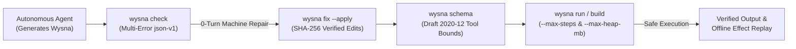

<p align="center">
  
</p>

<h1 align="center">Wysna</h1>

<p align="center">
  <strong>The Statically Typed, Agent-First Programming Language.</strong><br />
  <em>Predictable automation, high-speed execution, and native safety for autonomous AI agents and systems engineering.</em>
</p>

<p align="center">
  <a href="https://github.com/WashingtonYandun/Wysna/actions/workflows/ci.yml">
    
  </a>
  <a href="https://github.com/WashingtonYandun/Wysna/releases/tag/v0.6.0">
    
  </a>
  <a href="LICENSE">
    
  </a>
  
</p>

<p align="center">
  <a href="#why-wysna">Why Wysna</a> ·
  <a href="#why-wysna-for-ai-agents">Agent-First Matrix</a> ·
  <a href="#quick-start">Quick start</a> ·
  <a href="#language-tour">Language tour</a> ·
  <a href="#toolchain">Toolchain</a> ·
  <a href="#status-and-scope">Status</a> ·
  <a href="WYSNA_SINTAXIS.md">Syntax Manual</a> ·
  <a href="#documentation">Docs</a>
</p>

---

Wysna is an independent, statically typed programming language engineered from first
principles for the **AI Agent era**. It bridges the gap between high-level scripting
and low-level native performance (C99 and LLVM), delivering the deterministic safety,
strict execution quotas, token economy, and zero-turn self-healing loops that autonomous
agents need to write, verify, and run production software reliably.

> [!TIP]
> **Canonical Language Reference:** Consult [**`WYSNA_SINTAXIS.md`**](WYSNA_SINTAXIS.md) for the
> complete, 16-pillar syntax manual covering imports, pattern matching, contracts,
> effect handlers, unboxed scalar buffers, and structured concurrency.

> [!WARNING]
> **Wysna 0.6.0 is a pre-1.0 release** with documented language, platform and
> security limits. Its Windows, macOS and Linux installers are unsigned; the macOS
> package is not notarized, so operating systems may display security warnings.
> Read [scope and status](docs/SCOPE.md) before relying on Wysna for critical work.

## Why Wysna

| Principle | What it gives you |
| :--- | :--- |
| **Errors are values** | `T ! E` puts declared errors in the signature. `else error`, `?` and exhaustive `match` make those errors explicit; runtime failures remain possible. |
| **Memory you can reason about** | Single-threaded ARC and copy-on-write provide predictable lifetime management and cheap snapshots, with $O(1)$ fast paths for unboxed scalar lists. Strong cycles are not collected automatically, and abnormal termination can bypass cleanup; `Weak` helps break cycles. |
| **First-class contracts** | Native `requires` and `ensures` enforce preconditions and postconditions statically and dynamically (`W4005`), exportable as JSON Schema (Draft 2020-12) via `wysna schema`. |
| **Structured cooperative async** | Native `async fn` and `await` with zero-allocation scalar futures, combinators (`std/async`), and non-blocking multiplexed HTTP dispatch without heavy thread overhead. |
| **Zero-dependency cryptography** | Clean, self-contained header-only C99 primitives (SHA-256, SHA-512, MD5, HMAC), timing-safe comparisons, and native CSPRNG (`/dev/urandom`) without external `-lcrypto` dependencies. |
| **Deterministic quotas** | `--max-steps` and `--max-heap-mb` bound execution budgets with deterministic fail-stop `W4004` across interpreter, LLVM, and native binaries. |
| **Effect cassette replay** | `--record-trace` and `--replay-trace` capture and replay external I/O interactions (`wysna.effect.trace/1`) for reproducible testing and agent sandboxing. |
| **Deterministic concurrency** | Index-ordered parallel batching, mapping, and HTTP dispatch over thread-safe multi-core worker runtimes. |
| **Progressive native tooling** | `wysna check`, `fmt`, `run`, and `test` with `--engine=compiler` / `--native` for sub-millisecond static verification and test execution on the self-hosted binary. |
| **A verified pipeline** | Source → typed HIR or checked nodes → verified MIR → C99. Independent oracles, a self-hosted compiler and conformance tests check the same language from different angles. |
| **One install for the core** | The Seed distribution carries private CPython and Zig, so core CLI, projects, formatter and LSP work without host Python, a virtual environment or a C SDK. |
| **Tools for humans and agents** | Scriptable commands, JSON Schema export, and versioned `json-v1` envelopes let editors, scripts and AI agents inspect and bound programs before execution. |
| **Native first, portable by design** | Native C99 is the default. WASI is a declared target; browser libraries and LLVM are explicit, bounded experiments. |

## Why Wysna for AI Agents

While traditional programming languages were designed solely for human ergonomics, Wysna is engineered from the compiler front-end to runtime for **autonomous machine code generation**:

| Capability | Python | Rust | Go | **Wysna (Agent-First)** |
| :--- | :---: | :---: | :---: | :---: |
| **Self-Healing Diagnostics** | ❌ Runtime crash tracebacks | ⚠️ Complex lifetime borrow errors | ❌ Unstructured human text | ✅ **Machine `json-v1` facts & `wysna fix`** |
| **Token Economy (BPE)** | ⚠️ Verbose runtime boilerplate | ❌ Heavy lifetime annotations (`'a`) | ⚠️ Repetitive `if err != nil` | ✅ **~18% fewer BPE tokens (`from...use`, `?`)** |
| **Execution Budgets (Quotas)** | ❌ Unbounded execution (infinite loops) | ❌ Requires external OS process limits | ❌ Manual context propagation | ✅ **Built-in `--max-steps` & `--max-heap-mb` (`W4004`)** |
| **Effect Cassettes & Replay** | ❌ Fragile runtime monkey-patching | ❌ Complex trait mocking overhead | ❌ Heavy manual interface injection | ✅ **`--record-trace` & offline `--replay-trace`** |
| **Contracts & Tool Calling** | ❌ Runtime validation (Pydantic/eval) | ❌ Third-party procedural macros | ❌ Not supported natively | ✅ **First-class `requires`/`ensures` + `wysna schema`** |
| **Memory Architecture** | ❌ Tracing GC latency spikes | ⚠️ High LLM reasoning failure rate | ❌ Stop-the-world GC pauses | ✅ **Deterministic ARC + CoW (unboxed scalar lists)** |
| **Native Compilation** | ❌ Slow bytecode / JIT warmup | ✅ Native machine code | ✅ Native machine code | ✅ **Native C99 / LLVM (<35KB standalone binaries)** |
| **Agent Protocol Support** | ❌ Requires external SDKs / daemons | ❌ Requires external SDKs / daemons | ❌ Requires external SDKs / daemons | ✅ **Built-in `wysna mcp` daemon over stdio** |



## Quick start

### Install the Seed distribution

The recommended installation is the **complete Seed distribution**. Download the
installer for your host from the [Wysna 0.6.0 release](https://github.com/WashingtonYandun/Wysna/releases/tag/v0.6.0).
The release includes SHA-256 manifests and per-platform provenance records.

| Host | Package | Launcher |
| :--- | :--- | :--- |
| Windows x64 | `.exe` (Inno Setup) | `wysna.exe` or `open-terminal.cmd` |
| macOS arm64 | `.pkg` | `/usr/local/bin/wysna` |
| Linux x64 | `.deb` / `.rpm` | `/usr/bin/wysna` |

The 0.6.0 release includes the Windows `.exe`, macOS `.pkg`, and Linux `.deb` and
`.rpm` installers. They are unsigned, and the macOS package is not notarized. See
[Seed distribution](docs/SEED_DISTRIBUTION.md) for installation, repair, update,
uninstall and dependency details. Other hosts can use the source checkout described
in [Development](#development); the native SDK and WASI profiles have their own limits.

```sh
wysna --version
wysna doctor
```

`doctor` exists only in the installed distribution. On Windows, `open-terminal.cmd`
sets up a terminal-local `PATH`; build outputs use `.exe`.

### Hello, Wysna

Save this as `hello.wysna`:

```wysna
import "std/json"

let value = json.number("42") else error { json.null() }
let output = json.stringify(json.object({"answer": value})) else error { "{}" }
print(output)
```

```sh
wysna check hello.wysna
wysna run hello.wysna          # {"answer":42}
wysna build hello.wysna -o hello
wysna explain hello.wysna --output-format=json-v1
wysna schema hello.wysna       # JSON Schema contracts & shapes
```

`run` executes source through the reference runtime. `build` produces a native
executable through verified MIR and C99. Arguments after `--` belong to the program.
Create a project with `wysna project new example`, then run `wysna project test`
from its directory. The separate `wysna test` command runs the compiler's own
maintenance suite and requires a source checkout.
`wysna repl` keeps definitions and values between inputs and continues while delimiters
are open. `:help` lists the commands; `:reload` reloads imports in a fresh runtime
if the session has no declarations. Otherwise, use `:reset` and import again.
`exit` closes the session.

## Language tour

### Agent-First selective imports

Wysna provides structured, token-dense symbol imports designed for AI agents and developer ergonomics:

```wysna-agent
from std.json use {
    number,
    null,
    object,
    stringify,
}

let value = number("42") else error { null() }
let output = stringify(object({"answer": value})) else error { "{}" }
print(output)
```

`from ... use { ... }` brings declared symbols directly into the current scope, eliminating repetitive namespace prefixes and reducing token consumption in LLM context windows (~13%–22% fewer tokens). For hierarchical submodules, symbol aliasing prevents naming collisions:

```wysna-agent
from app.domain.user use { User as DomainUser, get_name }
from app.infrastructure.auth use { User as AuthUser, get_email }
```

Whole-module namespace imports (`import "std/json"` or `import "std/algorithms" as alg`) remain fully supported across both Wysna Seed and the self-hosted compiler for unified qualification.

### Explicit error channels

```wysna
import "std/parse"

fn compute_ratio(raw: str, divisor: int) -> int ! str {
    let value = parse.parse_int(raw) else error { return Err("invalid number") }
    if divisor == 0 { return Err("division by zero") }
    return value / divisor
}
```

Error sets are part of the type. `?` propagates a compatible error set, `else error`
handles it locally, and `match` inspects the payload.

### Algebraic data types and pattern matching

```wysna
enum Status { Active, Suspended(str), Terminated(int, str) }

fn describe(status: Status) -> str {
    return match status {
        Status.Active => "active",
        Status.Suspended(reason) => "suspended: " + reason,
        Status.Terminated(code, message) => "terminated (" + str(code) + "): " + message
    }
}

print(describe(Status.Active))
```

### Copy-on-write values

```wysna
let original = [1, 2, 3, 4]
let mut copy = original   # shares storage until mutation
copy.append(5)
print(original)           # [1, 2, 3, 4]
print(copy)               # [1, 2, 3, 4, 5]
```

Scalar-only lists (`list[int]`, `list[bool]`, `list[float]`) benefit from $O(1)$ release
and `memcpy` copy-on-write detachment with unboxed element access in native binaries.

### First-class contracts

```wysna
fn withdraw(balance: int, amount: int) -> int
    requires amount > 0, balance >= amount
    ensures result == balance - amount
{
    return balance - amount
}

print(withdraw(100, 40))   # 60
# withdraw(100, 150)       # raises [W4005] contract violation
```

Function signatures support preconditions (`requires`) and postconditions (`ensures`).
`result` binds to the returned value inside postconditions. Both the Seed compiler and
the native self-hosted compiler enforce contracts dynamically with `W4005` fail-stop
diagnostics. In addition, `wysna schema` extracts typed numeric and string boundaries
(e.g., `minimum`, `exclusiveMinimum`) directly into standard JSON Schema (Draft 2020-12)
for agent tool calling.

### Deterministic concurrency and batching

```wysna
import "std/algorithms" as alg

let numbers = [1, 2, 3, 4, 5]
let squares = alg.parallel_map[int, int] (numbers, |n: int| => n * n)
print(squares)  # [1, 4, 9, 16, 25]
```

`std/algorithms` provides `parallel_batch`, `parallel_filter`, `parallel_reduce`, and
`parallel_map`. Worker tasks execute across available CPU cores with thread-safe runtime
locks, guaranteeing strict deterministic index-ordered output.

### Structured cooperative async (async/await & std/async)

```wysna
import "std/async"

async fn compute_job(id: int) -> int {
    return id * 10
}

let task_a = async.ready(42)
let task_b = async.ready(100)

# Combinators: wait for all or race the first resolved task
let both = async.all([task_a, task_b])
let values = await both
print(values)  # [42, 100]
```

Wysna provides structured, cooperative asynchronous I/O via `async fn` and `await`. Asynchronous functions evaluate tasks without blocking the main OS thread. Combined with `std/http`'s non-blocking multiplexed dispatcher (`curl_multi_*`), agents can concurrently orchestrate multiple LLM calls, vector database queries, and external APIs with zero memory leaks and single-threaded ARC safety.

### Cryptographic security and CSPRNG (std/crypto)

```wysna
import "std/crypto"

let digest = crypto.sha512("wysna-agent-security")
let session_id = crypto.random_hex(16)
let token = "expected-bearer-secret"

# Timing-attack resistant verification
let is_valid = crypto.constant_time_eq(token, token)

print("Hash prefix: " + digest[0..16])
print("Session: " + session_id)
print("Constant-time valid: " + str(is_valid))
```

`std/crypto` provides header-only, self-contained C99 cryptographic primitives without external dynamic dependencies (`-lcrypto` is not required):
- **Hashing:** NIST FIPS 180-4 SHA-256 and SHA-512, RFC 1321 MD5.
- **Message Authentication:** RFC 2104 HMAC-SHA256 and HMAC-SHA512.
- **Operating System CSPRNG:** `random_bytes(count)` and `random_hex(count)` backed by `/dev/urandom` on POSIX and `CryptGenRandom` on Windows.
- **Side-Channel Protection:** `constant_time_eq` and `constant_time_eq_bytes` to protect against timing attacks.

See [more executable examples](examples/language), including bounded resources,
error channels, contracts and pattern matching.

## Toolchain

| Command | Purpose |
| :--- | :--- |
| `wysna check` | Typecheck without executing; supports `--engine=compiler` (native MIR) and `--output-format=json-v1`. |
| `wysna fix` | Apply deterministic compiler self-healing repairs with verified SHA-256 edits. |
| `wysna run` | Execute source through the reference runtime or native binary (`--engine=compiler`), with `--max-steps` / `--max-heap-mb`. |
| `wysna build` | Compile a native executable through verified MIR → C99. |
| `wysna fmt` | Canonical, deterministic formatting; supports `--engine=compiler` verification. |
| `wysna test` | Run conformance, differential, fuzz, or native test runner (`--engine=compiler` / `--native`). |
| `wysna explain` | Conservative effect and capability report over verified MIR. |
| `wysna schema` | Export function contracts and struct shapes to JSON Schema (Draft 2020-12). |
| `wysna mcp` | In-memory Model Context Protocol daemon for AI agents and IDE integrations. |
| `wysna project` | Create, lock, check, build, run and test local projects. |
| `wysna api` / `wysna capabilities` | Discover standard-library APIs and target availability. |
| `wysna lsp` | Language server over stdio with code action quickfixes. |

For native source compilation, `--engine=seed|compiler` selects the compiler
implementation and `--backend=c99|llvm-experimental` selects the output target.
Seed plus C99 is the supported default. The Compiler engine is based on
`native-core-v1`; in this CLI it supports `check`, `fmt`, `run`, `emit-c`, `build`,
and native testing (`wysna test --native`), while its standalone SDK provides its own
embedded driver. AST-to-C emission is only a differential test oracle. C99 is translated
source: the selected C toolchain produces and links the machine-code executable. LLVM IR
is available as an experimental Seed target.

### Deterministic Execution & Effect Cassettes

Wysna provides built-in mechanisms to constrain and record program execution:

- **Resource quotas:** `--max-steps=<N>` bounds instruction steps, and `--max-heap-mb=<N>`
  (or `--max-heap-bytes=<N>`) bounds dynamic heap allocations. Exceeding either limit halts
  execution deterministically with error code `[W4004]`. In native binaries, quotas can also
  be injected via the `WYSNA_MAX_STEPS` and `WYSNA_MAX_HEAP_BYTES` environment variables.
- **Effect cassette replay:** `--record-trace=<file>` serializes external effect outcomes
  (HTTP calls, file operations, clocks) using the versioned `wysna.effect.trace/1` envelope.
  `--replay-trace=<file>` re-executes the program against the recorded cassette without
  performing actual network or host I/O, guaranteeing bit-for-bit deterministic replays
  for tests, regression detection, and agent sandboxing.

Structured commands accept `--output-format=json-v1`. `explain` reports transitive
effects and marks unknown FFI or indirect calls. `wysna run --allow=...` or
`--deny=...` applies that report as a static pre-execution gate and refuses
incomplete analyses. It is **not** an operating-system sandbox, does not cover
native builds or project runs, and is not a purity proof. See
[effect contracts](docs/EFFECTS.md). Agent-generated changes should follow the
[AI agent workflow](docs/AI_AGENT_GUIDE.md), including target discovery and
source-hash-checked diagnostics.

## Standard library

| Area | Modules |
| :--- | :--- |
| Data & Algorithms | `std/json`, `std/text`, `std/parse`, `std/algorithms`, `std/bytes`, `std/crypto` |
| Concurrency & Async | `std/async` (`Task[T]`, `all`, `race`, `wait`) |
| I/O and files | `std/files`, `std/buffer`, `std/fs`, `std/path`, `std/io`, `std/resources` |
| Host & Network | `std/environment`, `std/process`, `std/time`, `std/http` |
| Testing | `std/test` |

`std/algorithms` includes scalar list specializations along with deterministic multi-core
operations (`parallel_batch`, `parallel_filter`, `parallel_reduce`, `parallel_map`).
Native HTTP uses libcurl with TLS verification, deadlines, response limits, parallel
`batch_get`, and non-blocking event loop dispatch (`curl_multi_*`). `std/crypto` delivers
self-contained, header-only C99 implementations of SHA-256/512, MD5, HMAC, timing-safe
equality, and OS-level CSPRNG. HTTP remains an explicit dependency, as do C FFI libraries
and their headers. Projects use `wysna.toml`, contained local dependencies and hash-checked
lockfiles; there is no public package registry.

## Status and scope

Wysna is developed as a set of explicitly bounded contracts, not a promise of
universal parity.

| Area | Status |
| :--- | :--- |
| Native CLI, scripting, projects, formatter, LSP core, effect reports | **Supported** for the declared profiles; host and package limits are recorded in [scope](docs/SCOPE.md). |
| Seed distribution with private CPython and Zig | **0.6.0 release**; unsigned installers are qualified per source commit. |
| Deterministic execution quotas & effect cassette replay | **Supported** across interpreter, native C99, and LLVM backends. |
| Structured deterministic concurrency | **Supported** for data-parallel batching and HTTP dispatch (`std/algorithms`, `std/http`). |
| WASI command profile | **Declared target** with a Wasmtime boundary, fuel, memory limits and explicit preopens. |
| LLVM backend and LLVM SDK | **Experimental**, opt-in and qualification-gated. |
| Wysna Compiler / native SDK | **Experimental**, bounded by the `native-core-v1` profile. |
| Browser library, local service pilot, JSON/HTTP/SQLite app | **Experimental**, with explicit dependencies and limits. |
| Public package registry, arbitrary preemptive threads, sandbox for untrusted native code | **Not implemented**. |

### Two compilers, one language

- **Wysna Seed** is the reference implementation in Python and the default compiler.
  It provides the complete project and editor tooling, the C99 backend, JSON Schema extraction,
  and the independent interpreter and AST oracles.
- **Wysna Compiler** is the self-hosted implementation in Wysna. It ships as a bounded
  native SDK for the `native-core-v1` profile, features CLI parity (`--check`, `--check-json`),
  and lowers first-class function contracts (`requires`/`ensures`) through verified MIR.

Both use verified MIR and C99. See [compiler architecture](docs/COMPILER_ARCHITECTURE.md)
and [engine parity](docs/ENGINE_PARITY_MATRIX.md).

## Security

Native programs and the reference runtime execute with the user's OS authority.
Process isolation alone does not restrict filesystem, network or FFI access. The WASI
profile has a Wasmtime boundary with declared preopens, fuel and linear-memory limits.
`wysna run --allow=...` and `--deny=...` gate modeled effects for interpreted Seed
programs, but they are not an OS sandbox or a guarantee about native children.

Do not run untrusted native code based on effect reports. See [SECURITY.md](SECURITY.md)
and [scope](docs/SCOPE.md) for the full boundary.

## Documentation

| Start here | Go deeper |
| :--- | :--- |
| [Syntax manual](WYSNA_SINTAXIS.md) | [Compiler architecture](docs/COMPILER_ARCHITECTURE.md) |
| [AI agent guide](docs/AI_AGENT_GUIDE.md) | [MIR design](docs/MIR_DESIGN.md) |
| [Scope and status](docs/SCOPE.md) | [Full architecture audit](docs/FULL_LANGUAGE_CAPABILITIES_AND_DEBT_AUDIT.md) |
| [Seed distribution](docs/SEED_DISTRIBUTION.md) | [Effect reports](docs/EFFECTS.md) |
| [Projects and tests](docs/PROJECTS.md) | [Known limits](docs/KNOWN_LIMITS.md) |
| [Standard library](docs/STDLIB.md) | [Engine parity](docs/ENGINE_PARITY_MATRIX.md) |
| [Examples](examples/language) | [Language specification](SPEC.md) |
| [Changelog](CHANGELOG.md) | [Security policy](SECURITY.md) |

The full [documentation index](docs/README.md) covers ownership, FFI, the native SDK,
LLVM, the service pilot and distribution details.

## Development

Source work requires Python 3.10 or newer and a C99 compiler for native builds. A
source checkout exposes the full toolchain, including `wysna test` and `wysna bench`.

```sh
git clone --branch develop https://github.com/WashingtonYandun/Wysna.git
cd Wysna
python3 -m pip install -e '.[dev]'
./wysna --version
./wysna test
```

The `dev` extra installs pytest and the optional HTTP/service dependencies used by
the complete unit suite. Without those extras, the full suite fails rather than
silently skipping the affected contracts.

On Windows, run the source CLI as `py -3 main.py`.

Run `./wysna test --sanitize` for ASan/UBSan builds, or
`python3 tools/ci_conformance.py --profile=release` for the release corpus. The
self-hosted compiler has a deterministic bootstrap check:

```sh
python3 -m tests.unit.test_bootstrap_conformance
```

See [CONTRIBUTING.md](CONTRIBUTING.md) for architecture, test layers and the pull
request workflow.

## Contributing

Contributions are welcome. Start with [CONTRIBUTING.md](CONTRIBUTING.md), follow the
[Code of Conduct](CODE_OF_CONDUCT.md), and report security issues privately as
described in [SECURITY.md](SECURITY.md).

## License

Apache-2.0 © 2024–2026 Washington Yandún. See [LICENSE](LICENSE) and [NOTICE](NOTICE).
