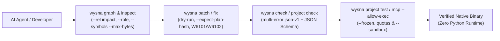
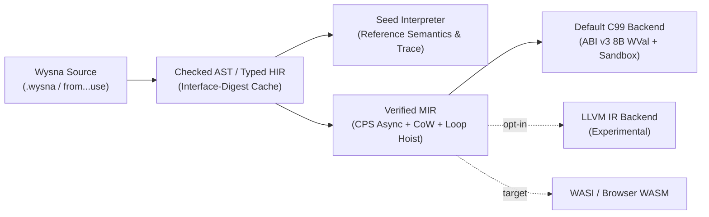

<p align="center">
  
</p>

<h1 align="center">Wysna</h1>

<p align="center">
  <strong>The statically typed, native, Agent-First systems programming language.</strong><br />
  <em>8-byte NaN-boxed ABI · Atomic ARC + Copy-on-Write · Stackless CPS async · Self-hosted Native SDK &amp; 13-tool MCP</em>
</p>

<p align="center">
  <a href="https://wysna.wysofia.com/">
    
  </a>
  <a href="https://github.com/WashingtonYandun/Wysna/actions/workflows/ci.yml">
    
  </a>
  <a href="https://github.com/WashingtonYandun/Wysna/releases">
    
  </a>
  <a href="docs/MIR_DESIGN.md">
    
  </a>
  <a href="docs/AI_AGENT_GUIDE.md">
    
  </a>
  <a href="LICENSE">
    
  </a>
</p>

<p align="center">
  <a href="https://wysna.wysofia.com/">Website &amp; Handbook</a> ·
  <a href="#overview">Overview</a> ·
  <a href="#agent-first-by-design">Agent-First</a> ·
  <a href="#quick-start">Quick Start</a> ·
  <a href="#language-tour">Language Tour</a> ·
  <a href="#architecture-and-engines">Architecture</a> ·
  <a href="#toolchain">Toolchain</a> ·
  <a href="#standard-library">Stdlib</a> ·
  <a href="#security">Security</a> ·
  <a href="#documentation">Docs</a>
</p>

---

## Overview

Wysna is an independent, statically typed systems programming language built from first principles for **deterministic systems engineering** and **autonomous AI code generation**. It compiles through a verified intermediate representation (HIR/MIR) to portable native C99 (default), WebAssembly/WASI, and experimental LLVM IR — pairing predictable memory ownership with machine-verifiable tooling that developers and coding agents share.

> [!NOTE]
> **Website & Current Line (`0.9.5`):** Full language guides and handbooks live at **[wysna.wysofia.com](https://wysna.wysofia.com/)**. The `0.9.5` line on `main` builds on `0.9` ([CHANGELOG.md](CHANGELOG.md)) with major runtime/compiler performance gains, Agent-First symbol identity, Selfhost multi-error recovery, bounded/batch `inspect`, multi-file `workspace patch`, 13-tool MCP, and checked architecture contracts. Review [scope and limits](docs/SCOPE.md) before relying on Wysna in production.

| Architectural Pillar | What It Delivers |
| :--- | :--- |
| **Unified 8B `WVal` ABI v3 & Atomic ARC + CoW** | Single 8-byte NaN-boxed value representation across C99, Seed AST/HIR/MIR, Selfhost, and LLVM (`<=6B` SSO inline strings, 48-bit inline `int`, `WStringBuf` hash cache). Lock-free atomic ARC, `memcpy` CoW unboxed scalar lists, `Weak[C]` references, and deferred Bacon-Rajan cycle collection (`WYSNA_COLLECT_CYCLES=1`). |
| **Explicit Error Channels & First-Class Contracts** | Typed `T ! E` signatures (`?`, `else error` / `else err`), exhaustive pattern matching with ranges/alternatives/guards (`W6003` unreachable-arm checks), and runtime-enforced `requires`/`ensures` contracts (`[W4005]`) exported to JSON Schema (Draft 2020-12) via `wysna schema`. |
| **Stackless CPS Async & Isolated Parallel Workers** | `async fn` and `await` lower to stackless CPS state machines (`std/async`), complemented by isolated-ownership worker pools (`std/async.spawn`, `run_group`, `std/algorithms.parallel_*`) and multiplexed HTTP (`curl_multi`). |
| **Agent-First Closed-Loop Tooling (`13`-Tool MCP)** | Declaration-level `wysna graph` (`[W1005]` disambiguation), `--max-bytes` / `--symbols` batch `inspect`, Selfhost multi-error recovery (`100`-diagnostic cap with cascade suppression), structured `json-v1` envelopes validated against [wysna-tool-result.v1.schema.json](schemas/wysna-tool-result.v1.schema.json), atomic multi-file `wysna patch`, and `wysna mcp`. |
| **Checked Architecture Contracts** | Typed static metadata attributes (`struct` schemas on functions and top-level classes) paired with declarative `wysna.toml` dependency rules enforced in `project check`, `workspace patch`, and MCP (`W6101`/`W6102`), plus `wysna graph --role`. |
| **Quotas, Effect Replay & Compiled C99 Sandbox** | Step and heap execution budgets (`--max-steps`, `--max-heap-mb` → `[W4004]`), deterministic offline I/O cassettes (`--record-trace` / `--replay-trace`), Seed static gates (`--allow`/`--deny`), and compiled `#define WYSNA_DENY_CAP_*` C99 traps (`wysna build --sandbox` → `[W5006]`). |
| **Zero-Dependency Cryptography & Unicode** | Header-only C99 cryptography (`std/crypto`: ChaCha20-Poly1305 AEAD, SHA-256/512, HMAC, constant-time compare, OS CSPRNG) and Unicode 16.0.0 UAX #15 normalization (`std/text`: `NFC`/`NFD`/`NFKC`/`NFKD`). |

> [!TIP]
> **Official Handbook & Syntax Manual:** Browse [**wysna.wysofia.com**](https://wysna.wysofia.com/) or read [**`WYSNA_SINTAXIS.md`**](WYSNA_SINTAXIS.md) for the complete reference covering imports, ADTs, contracts, error unions, typed attributes, FFI, and structured concurrency.

---

## Agent-First by Design

Most toolchains bolt AI integration onto prose error formats and runtimes designed strictly for humans. Wysna builds machine inspectability, bounded execution, architecture verification, and atomic multi-file repair directly into the compiler:

| Capability | Python | Rust | Go | **Wysna** |
| :--- | :---: | :---: | :---: | :--- |
| **Machine Diagnostics & Recovery** | Runtime tracebacks | Text borrow errors | Prose compiler errors | **Multi-error `json-v1` facts (`data` + `related`) & SHA `wysna fix`** |
| **Semantic Graph & Context Slicing** | External AST scripts | `rust-analyzer` RPC | `gopls` / packages | **Native `wysna graph` (`W1005`, `impact`, `--role`) & batch `--max-bytes` `inspect`** |
| **Guarded Multi-File Editing** | Unchecked text writes | Unchecked text writes | Unchecked text writes | **Atomic `wysna patch` (`source`/`symbol`/`hunks`/`create`/`delete`) + rollback** |
| **Architecture Rules Enforcement** | External linters | External scripts | Package cycles only | **First-class `@Role` attributes + `wysna.toml` policies (`W6101`/`W6102`)** |
| **Execution Budgets & Replay** | External OS limits | External OS limits | Manual `context` checks | **Built-in `--max-steps`, `--max-heap-mb` (`W4004`) & offline trace replay** |
| **Contracts & Tool Schemas** | External libs (Pydantic) | Proc macros | None natively | **Native `requires`/`ensures` + `@AgentTool` → Draft 2020-12 `wysna schema`** |
| **Memory & Binary Model** | Tracing GC | Static lifetimes (`'a`) | Concurrent GC | **Lock-free ARC + CoW, 8B `WVal`, standalone C99 binaries** |



---

## Quick Start

### 1. Choose a Distribution (`0.9.5+`)

Visit **[wysna.wysofia.com](https://wysna.wysofia.com/)** or download archives and installers from [**GitHub Releases**](https://github.com/WashingtonYandun/Wysna/releases) (upgrading from `0.8`? Follow [Migrating 0.8 → 0.9](docs/MIGRATING_0_8_TO_0_9.md)):

| Distribution | Recommended For | Platforms |
| :--- | :--- | :--- |
| [**Native SDK (`native-core-v1`)**](docs/NATIVE_SDK.md) | Standalone C99 builds, `wysna.lock` projects, offline SHA-256 packages, `graph`/`inspect`/`patch`, 13-tool `mcp`, and Stage-3 `lsp`. Bundles the self-hosted compiler, Zig, and stdlib with **zero Python runtime dependency**. | Windows x64 (`zip`), macOS arm64 (`tar.gz`), Linux x64 (`tar.gz`) |
| [**Seed Distribution**](docs/SEED_DISTRIBUTION.md) | WebAssembly (`wasm32-wasip1`), browser libraries, experimental direct LLVM compilation, differential AST oracle, and `wysna repl`. Installers bundle private CPython and Zig. | Windows x64 (`.exe`), macOS arm64 (`.pkg`), Linux x64 (`.deb`/`.rpm`) |

Verify downloads against `SHA256SUMS`, add `bin/` to your `PATH` (or launch `open-terminal.cmd` on Windows), and confirm with `wysna --version`.

### 2. First Program & Manifest Project

Save as `quote.wysna`:

```wysna
pub fn quote_total(quantity: int, unit_price_cents: int) -> int
    requires quantity > 0, unit_price_cents >= 0
    ensures result == quantity * unit_price_cents
{
    return quantity * unit_price_cents
}

print(quote_total(3, 1299))
```

Typecheck, run, compile to native machine code, and inspect tool schemas/diagnostics:

```sh
wysna check quote.wysna --output-format=json-v1
wysna run quote.wysna                              # 3897
wysna build quote.wysna -o quote                   # Verified MIR -> C99 native binary
wysna schema quote.wysna                           # Draft 2020-12 JSON Schema
wysna explain --code W2001 --output-format=json-v1
```

Create and verify a manifest-backed project (`wysna.toml` + deterministic SHA-256 `wysna.lock`):

```sh
wysna project new my-app
cd my-app
wysna project lock
wysna project test --frozen
```

---

## Language Tour

Every `wysna` code block in this README is compiled and executed across **all four verification engines** in CI (Seed Interpreter, Seed AST C99, Seed Typed HIR/MIR C99, and Self-Hosted Stage-2).

### Explicit Imports, Nested Comments & Unicode Normalization

```wysna
from "std/text" use { normalize_nfc, trim }

/* Nested block comments /* work cleanly */ across lexers and formatter */
let raw = trim("  cafe\u{0301}  ")
let normalized = normalize_nfc(raw)
print(normalized)
print(len(normalized))
```

### Explicit Error Channels (`T ! E`)

```wysna
import "std/parse"

fn compute_ratio(raw: str, divisor: int) -> int ! str {
    let value = parse.parse_int(raw) else err { return Err("invalid number") }
    if divisor == 0 { return Err("division by zero") }
    return value / divisor
}

let ok_val = compute_ratio("84", 2) else err { 0 }
print(ok_val)
```

### Algebraic Data Types & Pattern Matching

```wysna
enum Status { Active, Suspended(str), Terminated(int, str) }

fn describe(status: Status) -> str {
    return match status {
        Status.Active => "active",
        Status.Suspended(reason) => "suspended: " + reason,
        Status.Terminated(code, msg) => "terminated (" + str(code) + "): " + msg,
    }
}

print(describe(Status.Active))
print(describe(Status.Terminated(13, "quota")))
```

### Copy-on-Write Collections & Runtime Contracts

```wysna
fn withdraw(balance: int, amount: int) -> int
    requires amount > 0, balance >= amount
    ensures result == balance - amount
{
    return balance - amount
}

let original = [1, 2, 3, 4]
let mut alias = original
alias.append(5)

print(original)              # [1, 2, 3, 4]
print(alias)                 # [1, 2, 3, 4, 5]
print(withdraw(100, 40))     # 60
```

### Typed Static Metadata & Tool Contracts

```wysna
pub struct AgentTool { name: str, read_only: bool }

@AgentTool(name: "lookup", read_only: true)
@must_use
pub fn lookup_score(id: int) -> int {
    return id * 10
}

print(lookup_score(4))
```

### Deterministic Multi-Core Parallelism

```wysna
import "std/algorithms" as alg

let numbers = [1, 2, 3, 4, 5]
let squares = alg.parallel_map[int, int](numbers, |n: int| => n * n)
print(squares)
```

### Stackless CPS Async (`async fn` / `await`)

```wysna
import "std/async"

async fn compute_job(id: int) -> int {
    return id * 10
}

let base = await compute_job(4)
let task_a = async.ready(base + 2)
let task_b = async.ready(100)
let values = async.all([task_a, task_b]) else err { [] }
print(values)
```

### Zero-Dependency Cryptography (`std/crypto`)

```wysna
import "std/crypto"

let key = "0123456789abcdef0123456789abcdef"
let mac = crypto.hmac_sha256(key, "agent-payload") else err { "" }
let expected = crypto.hmac_sha256(key, "agent-payload") else err { "" }
let digest = crypto.sha256("wysna") else err { "" }

print(crypto.constant_time_eq(mac, expected))
print(slice(digest, 0, 16))
```

### Checked Architecture Contracts (`wysna.toml`)

Annotate top-level classes with typed role schemas and enforce layer boundaries during `wysna project check` and `wysna patch`:

```toml
[architecture]
role_attribute = "src/architecture.wysna::Architecture"
roles = ["Controller", "Service", "Repository"]

[[architecture.rules]]
id = "controller-no-repository"
from_role = "Controller"
relations = ["calls", "uses_type"]
deny_roles = ["Repository"]
severity = "error"
```

See [Architecture Contracts](docs/ARCHITECTURE_CONTRACTS.md) and [examples/architecture](examples/architecture/wysna.toml), or inspect the [language examples](examples/language) and [FFI validation](docs/FFI_VALIDATION.md).

---

## Architecture and Engines

Wysna maintains a shared language specification backed by independent execution and compilation engines:



- **Wysna Seed (`src/`):** Reference Python compiler, runtime interpreter, WASI/browser & experimental LLVM drivers, differential AST C99 oracle, and test/evaluation harnesses.
- **Wysna Compiler (`selfhost/` + `packaging/native/driver.c`):** 3-stage bootstrapped self-hosted compiler (`49` modules / `25,117` bundled lines) emitting C99 via verified MIR (`native-core-v1`), powering the **Python-free Native SDK** for `check`, `fmt`, `run`, `build`, `project`, `packages`, `graph`, `inspect`, `patch`, `fix`, `schema`, `api`, 13-tool `mcp`, and Stage-3 `lsp`.

| Surface | Status | Details |
| :--- | :--- | :--- |
| Core language, contracts, `WVal` ABI v3, CPS `async fn`, C99 builds | **Supported** | Bounded by [docs/SCOPE.md](docs/SCOPE.md) and [docs/KNOWN_LIMITS.md](docs/KNOWN_LIMITS.md). |
| **Native SDK (`native-core-v1`)** | **Supported** | Zero-Python CLI, `project`/`packages` USTAR v1, 13-tool `mcp`, multi-file `patch`, checked architecture rules, and Stage-3 `lsp`. |
| **Seed Distribution** | **Supported** | Offline desktop installers (`.exe`, `.pkg`, `.deb`, `.rpm`) bundling CPython + Zig. |
| **WASI (`wasi-command`) & Browser WASM** | **Declared target** | Wasmtime boundary with preopens, fuel, and linear-memory limits (Seed). |
| **Direct LLVM Backend** | **Experimental** | Opt-in via `--backend=llvm-experimental`; see [LLVM Experimental](docs/LLVM_EXPERIMENTAL.md). |
| **Remote package registry, shared mutable cross-thread graphs, OS kernel sandbox** | **Not implemented** | Local/offline SHA-256 `wysna packages` and snapshot closures; see [KNOWN_LIMITS.md](docs/KNOWN_LIMITS.md). |

See [Engine Parity Matrix](docs/ENGINE_PARITY_MATRIX.md) for cross-engine test evidence.

---

## Toolchain

| Category | Commands | Highlights |
| :--- | :--- | :--- |
| **Compile & Run** | `wysna check` · `run` · `build` · `emit-c` · `fmt` | `--engine=seed\|compiler`, `--backend=c99\|llvm-experimental`, `--sandbox`, `--allow`/`--deny`, `--max-steps`, `--max-heap-mb` |
| **Agent-First Loop** | `wysna graph` · `inspect` · `patch` · `fix` · `schema` · `explain` | `--output-format=json-v1`, `[W1005]` candidates, `--symbols`/`--max-bytes`, multi-file `--edits` + rollback, Draft 2020-12 schemas |
| **Projects & Packages** | `wysna project new\|lock\|check\|build\|run\|test` · `packages` | Deterministic `wysna.lock`, `--frozen`, isolated fixtures, USTAR v1 offline SHA-256 packages |
| **Architecture & IDE** | `wysna graph --role` · `api` · `skills` · `capabilities` · `mcp` · `lsp` | Architecture policies (`W6101`/`W6102`), 13-tool stdio MCP (`--allow-exec` for tests), Stage-3 LSP 3.17, [VS Code extension](editors/vscode-wysna/README.md) |

- **Deterministic Quotas (`[W4004]`):** Bound instruction steps with `--max-steps=<N>` and allocations with `--max-heap-mb=<N>` / `--max-heap-bytes=<N>` (or `WYSNA_MAX_STEPS` / `WYSNA_MAX_HEAP_BYTES` in compiled binaries).
- **Offline Effect Replay (`wysna.effect.trace/1`):** Record external I/O and clocks with `--record-trace=<file>` and replay deterministically without touching host I/O using `--replay-trace=<file>`.
- **Agent Benchmark Harness:** Measure token efficiency and graph-guided impact selection in [`bench/ai_eval/README.md`](bench/ai_eval/README.md).

---

## Examples & Standard Library

### Real Project Examples

| Project | What It Demonstrates |
| :--- | :--- |
| [**Operations Audit (`wysofia-ops`)**](examples/wysofia-ops/README.md) | Validated JSON event auditing with contracts, `T ! E`, and optional SQLite storage built with the Native SDK. |
| [**Measurement Sync (`automation-sync`)**](examples/automation-sync/README.md) | Bounded remote/file batch ingestion into SQLite inside an explicit transaction. |
| [**Shared Quote App (`shared-browser-app`)**](examples/shared-browser-app/README.md) | Shared pricing and validation logic across native CLI, service, and WebAssembly targets. |
| [**Architecture Contracts (`architecture`)**](examples/architecture/wysna.toml) | Typed class role annotations and declarative dependency rules enforced at check and patch time. |

### Standard Library

| Area | Modules |
| :--- | :--- |
| **Data, Parsing & Security** | `std/json`, `std/csv`, `std/text` (Unicode UAX #15), `std/parse`, `std/bytes`, `std/regex`, `std/collections`, `std/algorithms` (`parallel_*`), `std/crypto` (ChaCha20-Poly1305 AEAD, SHA-256/512, HMAC, CSPRNG) |
| **Async & Networking** | `std/async` (`async fn`, `spawn`, `run_group`, `all`, `race`, timers), `std/http` (libcurl TLS + `curl_multi` non-blocking dispatch) |
| **Filesystem, Host & Testing** | `std/files`, `std/buffer`, `std/fs`, `std/path`, `std/io`, `std/env`, `std/environment`, `std/process`, `std/time`, `std/resources`, `std/test` |

See the [Standard Library reference](docs/STDLIB.md) and [Projects guide](docs/PROJECTS.md).

---

## Security

- Native executables and Seed runs inherit the invoking user's OS privileges.
- `wysna run --allow=...` / `--deny=...` applies a static conservative effect gate (`[W5006]`) prior to interpretation.
- `wysna build --sandbox` (with optional `--allow`/`--deny`) compiles `#define WYSNA_DENY_CAP_*` traps directly into C99 runtime/host adapters (`[W5006]`), while external native C FFI libraries remain outside that macro boundary.
- The WASI profile enforces Wasmtime preopens, fuel, and linear-memory bounds.
- MCP defaults to static inspection and checked preview/edit workflows; `wysna_project_test` execution is explicitly opt-in (`--allow-exec`).

Never treat compiler effect reports as an OS kernel sandbox for untrusted native dependencies. Consult [SECURITY.md](SECURITY.md) and [docs/SCOPE.md](docs/SCOPE.md).

---

## Documentation

| Core Guides & Web | Deep-Dive Architecture |
| :--- | :--- |
| [**Official Website & Handbook (`wysna.wysofia.com`)**](https://wysna.wysofia.com/) | [Compiler Architecture](docs/COMPILER_ARCHITECTURE.md) |
| [Syntax Manual (`WYSNA_SINTAXIS.md`)](WYSNA_SINTAXIS.md) | [MIR Design & ABI v3](docs/MIR_DESIGN.md) |
| [AI Agent Guide](docs/AI_AGENT_GUIDE.md) | [Type System Design](docs/TYPE_SYSTEM_DESIGN.md) |
| [Architecture Contracts](docs/ARCHITECTURE_CONTRACTS.md) | [Ownership & Lifetimes](docs/OWNERSHIP_LIFETIME.md) |
| [Projects & Packages](docs/PROJECTS.md) | [Effect Contracts](docs/EFFECTS.md) |
| [Migrating 0.8 → 0.9](docs/MIGRATING_0_8_TO_0_9.md) | [Engine Parity Matrix](docs/ENGINE_PARITY_MATRIX.md) |
| [Scope & Known Limits](docs/KNOWN_LIMITS.md) | [Native SDK](docs/NATIVE_SDK.md) & [Seed Distribution](docs/SEED_DISTRIBUTION.md) |
| [Changelog](CHANGELOG.md) & [0.9.5 Release Notes](docs/release-notes/v0.9.5.md) | [Full Capabilities & Debt Audit](docs/FULL_LANGUAGE_CAPABILITIES_AND_DEBT_AUDIT.md) |

Full index: [docs/README.md](docs/README.md) · Language Spec: [SPEC.md](SPEC.md) · Security Policy: [SECURITY.md](SECURITY.md)

---

## Development

Source builds require Python 3.10+ and a C99 compiler (`clang` or `gcc`):

```sh
git clone https://github.com/WashingtonYandun/Wysna.git
cd Wysna
python3 -m pip install -e '.[dev]'
./wysna --version
./wysna test
```

Additional qualification gates (use `py -3 main.py` on Windows):

```sh
./wysna test --sanitize                                  # Full suite under ASan + UBSan
python3 tools/ci_conformance.py --profile=release        # 4-engine parity verification
python3 -m tests.unit.test_bootstrap_conformance         # 3-stage selfhost SHA-256 fixed-point
```

See [CONTRIBUTING.md](CONTRIBUTING.md) and [CODE_OF_CONDUCT.md](CODE_OF_CONDUCT.md).

---

## License

Apache License, Version 2.0 © 2024–2026 Washington Yandún. See [LICENSE](LICENSE) and [NOTICE](NOTICE).
