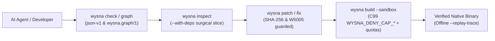
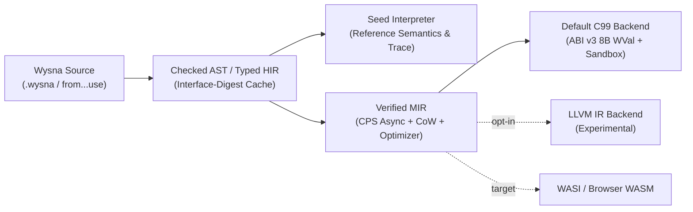

<p align="center">
  
</p>

<h1 align="center">Wysna</h1>

<p align="center">
  <strong>The statically typed, native, Agent-First systems programming language.</strong><br />
  <em>8-byte NaN-boxed ABI · Lock-free ARC + Copy-on-Write · Stackless CPS async · Self-hosted compiler & Stage-3 LSP</em>
</p>

<p align="center">
  <a href="https://github.com/WashingtonYandun/Wysna/actions/workflows/ci.yml">
    
  </a>
  <a href="https://github.com/WashingtonYandun/Wysna/releases/tag/v0.7.0">
    
  </a>
  <a href="docs/ENGINE_PARITY_MATRIX.md">
    
  </a>
  <a href="docs/MIR_DESIGN.md">
    
  </a>
  <a href="LICENSE">
    
  </a>
</p>

<p align="center">
  <a href="#overview">Overview</a> ·
  <a href="#agent-first-by-design">Agent-First</a> ·
  <a href="#quick-start">Quick Start</a> ·
  <a href="#language-tour">Language Tour</a> ·
  <a href="#architecture-and-parity">Architecture</a> ·
  <a href="#toolchain">Toolchain</a> ·
  <a href="#standard-library">Stdlib</a> ·
  <a href="#security">Security</a> ·
  <a href="#documentation">Docs</a>
</p>

---

## Overview

Wysna is an independent, statically typed programming language built from first principles for **deterministic systems engineering** and **autonomous AI code generation**. It compiles through a verified intermediate representation (HIR/MIR) to portable native C99 (default) and experimental LLVM IR, pairing predictable memory ownership with machine-verifiable tooling.

> [!NOTE]
> **Release & Line Status:** The current tagged installer release is [**v0.7.0**](https://github.com/WashingtonYandun/Wysna/releases/tag/v0.7.0) (pre-1.0, unsigned desktop installers), while `main` advances to **0.8.0** with full Python-free native SDK autonomy (`wysna api`, `wysna project check|build|run|test`, 11/11 `wysna mcp`), parameterized generic interfaces in Selfhost, an ~8x Selfhost MIR temporary-scope CoW speedup, multi-OS `llvm-smoke` CI, and `examples/wysofia-ops/` — see [CHANGELOG.md](CHANGELOG.md). Review [scope and limits](docs/SCOPE.md) before relying on Wysna in production.

| Architectural Pillar | What It Delivers |
| :--- | :--- |
| **Unified 8B `WVal` ABI v3 & Atomic ARC + CoW** | Single 8-byte NaN-boxed value representation across C99, Seed AST/HIR/MIR, Selfhost, and LLVM (`<=6B` SSO inline strings, 48-bit inline `int`, $O(1)$ `WStringBuf.hash_cache`). Lock-free atomic ARC, `memcpy` CoW unboxed scalar lists (`list[int]`/`float`/`bool`), `weak` references, and opt-in Bacon-Rajan cycle collection (`WYSNA_COLLECT_CYCLES=1`). |
| **Explicit Error Channels & First-Class Contracts** | Typed `T ! E` signatures (`?`, `else error`, `ClassError`), exhaustive pattern matching with guards, and runtime-enforced `requires`/`ensures` contracts (`[W4005]`) exported to JSON Schema (Draft 2020-12) via `wysna schema`. |
| **Stackless CPS Async & OS-Thread Concurrency** | `async fn` and `await` lower to stackless CPS state machines across Seed C99, LLVM, and Selfhost Stage-2 (`std/async`), complemented by OS worker threads (`std/async.spawn`, `std/algorithms.parallel_*`) and multiplexed HTTP (`curl_multi`). |
| **Agent-First Closed-Loop Tooling** | Structured `json-v1` multi-error diagnostics, deterministic auto-repairs (`wysna fix --apply`), semantic code graph (`wysna graph`), surgical token slicing (`wysna inspect`), SHA-guarded edits (`wysna patch`), static effect analysis (`wysna explain`), and `wysna mcp`. |
| **Quotas, Effect Replay & Compiled C99 Sandbox** | Step and heap execution budgets (`--max-steps`, `--max-heap-mb` -> `[W4004]`), deterministic offline I/O cassettes (`--record-trace` / `--replay-trace`), Seed static gates (`--allow`/`--deny`), and compiled `#define WYSNA_DENY_CAP_*` C99 traps (`wysna build --sandbox` -> `[W5006]`). |
| **Zero-Dependency Security & Unicode** | Header-only C99 cryptography (`std/crypto`: ChaCha20-Poly1305 AEAD, SHA-256/512, HMAC, constant-time compare, OS CSPRNG) and Unicode 16.0.0 UAX #15 normalization (`std/text`: `NFC`/`NFD`/`NFKC`/`NFKD`). |

> [!TIP]
> **Canonical Syntax Manual:** Read [**`WYSNA_SINTAXIS.md`**](WYSNA_SINTAXIS.md) for the complete 16-pillar reference covering imports, ADTs, contracts, error unions, FFI, and structured concurrency.

---

## Agent-First by Design

Most toolchains bolt AI integration onto error formats and runtimes designed strictly for humans. Wysna builds machine inspectability, bounded execution, and deterministic repair directly into the compiler:

| Capability | Python | Rust | Go | **Wysna** |
| :--- | :---: | :---: | :---: | :--- |
| **Machine Diagnostics & Auto-Fix** | Runtime tracebacks | Text borrow errors | Prose compiler errors | **`json-v1` facts + SHA-256 `wysna fix` & `patch`** |
| **Semantic Context Slicing** | External AST scripts | `rust-analyzer` RPC | `gopls` / packages | **Native `wysna graph` & `wysna inspect --with-deps`** |
| **Execution Budgets** | External OS limits | External OS limits | Manual `context` checks | **Built-in `--max-steps` & `--max-heap-mb` (`W4004`)** |
| **Offline Effect Replay** | Monkey-patching | Trait mocks | Interface mocks | **Deterministic `wysna.effect.trace/1` cassettes** |
| **Contracts & Tool Schemas** | External libs (Pydantic) | Proc macros | None natively | **Native `requires`/`ensures` -> `wysna schema`** |
| **Memory & Binary Model** | Tracing GC | Static lifetimes (`'a`) | Concurrent GC | **Lock-free ARC + CoW, 8B `WVal`, standalone C99 binaries** |



---

## Quick Start

### 1. Install the Seed Distribution

Download the installer for your host from the [**v0.7.0 release**](https://github.com/WashingtonYandun/Wysna/releases/tag/v0.7.0) (includes SHA-256 manifests and private CPython/Zig so core workflows require zero host setup; see [Seed distribution](docs/SEED_DISTRIBUTION.md)):

| Host | Package | Default Launcher |
| :--- | :--- | :--- |
| **Windows x64** | `.exe` (Inno Setup) | `wysna.exe` / `open-terminal.cmd` |
| **macOS arm64** | `.pkg` | `/usr/local/bin/wysna` |
| **Linux x64** | `.deb` / `.rpm` | `/usr/bin/wysna` |

```sh
wysna --version
wysna doctor
```

### 2. Hello, Wysna

Save as `hello.wysna`:

```wysna
from "std/json" use {
    number,
    null,
    object,
    stringify,
}

let answer = number("42") else error { null() }
let payload = stringify(object({"answer": answer})) else error { "{}" }
print(payload)
```

Run, typecheck, inspect effects, and compile to native machine code:

```sh
wysna check hello.wysna
wysna run hello.wysna            # {"answer":42}
wysna build hello.wysna -o hello # Verified MIR -> C99 native binary
wysna schema hello.wysna         # Draft 2020-12 JSON Schema
wysna explain hello.wysna --output-format=json-v1
```

Create an isolated package with `wysna project new myapp && cd myapp && wysna project test`, or launch an interactive session with `wysna repl` (`:help`, `:reload`, `:reset`, `exit`).

---

## Language Tour

Every code snippet in this section is compiled and executed in CI across all four verification engines (Seed Interpreter, Seed AST C99, Seed Typed HIR/MIR C99, and Self-Hosted Stage-2).

### Explicit Imports, Nested Comments & Unicode Normalization

```wysna
from "std/text" use { normalize, trim }

/* Nested block comments /* work cleanly */ across lexers and formatter */
let raw = trim("  cafe\u0301  ")
let normalized = normalize(raw, "NFC")
print(normalized)
print(len(normalized))
```

### Explicit Error Channels (`T ! E`)

```wysna
import "std/parse"

fn compute_ratio(raw: str, divisor: int) -> int ! str {
    let value = parse.parse_int(raw) else error { return Err("invalid number") }
    if divisor == 0 { return Err("division by zero") }
    return value / divisor
}

let ok_val = compute_ratio("84", 2) else error { 0 }
print(ok_val)
```

### Algebraic Data Types & Pattern Matching

```wysna
enum Status { Active, Suspended(str), Terminated(int, str) }

fn describe(status: Status) -> str {
    return match status {
        Status.Active => "active",
        Status.Suspended(reason) => "suspended: " + reason,
        Status.Terminated(code, msg) => "terminated (" + str(code) + "): " + msg
    }
}

print(describe(Status.Active))
print(describe(Status.Terminated(13, "quota")))
```

### Copy-on-Write Collections & Contracts

```wysna
fn withdraw(balance: int, amount: int) -> int
    requires amount > 0, balance >= amount
    ensures result == balance - amount
{
    return balance - amount
}

let original = [1, 2, 3, 4]
let mut alias = original
alias.append(5)

print(original)              # [1, 2, 3, 4]
print(alias)                 # [1, 2, 3, 4, 5]
print(withdraw(100, 40))     # 60
```

### Deterministic Multi-Core Parallelism

```wysna
import "std/algorithms" as alg

let numbers = [1, 2, 3, 4, 5]
let squares = alg.parallel_map[int, int](numbers, |n: int| => n * n)
print(squares)
```

### Stackless CPS Async (`async fn` / `await`)

```wysna
import "std/async"

async fn compute_job(id: int) -> int {
    return id * 10
}

let base = await compute_job(4)
let task_a = async.ready(base + 2)
let task_b = async.ready(100)
let values = async.all([task_a, task_b]) else error { [] }
print(values)
```

### Zero-Dependency Cryptography (`std/crypto`)

```wysna
import "std/crypto"

let key = "0123456789abcdef0123456789abcdef"
let nonce = "123456789012"
let sealed = crypto.aead_seal(key, nonce, "agent-payload", "hdr") else error { "" }
let opened = crypto.aead_open(key, nonce, sealed, "hdr") else error { "" }
let digest = crypto.sha256("wysna") else error { "" }

print(opened)
print(crypto.constant_time_eq(opened, "agent-payload"))
print(slice(digest, 0, 16))
```

Explore standalone programs in [examples/language](examples/language), the operational JSON/SQLite audit dogfooding app in [examples/wysofia-ops](examples/wysofia-ops), and FFI pilots in [FFI validation](docs/FFI_VALIDATION.md).

---

## Architecture and Parity

Wysna maintains a shared language specification backed by independent execution and compilation engines:



- **Wysna Seed (`src/`):** Canonical Python reference compiler, runtime interpreter, project/manifest toolchain (`wysna.toml` / `wysna.lock`), MCP server, JSON Schema extractor, WASI/LLVM drivers, and differential AST C99 oracle.
- **Wysna Compiler (`selfhost/` + `packaging/native/driver.c`):** 3-stage bootstrapped self-hosted compiler emitting C99 via verified MIR (`native-core-v1`, 33 modules / 15,795 bundled lines) with a **Python-free native driver** for `check`, `fmt`, `run`, `build`, multi-file `test`, `project check|build|run|test`, `api`, Agent-First tools (`graph`, `inspect`, `patch`, `explain`, `schema`, `fix`, `skills`, `capabilities`), stdio **MCP server (`wysna mcp`, 11 tools)**, and **Stage-3 native LSP (`wysna lsp`)**.

### Tested 4-Engine Parity (`tools/ci_conformance.py --profile=release`)

| Engine | Role | Verified Release Corpus |
| :--- | :--- | :---: |
| **Wysna Seed (Interpreter)** | Reference semantics, quotas & trace replay | **209 / 209 (100.0%)** |
| **Wysna Seed (AST C99)** | Independent differential C99 oracle | **209 / 209 (100.0%)** |
| **Wysna Seed (HIR/MIR C99)** | Default production compilation pipeline | **209 / 209 (100.0%)** |
| **Wysna Compiler (Self-Hosted)** | `native-core-v1` Stage-2 bootstrapped binary | **209 / 209 (100.0%)** |

See [engine parity matrix](docs/ENGINE_PARITY_MATRIX.md) for the SHA-pinned evidence summary (`source_fingerprint`).

### Current Status & Honest Scope

| Surface | Status | Details |
| :--- | :--- | :--- |
| Core language, contracts, ABI v3, CPS `async fn`, C99 builds, Stage-3 LSP | **Supported** | Bounded by [docs/SCOPE.md](docs/SCOPE.md) and [docs/KNOWN_LIMITS.md](docs/KNOWN_LIMITS.md). |
| Seed distribution (private CPython + Zig) | **v0.7.0 Release** | Unsigned installers per platform (`.exe`, `.pkg`, `.deb`, `.rpm`). |
| Native SDK (`wysna` Python-free Stage-2/3 binary) | **Supported (`native-core-v1`)** | Supports native compilation, `project check\|build\|run\|test`, `api`, parameterized classes/interfaces, Agent CLI, 11-tool `mcp`, `test`, and `lsp`. |
| WASI (`wasi-command`) | **Declared target** | Wasmtime boundary with preopens, fuel, and linear-memory limits. |
| LLVM backend & Browser WASM library | **Experimental** | Opt-in via `--backend=llvm-experimental` or Emscripten workflow. |
| Remote package registry, preemptive cross-thread shared graphs, OS kernel sandbox | **Not implemented** | Local/vendor `wysna.toml` manifests and snapshot closures are documented in [KNOWN_LIMITS.md](docs/KNOWN_LIMITS.md). |

---

## Toolchain

| Category | Commands | Highlights |
| :--- | :--- | :--- |
| **Compile & Run** | `wysna check` · `run` · `build` · `emit-c` | `--engine=seed\|compiler`, `--backend=c99\|llvm-experimental`, `--sandbox`, `--allow`/`--deny`, `--max-steps`, `--max-heap-mb` |
| **Agent-First Loop** | `wysna graph` · `inspect` · `patch` · `fix` · `schema` · `mcp` | `json-v1` envelopes, SHA-256 `patch --expect-graph-hash` (`[W5005]`), Draft 2020-12 JSON Schema, stdio MCP daemon |
| **Verification & Effects** | `wysna test` · `explain` · `fmt` · `bench` | Multi-file `test <dir>`, conservative MIR effect reports (`explain --code Wxxxx`), deterministic canonical formatter |
| **IDE & Projects** | `wysna lsp` · `project` · `repl` · `skills` · `api` · `capabilities` · `doctor` | Native Stage-3 LSP 3.17 (`didChange`, `definition`, `implementation`, `references`, `hover`, `completion`, `semanticTokens`), local `wysna.lock` |

### Quotas & Effect Cassettes

- **Quotas (`[W4004]`):** Bound instruction steps with `--max-steps=<N>` and dynamic allocations with `--max-heap-mb=<N>` / `--max-heap-bytes=<N>` (or `WYSNA_MAX_STEPS` / `WYSNA_MAX_HEAP_BYTES` in compiled binaries).
- **Offline Replay (`wysna.effect.trace/1`):** Record external I/O and clocks with `--record-trace=<file>` and replay deterministically without touching host I/O using `--replay-trace=<file>`.

---

## Standard Library

| Area | Modules |
| :--- | :--- |
| **Data, Parsing & Security** | `std/json`, `std/text` (Unicode UAX #15), `std/parse`, `std/bytes`, `std/algorithms` (`parallel_*`), `std/crypto` (ChaCha20-Poly1305 AEAD, SHA-256/512, HMAC, CSPRNG) |
| **Async & Networking** | `std/async` (`async fn`, `spawn`, `all`, `race`, timers), `std/http` (libcurl TLS + `curl_multi` non-blocking dispatch) |
| **Filesystem, Host & Testing** | `std/files`, `std/buffer`, `std/fs`, `std/path`, `std/io`, `std/environment`, `std/process`, `std/time`, `std/resources`, `std/test` |

See [standard library reference](docs/STDLIB.md) and [projects guide](docs/PROJECTS.md).

---

## Security

- Native executables and Seed runs inherit the invoking user's OS privileges.
- `wysna run --allow=...` / `--deny=...` applies a static conservative effect gate (`[W5006]`) prior to interpretation.
- `wysna build --sandbox` (with optional `--allow`/`--deny`) compiles `#define WYSNA_DENY_CAP_*` traps directly into the C99 runtime/host adapters (`[W5006]`), while external native C FFI libraries remain outside the C macro boundary.
- The WASI profile enforces Wasmtime preopens, fuel, and linear-memory bounds.

Never treat effect reports as an OS kernel sandbox for untrusted native dependencies. Consult [SECURITY.md](SECURITY.md) and [docs/SCOPE.md](docs/SCOPE.md).

---

## Documentation

| Core Guides | Deep-Dive Architecture |
| :--- | :--- |
| [Syntax Manual (`WYSNA_SINTAXIS.md`)](WYSNA_SINTAXIS.md) | [Compiler Architecture](docs/COMPILER_ARCHITECTURE.md) |
| [AI Agent Guide](docs/AI_AGENT_GUIDE.md) | [MIR Design & ABI v3](docs/MIR_DESIGN.md) |
| [Scope & Status](docs/SCOPE.md) | [Type System Design](docs/TYPE_SYSTEM_DESIGN.md) |
| [Known Limits](docs/KNOWN_LIMITS.md) | [Ownership & Lifetimes](docs/OWNERSHIP_LIFETIME.md) |
| [Standard Library](docs/STDLIB.md) | [Effect Contracts](docs/EFFECTS.md) |
| [Projects & Tests](docs/PROJECTS.md) | [Engine Parity Matrix](docs/ENGINE_PARITY_MATRIX.md) |
| [Seed Distribution](docs/SEED_DISTRIBUTION.md) | [Native SDK](docs/NATIVE_SDK.md) |
| [Changelog](CHANGELOG.md) | [Full Capabilities & Debt Audit](docs/FULL_LANGUAGE_CAPABILITIES_AND_DEBT_AUDIT.md) |

Full index: [docs/README.md](docs/README.md) · Language Spec: [SPEC.md](SPEC.md) · Security Policy: [SECURITY.md](SECURITY.md)

---

## Development

Source builds require Python 3.10+ and a C99 compiler (`clang` or `gcc`):

```sh
git clone --branch develop https://github.com/WashingtonYandun/Wysna.git
cd Wysna
python3 -m pip install -e '.[dev]'
./wysna --version
./wysna test
```

Additional qualification gates (use `py -3 main.py` on Windows):

```sh
./wysna test --sanitize                                  # Full suite under ASan + UBSan
python3 tools/ci_conformance.py --profile=release        # 4-engine parity verification
python3 -m tests.unit.test_bootstrap_conformance         # 3-stage selfhost SHA-256 fixed-point
```

See [CONTRIBUTING.md](CONTRIBUTING.md) and [CODE_OF_CONDUCT.md](CODE_OF_CONDUCT.md).

---

## License

Apache License, Version 2.0 © 2024–2026 Washington Yandún. See [LICENSE](LICENSE) and [NOTICE](NOTICE).
