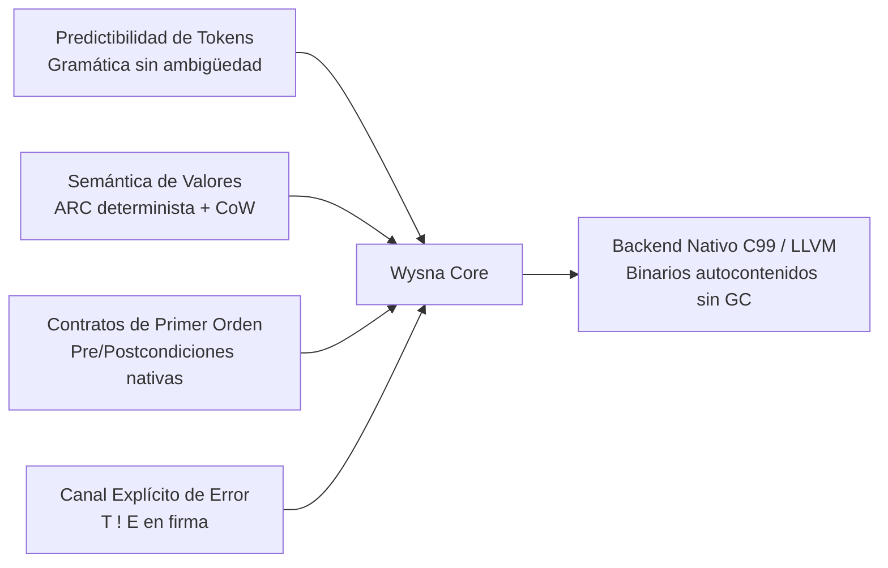
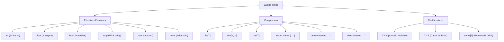

# Manual de Sintaxis y Referencia del Lenguaje Wysna (v0.6.0)

Este documento constituye la referencia técnica canónica, completa y exhaustiva de la sintaxis, el modelo semántico, el sistema de tipos y las primitivas de tiempo de ejecución del lenguaje **Wysna**, derivada directamente de la implementación de referencia del compilador (**Wysna Seed**), el compilador auto-hospedado (**Wysna Compiler**) y la especificación formal normativa.

---

## Índice General

1. [Filosofía y Principios de Diseño](#1-filosofía-y-principios-de-diseño)
2. [Estructura Léxica y Gramática Base](#2-estructura-léxica-y-gramática-base)
3. [Sistema de Tipos](#3-sistema-de-tipos)
4. [Variables, Inmutabilidad y Asignación](#4-variables-inmutabilidad-y-asignación)
5. [Funciones, Closures y Contratos Nativos](#5-funciones-closures-y-contratos-nativos)
6. [Canales de Error y Manejo de Excepciones de Valor](#6-canales-de-error-y-manejo-de-excepciones-de-valor)
7. [Tipos de Datos Algebraicos y Pattern Matching](#7-tipos-de-datos-algebraicos-y-pattern-matching)
8. [Estructuras de Datos y Programación Orientada a Objetos](#8-estructuras-de-datos-y-programación-orientada-a-objetos)
9. [Estructuras de Control](#9-estructuras-de-control)
10. [Sistema de Módulos e Importaciones (Agent-First & Bootstrap)](#10-sistema-de-módulos-e-importaciones)
11. [Funciones y Métodos Integrados (Builtins del Runtime)](#11-funciones-y-métodos-integrados)
12. [Semántica de Memoria: ARC, Copy-on-Write y Búferes Escalares](#12-semántica-de-memoria)
13. [Gobernanza de Ejecución: Cuotas y Cassettes de Efectos](#13-gobernanza-de-ejecución)
14. [Concurrencia Multi-Núcleo Determinista](#14-concurrencia-multi-núcleo-determinista)
15. [Herramientas de Línea de Comandos (Toolchain CLI)](#15-herramientas-de-línea-de-comandos)
16. [Catálogo Canónico de Códigos Diagnósticos (`Wxxxx`)](#16-catálogo-canónico-de-códigos-diagnósticos)

---

## 1. Filosofía y Principios de Diseño

Wysna es un lenguaje de programación de sistemas y automatización diseñado bajo el paradigma **Agent-First**: optimizado tanto para ingenieros humanos como para agentes de inteligencia artificial y modelos de lenguaje (LLMs).



* **Semántica de Valores Pura:** Por defecto, las colecciones (`list`, `dict`, `set`, `struct`) se comportan como valores inmutables compartidos mediante **Copy-on-Write (CoW)** con conteo de referencias automático (**ARC**).
* **Ausencia de Garbage Collector (GC):** La liberación de memoria es determinista e inmediata en el momento en que el contador de referencias llega a 0, con rutas de liberación $O(1)$ para búferes escalares planos.
* **Canales de Error en la Firma de Tipos:** No existen excepciones ocultas ni desenrollado de pila opaco (`panic`/`throw`). Toda función que puede fallar declara formalmente su conjunto de errores en la firma: `T ! E`.
* **Contratos Estáticos y Dinámicos:** Soporte nativo para precondiciones (`requires`) y postcondiciones (`ensures`), exportables automáticamente a **JSON Schema (Draft 2020-12)**.

---

## 2. Estructura Léxica y Gramática Base

### 2.1 Comentarios
Los comentarios inician con el carácter `#` y se extienden hasta el final de la línea física:

```wysna
# Esto es un comentario de una sola línea en Wysna
let x = 42  # Comentario en línea
```

### 2.2 Delimitación de Sentencias y Terminador Lógico
Wysna no utiliza punto y coma obligatorio (`;`). El salto de línea físico (`\n`) actúa como terminador lógico de sentencia **únicamente** cuando sigue a un token que puede cerrar una expresión completa (enteros, flotantes, strings, identificadores, `)`, `]`, `}`, `?`, `break`, `continue`).

```wysna
let a = 10
let b = 20
let c = a +
    b  # Permitido: el '+' al final de línea inhibe el terminador de sentencia
```

### 2.3 Literales Numéricos
Los números en Wysna son decimales en base 10. No se admiten notaciones hexadecimales (`0x`), binarias (`0b`) ni exponentes científicos (`1e5`). Se permite el uso de guion bajo (`_`) como separador de legibilidad:

* **Enteros (`int`):** Enteros con signo de 64 bits (`-9223372036854775808` a `9223372036854775807`).
  ```wysna
  let count = 42
  let million = 1_000_000
  let negative = -15
  ```
* **Flotantes (`float`):** IEEE-754 de doble precisión (64 bits). **Exigen obligatoriamente dígitos tanto antes como después del punto decimal**:
  ```wysna
  let pi = 3.14159
  let rate = 0.05
  let signed_float = -10.5
  # .5  -> Error sintáctico W0002 (requiere dígito previo: 0.5)
  # 5.  -> Error sintáctico W0002 (requiere dígito posterior: 5.0)
  ```

### 2.4 Literales de Texto (`str`)
Cadenas de caracteres codificadas estrictamente en UTF-8 delimitadas por comillas dobles (`"`). Soportan secuencias de escape estándar y escalares Unicode:

```wysna
let greeting = "Hola, mundo!\n"
let tabbed = "Columna 1\tColumna 2"
let unicode_char = "\u{1F980}"  # Cangrejo emoji vía escape Unicode
let escaped_quote = "Dijo: \"Wysna es rápido\""
```

### 2.5 Palabras Reservadas y Operadores

| Categoría | Palabras Clave / Símbolos |
| :--- | :--- |
| **Declaraciones** | `fn`, `let`, `mut`, `struct`, `enum`, `import`, `from`, `use`, `pub`, `extern` |
| **POO** | `class`, `interface`, `extends`, `implements`, `new`, `this`, `super`, `public`, `private` |
| **Control de Flujo** | `if`, `elif`, `else`, `for`, `while`, `in`, `match`, `return`, `break`, `continue` |
| **Literales Booleanos** | `true`, `false`, `none` |
| **Operadores Lógicos** | `and`, `or`, `not` |
| **Aritmética** | `+`, `-`, `*`, `/`, `%` |
| **Comparación** | `==`, `!=`, `<`, `<=`, `>`, `>=` |
| **Asignación / Flechas** | `=`, `->`, `=>` |
| **Rangos** | `..` (exclusivo), `..=` (inclusivo) |
| **Errores / Opcionales** | `?` (propagación), `??` (coalescencia nula), `!` (canal de error), `else error` |

---

## 3. Sistema de Tipos

Wysna cuenta con un sistema de tipos nominal, estático e inferido con invariantes estrictas.



### 3.1 Tipos Escalares
* **`int`:** Entero signado de 64 bits (`int64_t`).
* **`float`:** Número de coma flotante de 64 bits (`double`).
* **`bool`:** Valor lógico booleano (`true` o `false`).
* **`str`:** Cadena UTF-8 inmutable con búfer gestionado por ARC.
* **`unit`:** Tipo unitario vacío (equivalente a `void` funcional). Toda función sin tipo de retorno explícito retorna `unit`.
* **`none`:** Representa la ausencia de valor (utilizado con tipos opcionales `T?`).

### 3.2 Colecciones Copy-on-Write
* **`list[T]`:** Lista dinámica redimensionable.
  * **Optimización Escalar:** `list[int]`, `list[bool]` y `list[float]` son automáticamente asignadas como búferes contiguos C sin encajonar (`unboxed scalar buffers`), con desprendimiento $O(1)$ vía `memcpy`.
* **`dict[K, V]`:** Tabla hash asociativa. Las claves (`K`) deben ser tipos comparables (`int`, `str`, `bool`, o `enum`).
* **`set[T]`:** Conjunto de elementos únicos no duplicados.

### 3.3 Tipos Opcionales (`T?`)
Cualquier tipo puede marcarse como opcional agregando el sufijo `?`. Su valor puede ser una instancia de `T` o `none`:

```wysna
let possible_name: str? = "Washo"
let missing_name: str? = none

# Operador de coalescencia nula (??)
let display_name: str = possible_name ?? "Anónimo"
```

### 3.4 Canales de Error (`T ! E`)
Las funciones no arrojan excepciones no tipadas. Cuando una función puede fallar, declara el tipo exitoso (`T`) y el conjunto de errores (`E`) separados por el operador de exclamación `!`:

```wysna
fn divide(a: int, b: int) -> int ! str {
    if b == 0 {
        return Err("División por cero")
    }
    return a / b
}
```

---

## 4. Variables, Inmutabilidad y Asignación

### 4.1 Inmutabilidad por Defecto
Toda variable declarada con `let` es inmutable. Reasignar una variable inmutable produce el error estático `W3001`:

```wysna
let port = 8080
# port = 8081  -> Error de compilación W3001: Cannot reassign immutable variable
```

### 4.2 Mutabilidad Explícita (`let mut`)
Para permitir la reasignación de una variable o la modificación de sus campos internos, debe declararse explícitamente con `mut`:

```wysna
let mut counter = 0
counter = counter + 1

let mut numbers = [1, 2, 3]
numbers.append(4)
```

### 4.3 Inferencia de Tipos
El compilador infiere automáticamente el tipo a partir de la expresión inicializadora. La anotación de tipo es opcional a menos que exista ambigüedad:

```wysna
let name = "Sofia"        # Inferido como str
let score: int = 100       # Explícito
let ratio: float = 0.75    # Explícito
```

---

## 5. Funciones, Closures y Contratos Nativos

### 5.1 Declaración de Funciones
Las funciones se introducen con la palabra clave `fn`. Las funciones públicas para exportación de módulos llevan el prefijo `pub fn`:

```wysna
pub fn add(a: int, b: int) -> int {
    return a + b
}
```

### 5.2 Contratos de Primer Orden (`requires` / `ensures`)
Wysna soporta formalmente la especificación de contratos en tiempo de compilación y ejecución:
* **`requires` (Precondición):** Expresión booleana que debe cumplirse antes de ingresar al cuerpo de la función. Múltiples precondiciones se separan por comas.
* **`ensures` (Postcondición):** Expresión booleana que valida el estado tras la ejecución. La palabra clave especial `result` está ligada al valor de retorno de la función.

```wysna
pub fn withdraw(balance: int, amount: int) -> int
    requires amount > 0, balance >= amount
    ensures result == balance - amount
{
    return balance - amount
}

let remaining = withdraw(100, 30)  # 70
# withdraw(100, 150) -> Falla en runtime con código diagnóstico [W4005]
```

> [!NOTE]
> Las herramientas de introspección del compilador (`wysna schema`) leen los contratos `requires`/`ensures` del AST/MIR y los traducen automáticamente a restricciones numéricas (`minimum`, `exclusiveMinimum`, etc.) en formato **JSON Schema Draft 2020-12** para llamadas a herramientas de LLMs.

### 5.3 Funciones Genéricas
Las funciones admiten parámetros de tipo encerrados entre corchetes `[T]`:

```wysna
fn identity[T](value: T) -> T {
    return value
}

let int_val = identity[int](42)
let str_val = identity[str]("WySofia")
```

### 5.4 Funciones Lambda y Closures
Las funciones anónimas se declaran mediante la sintaxis de tubería `|params| => expr`:

```wysna
let square = |n: int| => n * n
let sum = |a: int, b: int| => a + b

let numbers = [1, 2, 3, 4]
# Usando closures con funciones de orden superior
let doubled = numbers.map(|n: int| => n * 2)
```

### 5.5 Enlaces Externos C (`extern "C" fn`)
Para interoperar con bibliotecas nativas de C mediante la interfaz FFI:

```wysna
extern "C" fn puts(message: str) -> int
extern "C" fn sqrt(val: float) -> float
```

---

## 6. Canales de Error y Manejo de Excepciones de Valor

Wysna trata los errores como valores concretos en lugar de mecanismos de control de flujo desenfrenados.

### 6.1 Constructor de Error (`Err`)
Para emitir un error, se utiliza la función constructora `Err(...)` correspondiente al canal de error declarado:

```wysna
fn parse_port(text: str) -> int ! str {
    if len(text) == 0 {
        return Err("Puerto vacío")
    }
    return 8080
}
```

### 6.2 Cláusula de Manejo Local (`else error`)
Permite capturar el error en el sitio de la llamada y proporcionar un valor por defecto o ejecutar un bloque de salida:

```wysna
# Desempaquetado con valor por defecto
let port = parse_port("") else error { 3000 }

# Desempaquetado con retorno temprano
let safe_port = parse_port(input) else error {
    print("Error en puerto, abortando")
    return Err("Fallo de configuración")
}
```

### 6.3 Operador de Propagación de Errores (`?`)
Si la función que realiza la llamada declara un canal de error compatible con el error de la función llamada, el operador `?` propaga automáticamente el fallo:

```wysna
fn setup_server(port_str: str) -> unit ! str {
    let port = parse_port(port_str)?  # Si falla, propaga el Err hacia el caller
    print("Servidor listo en puerto: " + str(port))
}
```

---

## 7. Tipos de Datos Algebraicos y Pattern Matching

### 7.1 Declaración de Enums
Los enums en Wysna son tipos de datos algebraicos (ADT / Sum Types). Sus variantes pueden ser unitarias o portar tuplas de datos adjuntos:

```wysna
enum Command {
    Quit,
    Echo(str),
    Move(int, int),
}

enum ConnectionState[T] {
    Disconnected,
    Connecting(int),
    Connected(T),
}
```

### 7.2 Coincidencia de Patrones (`match`)
La sentencia `match` evalúa exhaustivamente todas las variantes de un enum o valores primitivos. Si una variante no está contemplada y no se define un comodín `_`, el compilador genera un error estático `W2001`:

```wysna
fn execute(cmd: Command) -> str {
    return match cmd {
        Command.Quit => "Cerrando aplicación",
        Command.Echo(msg) => "Eco: " + msg,
        Command.Move(x, y) => "Moviendo a (" + str(x) + ", " + str(y) + ")",
    }
}
```

---

## 8. Estructuras de Datos y Programación Orientada a Objetos

### 8.1 Structs (Semántica de Valor Pura)
Los structs representan agrupaciones de datos con semántica de valor Copy-on-Write:

```wysna
pub struct User {
    id: int,
    username: str,
    active: bool,
}

# Inicialización nominal
let user1 = User {
    id: 1,
    username: "washo",
    active: true,
}

# Acceso a campos
print(user1.username)
```

### 8.2 Clases (Semántica de Referencia con ARC)
Las clases se utilizan para modelar entidades con identidad compartida, estado mutable y métodos de instancia:

```wysna
class BankAccount {
    private balance: int
    public owner: str

    fn BankAccount(owner: str, initial_deposit: int) {
        this.owner = owner
        this.balance = initial_deposit
    }

    public fn deposit(amount: int) -> unit {
        if amount > 0 {
            this.balance = this.balance + amount
        }
    }

    public fn get_balance() -> int {
        return this.balance
    }
}

# Instanciación mediante 'new'
let account = new BankAccount("Washo", 500)
account.deposit(200)
print(account.get_balance())  # 700
```

### 8.3 Interfaces y Polimorfismo
Las interfaces definen contratos de métodos que las clases pueden implementar:

```wysna
interface Serializable {
    fn serialize() -> str
}

class Config implements Serializable {
    public path: str

    fn Config(path: str) {
        this.path = path
    }

    public fn serialize() -> str {
        return "{\"path\": \"" + this.path + "\"}"
    }
}
```

---

## 9. Estructuras de Control

### 9.1 Bifurcación Condicional (`if` / `elif` / `else`)
Las condiciones no requieren paréntesis circundantes, pero el bloque de código **siempre** exige llaves `{ ... }`:

```wysna
if temperature > 30 {
    print("Calor")
} elif temperature < 10 {
    print("Frío")
} else {
    print("Templado")
}
```

#### Expresión Ternaria (`if` inline)
`if` puede utilizarse directamente como una expresión con valor de retorno:

```wysna
let status = if is_admin { "Administrador" } else { "Usuario" }
```

### 9.2 Bucle Condicional (`while`)
Itera continuamente mientras la condición booleana sea verdadera:

```wysna
let mut i = 0
while i < 5 {
    print(i)
    i = i + 1
}
```

### 9.3 Bucle Iterativo (`for ... in ...`)
Itera sobre colecciones (`list`, `set`) o sobre rangos numéricos:

```wysna
# Iteración sobre listas
let fruits = ["manzana", "plátano", "naranja"]
for fruit in fruits {
    print(fruit)
}

# Iteración sobre rangos numéricos (exclusivo e inclusivo)
for idx in 0..5 {
    print(idx)  # Imprime del 0 al 4
}

for idx in 1..=5 {
    print(idx)  # Imprime del 1 al 5
}
```

### 9.4 Control de Bucles (`break` / `continue`)
* `break`: Interrumpe y finaliza el bucle actual inmediatamente.
* `continue`: Salta el resto del cuerpo del bucle y pasa a la siguiente iteración.

---

## 10. Sistema de Módulos e Importaciones

Wysna cuenta con dos mecanismos complementarios de modularidad:

### 10.1 Sintaxis Primaria Agent-First (`from ... use ...`)

Diseñada específicamente para maximizar la densidad de información y evitar la redundancia de prefijos:

```wysna
# 1. Importación selectiva de múltiples símbolos con llaves
from std.text use {
    contains,
    to_lower,
    split as text_split,
}

# 2. Importación de símbolo único
from app.domain.user use User
from app.infrastructure.auth use User as AuthUser

# 3. Importación de submódulos en bloque
from app.domain use {
    auth.Role,
    user.User,
}

# 4. Importación del espacio de nombres completo sin comillas
from app.domain use user
let u = user.create("Washo")
```

### 10.2 Sintaxis Bootstrap / Espacio de Nombres (`import`)

Importa un archivo completo o módulo de biblioteca estándar bajo un prefijo calificador:

```wysna
import "std/json"
import "std/algorithms" as alg

let val = json.number("42") else error { json.null() }
let rev = alg.reverse([1, 2, 3])
```

### 10.3 Matriz de Compatibilidad entre Compiladores

| Sintaxis | Compilador Seed (Python) | Compilador Self-Hosted (Nativo C99) |
| :--- | :---: | :---: |
| `import "<path>"` | ✅ Soportado al 100% | ✅ Soportado al 100% |
| `import "<path>" as <alias>` | ✅ Soportado al 100% | ✅ Soportado al 100% |
| `pub import "<path>"` | ✅ Soportado al 100% | ✅ Soportado al 100% |
| `from <path> use { sym1, sym2 }` | ✅ Soportado al 100% | ⏳ Previsto v0.7.0 (Límite de perfil actual) |

---

## 11. Funciones y Métodos Integrados

### 11.1 Funciones Globales del Runtime

| Función | Firma | Descripción |
| :--- | :--- | :--- |
| `print(value)` | `(any) -> unit` | Imprime el valor a la salida estándar (`stdout`) seguido de salto de línea. |
| `eprint(value)` | `(any) -> unit` | Imprime el valor a la salida de errores (`stderr`) seguido de salto de línea. |
| `exit(code)` | `(int) -> unit` | Termina el proceso inmediatamente con el código de salida especificado. |
| `len(collection)` | `(list / dict / str / set) -> int` | Retorna la cantidad de elementos o bytes de la colección o texto. |
| `int(value)` | `(any) -> int` | Convierte strings o flotantes a entero de 64 bits. |
| `float(value)` | `(any) -> float` | Convierte enteros o strings a número de coma flotante IEEE-754. |
| `str(value)` | `(any) -> str` | Convierte cualquier valor a su representación textual canónica UTF-8. |
| `ord(character)` | `(str) -> int` | Retorna el valor numérico Unicode del primer carácter. |
| `chr(codepoint)` | `(int) -> str` | Retorna el carácter correspondiente al punto de código Unicode. |
| `args()` | `() -> list[str]` | Retorna la lista de argumentos de línea de comandos pasados tras `--`. |
| `env(name)` | `(str) -> str?` | Obtiene una variable de entorno del sistema operativo (`none` si no existe). |
| `unix_time()` | `() -> int` | Retorna la marca de tiempo Unix actual en segundos desde la época. |
| `read_file(path)` | `(str) -> str ! IoError` | Lee el contenido completo de un archivo UTF-8 de forma atómica. |
| `write_file(path, data)`| `(str, str) -> unit ! IoError` | Escribe datos a un archivo en disco de forma segura. |
| `weak(object)` | `(class) -> Weak[T]` | Crea una referencia débil que no incrementa el contador fuerte de ARC. |
| `upgrade(weak_ref)` | `(Weak[T]) -> T?` | Intenta resolver la referencia débil (`none` si el objeto ya fue destruido). |

### 11.2 Métodos de Colecciones y Cadenas

```wysna
# Listas
let mut lst = [1, 2]
lst.append(3)           # [1, 2, 3]
let last = lst.pop()     # Retorna 3, lista queda [1, 2]
lst.clear()             # []

# Cadenas
let text = "  Wysna Lang  "
let clean = text.trim()             # "Wysna Lang"
let parts = clean.split(" ")        # ["Wysna", "Lang"]
let upper = clean.to_upper()        # "WYSNA LANG"
let has = clean.starts_with("Wys")  # true

# Diccionarios
let mut dict_val = {"a": 1, "b": 2}
let has_key = dict_val.contains("a")  # true
let keys = dict_val.keys()            # ["a", "b"]
let values = dict_val.values()        # [1, 2]
dict_val.remove("a")
```

---

## 12. Semántica de Memoria

Wysna garantiza la seguridad de memoria sin recurrir a pausas de recolección de basura (*Stop-the-World GC*):

### 12.1 Conteo de Referencias Automático (ARC)
Todo objeto en el heap posee un bloque de control de referencias atómicas. Cuando el último propietario sale de su ámbito léxico, la memoria se libera de manera inmediata y predecible.

### 12.2 Copy-on-Write (CoW) Inmutable
Las estructuras de datos compartidas solo se duplican físicamente en el instante exacto en que una copia intenta mutar sus elementos:

```wysna
let original = [1, 2, 3, 4]
let mut copy = original    # No hay asignación de memoria: ambos comparten el mismo búfer
copy.append(5)             # Desprendimiento CoW: solo 'copy' se duplica; 'original' queda intacto
```

### 12.3 Detección Estática de Retain Cycles (`W6002`)
Para evitar fugas de memoria causadas por ciclos fuertes de referencia entre clases, el typechecker implementa un análisis estático de grafos de asignación (`LayoutGraph`). Si se detecta un ciclo potencial, el compilador emite la advertencia `W6002`, recomendando el uso de `Weak[T]`.

---

## 13. Gobernanza de Ejecución

Diseñado para agentes autónomos que ejecutan código dinámico en entornos aislados o sandbox:

### 13.1 Cuotas Deterministas (`--max-steps` / `--max-heap-mb`)
Limita la cantidad máxima de instrucciones evaluadas y la memoria de heap consumida. Superar cualquier límite aborta la ejecución con el código de diagnóstico determinista `[W4004]`:

```sh
# Ejecución acotada por cuotas
wysna run --max-steps=1000000 --max-heap-mb=32 main.wysna

# En binarios nativos vía variables de entorno
WYSNA_MAX_STEPS=500000 WYSNA_MAX_HEAP_BYTES=16777216 ./main
```

### 13.2 Cassettes de Efectos (`--record-trace` / `--replay-trace`)
Permite capturar todas las interacciones con el entorno exterior (llamadas HTTP, lectura de archivos, reloj) en un sobre serializado `wysna.effect.trace/1` y reproducirlas posteriormente de forma exacta y fuera de línea sin I/O real:

```sh
# Fase de grabación
wysna run --record-trace=network_test.json test_runner.wysna

# Fase de reproducción exacta bit a bit
wysna run --replay-trace=network_test.json test_runner.wysna
```

---

## 14. Concurrencia Multi-Núcleo Determinista

Wysna implementa concurrencia estructurada a través de la biblioteca estándar `std/algorithms` y `std/http`:

```wysna
import "std/algorithms" as alg

let numbers = [1, 2, 3, 4, 5, 6, 7, 8]

# Mapeo paralelo multi-hilo con ordenamiento de índices estrictamente preservado
let squares = alg.parallel_map[int, int] (numbers, |n: int| => n * n)
print(squares)  # [1, 4, 9, 16, 25, 36, 49, 64]
```

* **Garantía de Orden Determinista:** El resultado de `parallel_map`, `parallel_batch`, `parallel_filter` y `parallel_reduce` produce un orden de salida indexado idéntico al de una ejecución puramente secuencial.
* **Seguridad de Hilos en Host ABI:** El runtime incorpora bloqueos reentrantes en operaciones críticas de memoria y almacenamiento de estados thread-local.

---

## 15. Herramientas de Línea de Comandos (Toolchain CLI)

Wysna provee una suite completa de herramientas para desarrolladores y agentes:

| Comando | Sintaxis Canónica | Propósito |
| :--- | :--- | :--- |
| `check` | `wysna check src/main.wysna [--output-format=json-v1]` | Verificación estática de tipos sin emitir código. |
| `fix` | `wysna fix --apply src/main.wysna` | Auto-reparación determinista de errores con SHA-256 verificado. |
| `run` | `wysna run src/main.wysna [--max-steps=N]` | Ejecución directa mediante el intérprete de referencia. |
| `build` | `wysna build src/main.wysna -o bin/app` | Compilación nativa a código máquina vía MIR y C99/LLVM. |
| `fmt` | `wysna fmt src/main.wysna` | Formateo canónico e idempotente del código fuente. |
| `explain` | `wysna explain src/main.wysna --output-format=json-v1` | Reporte conservador de efectos colaterales y FFI sobre MIR. |
| `schema` | `wysna schema src/main.wysna` | Generación de JSON Schema Draft 2020-12 y tools para LLMs. |
| `mcp` | `wysna mcp --root .` | Servidor daemon Model Context Protocol persistente en memoria. |
| `project` | `wysna project new <name> / check / build / test / lock` | Gestión integral de proyectos y paquetes con `wysna.toml`. |
| `repl` | `wysna repl` | Shell interactivo con transacciones de estado seguras. |
| `api` | `wysna api std/json` | Introspección y documentación de APIs de la biblioteca estándar. |
| `lsp` | `wysna lsp` | Servidor Language Server Protocol sobre stdio para IDEs (VS Code). |

---

## 16. Catálogo Canónico de Códigos Diagnósticos (`Wxxxx`)

Todos los diagnósticos emitidos por el compilador siguen una numeración formal y estable:

| Rango | Categoría | Códigos Notables |
| :--- | :--- | :--- |
| **`W0xxx`** | **Léxico y Sintaxis** | • `W0001`: Token inesperado o carácter no válido.<br>• `W0002`: Literal numérico malformado.<br>• `W0003`: String no terminado.<br>• `W0004`: Secuencia de escape inválida.<br>• `W0005`: Secuencia de escape Unicode inválida.<br>• `W0006`: Sintaxis inválida o delimitador faltante (`}`, `)`). |
| **`W1xxx`** | **Ámbito y Módulos** | • `W1001`: Identificador, símbolo o tipo desconocido.<br>• `W1002`: Declaración duplicada.<br>• `W1003`: Módulo no encontrado o dependencia circular.<br>• `W1004`: Uso inválido de control de flujo (`break`/`continue`/`return` fuera de contexto). |
| **`W2xxx`** | **Sistema de Tipos** | • `W2001`: Discrepancia de tipos (*Type mismatch*).<br>• `W2002`: Destino de asignación no válido.<br>• `W2003`: Cantidad de argumentos inválida.<br>• `W2004`: Estructura o enum no exhaustivo.<br>• `W2005`: Restricción genérica violada. |
| **`W3xxx`** | **Mutabilidad y Acceso** | • `W3001`: Intento de reasignación a variable inmutable (requiere `let mut`).<br>• `W3002`: Miembro privado inaccesible desde el ámbito exterior. |
| **`W4xxx`** | **Gobernanza y Runtime** | • `W4001`: Excepción de valor no capturada en tiempo de ejecución.<br>• `W4002`: Error de I/O en sistema de archivos.<br>• `W4003`: División por cero.<br>• `W4004`: Presupuesto de cuotas excedido (`--max-steps` o `--max-heap-mb`).<br>• `W4005`: Violación de contrato estático o dinámico (`requires`/`ensures`). |
| **`W5xxx`** | **Toolchain y C99** | • `W5001`: Compilador C del host no encontrado o comando inválido.<br>• `W5002`: Falla de enlace o compilación C99 nativa. |
| **`W6xxx`** | **Linter y Advertencias** | • `W6001`: Salto de línea ambiguo con operador unario menos (`let x = a\n -b`).<br>• `W6002`: Detección estática de ciclo de retención ARC en clases. |
