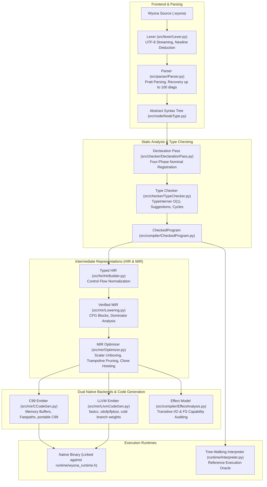
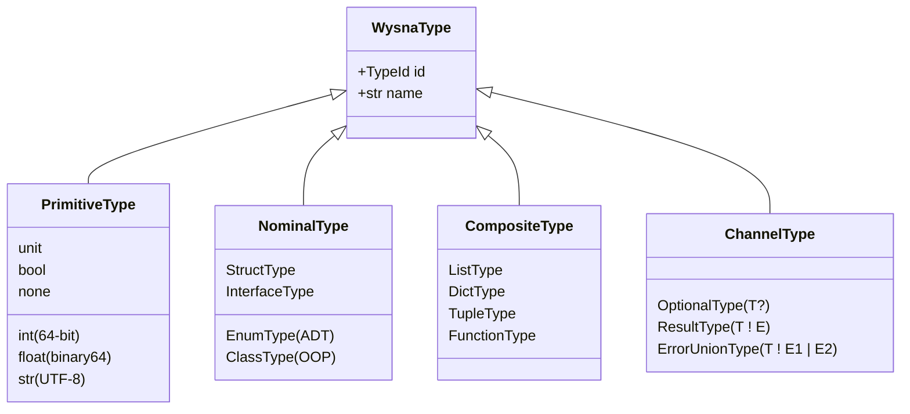
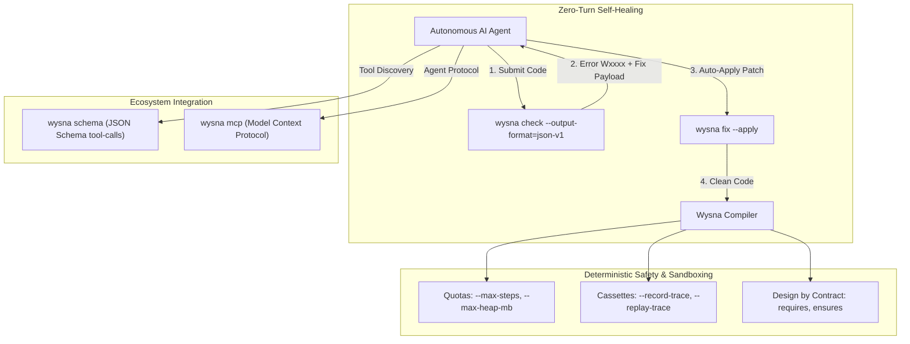
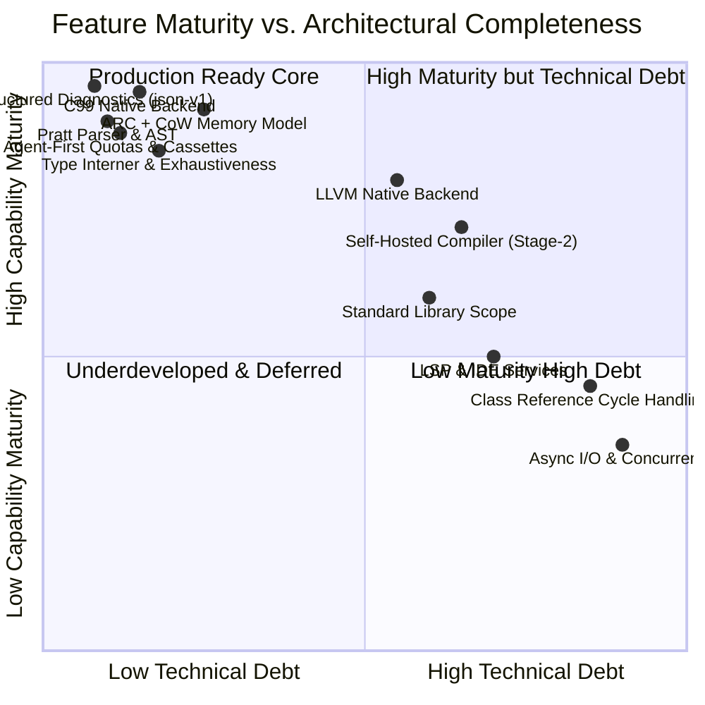

# Wysna: Comprehensive End-to-End Capabilities & Technical Debt Audit

**Status:** Canonical End-to-End Architecture, Feature Inventory & Deficit Audit  
**Date:** 2026-11-01  
**Scope:** Complete Codebase (`src/`, `runtime/`, `stdlib/`, `selfhost/`, `tools/`, `packaging/`, `tests/`)  
**Engines Analyzed:** Wysna Seed (Python Reference Engine) & Wysna Compiler (Stage-2 Self-Hosted Native Engine)  
**Backends Analyzed:** C99 Native Backend, LLVM Native Backend (`llvm-native-v1`), WASI Target, and AST/Interpreter Execution Oracles  

---

## Executive Summary

Wysna v0.6.0 is a statically typed, native compiled programming language operating under the Apache License 2.0. It is engineered around three non-negotiable architectural tenets:
1. **Deterministic Memory:** Automatic Reference Counting (ARC) paired with Copy-on-Write (CoW) value semantics without a stop-the-world tracing garbage collector.
2. **Dual-Backend Native Compilation:** Verified Intermediate Representation (MIR) lowered to high-performance C99 (default, portable) and native LLVM IR (opt-in, fast calling conventions, unboxed scalars).
3. **Agent-First Frontier:** First-class compiler support for autonomous AI workflows: zero-turn auto-remediation (`wysna fix --apply`), structured JSON diagnostics (`json-v1`), automated tool schemas (`wysna schema`), built-in MCP server (`wysna mcp`), deterministic compute/memory quotas, and offline effect replay cassettes.

This document presents a **rigorous, end-to-end audit** of every implemented language feature, followed by an exhaustive inventory of all known architectural boundaries, technical deficits, edge-case limitations, and open engineering trade-offs.

---

## Architecture & Compilation Flow Pipeline



---

## PART I: Comprehensive Language Feature Catalog (End-to-End)

### 1. Lexical & Syntactic Surface

| Feature | Implemented Syntax | Engine Support | Verification Status |
| :--- | :--- | :---: | :--- |
| **Variables & Mutability** | `let x = 10`<br>`let mut count = 0` | Seed + Compiler | Fully verified. Immutability enforced statically (`W3001`). |
| **Function Declarations** | `fn add(a: int, b: int) -> int { ... }`<br>`pub fn exported() -> unit { ... }` | Seed + Compiler | Full support for type annotations, unit returns, and visibility modifiers. |
| **Anonymous Lambdas** | `\|x: int, y: int\| -> int { x + y }` | Seed + Compiler | Closures convert to environment structs (`ClosureConversion.py`). Capture by immutable snapshot. |
| **Statement Separators** | Newlines as logical boundaries; semicolons optional | Seed + Compiler | Pratt parser deduces statement termination while supporting multiline fluent dot-chaining. |
| **Module Import System** | `from "path/mod" use { sym1, sym2 }`<br>`import "path/mod"` | Seed + Compiler | Predictable left-to-right lexical resolution; module caching and circular dependency rejection (`W1003`). |
| **Comments & Escapes** | `# Single-line comment`<br>`\n`, `\t`, `\r`, `\"`, `\\`, `\xHH`, `\u{HHHH}` | Seed + Compiler | Full UTF-8 codepoint support in string literals and validated Unicode scalar escapes (`W0005`). |

---

### 2. Type System & Semantics

Wysna implements a sound, static type system powered by a centralized hash-consed `TypeInterner` that enables $O(1)$ structural type equality checks.



#### Detailed Typing Capabilities:
1. **Primitive Scalars:** `int` (signed two's complement 64-bit), `float` (IEEE-754 `binary64`), `bool` (`true`/`false`), `str` (immutable UTF-8 sequence, codepoint indexed), `unit` (return absence), `none` (singular bottom optional literal).
2. **Nominal Structs:** Fixed-layout records initialized with field names (`Point { x: 1, y: 2 }`). Statically verified field coverage and immutability rules (`W2007`).
3. **Algebraic Data Types (ADTs / Enums):** Enums with or without payloads:
   ```wysna
   enum Shape {
       Circle(float),
       Rectangle(float, float),
       Point
   }
   ```
4. **Pattern Matching & Exhaustiveness:** `match expr { ... }` with exhaustiveness verification (`PatternCoverage.py` / `W2003`), variable binding, enum payload extraction, wildcard `_`, and boolean guards (`if condition`).
5. **Class OOP & Inheritance:** Single inheritance (`class Dog extends Animal`), constructor safety (`this` cannot escape before `super()` or complete field initialization / `W3004`), public/private access modifiers (`W3002`), virtual dispatch tables (`vtable`), and nominal interface implementation (`implements Interface`).
6. **Error Channels & Result Propagation:**
   - Fallible functions return `T ! E`.
   - Postfix `expr?` operator unwraps the success payload or performs early return on error.
   - `else err` unwrap clause with lexical error binding: `let val = fallible() else err { return default }`.
   - **Error Unions:** `T ! E1 | E2` with subset propagation and exhaustive handling.
7. **Optionals & Coalescing:** `T?` syntax, unwrapping via `?` operator (propagating `none`), and null coalescing via `??` (`let x = opt ?? fallback`).
8. **Parametric Generics:** Definition-time type checking for generic functions, structs, and enums (`fn map[T, R](...)`). Verified monomorphization with complexity budgeting (`MAX_SPECIALIZATION_COMPLEXITY`).
9. **Cycle & Infinite Layout Detection:** Tarjan's strongly connected components algorithm (`LayoutGraph.py`) detects and rejects infinite inline layouts (`W2011`) while permitting indirect recursive ADTs.

---

### 3. Memory & Lifetime Architecture (ARC + CoW)

Wysna achieves deterministic memory safety without a garbage collector through **Automatic Reference Counting (ARC)** and **Copy-on-Write (CoW)** value semantics:

| Subsystem | Mechanism | Technical Implementation |
| :--- | :--- | :--- |
| **Deterministic ARC** | Reference count in 8-byte header | `wysna_retain` ($O(1)$) and `wysna_release` ($O(1)$). Destruction happens immediately when `refcount == 0`. |
| **Ownership Classification** | Three-state compiler tracking | Internal classifications: `BORROWED` (views), `OWNED` (scope temporaries), and `TRANSFERRED` (moved/cloned). |
| **Zero-Cost Moves** | `wysna_move(&_tN)` | Copies pointer, overwrites source temporary with `W_UNIT`, transferring ownership with **zero refcount traffic**. |
| **LIFO Scope Destruction** | `CleanupScope` Stack | Enforces reverse-lexical destruction across all exits: normal `}`, early `return`, error propagation `?`, `break`, and `continue`. |
| **Copy-on-Write (CoW)** | Shared buffers with unshared mutation | Mutation methods (`append`, `set`) inspect `refcount`: if $>1$, detach buffer via deep copy; if $==1$, mutate in-place in $O(1)$. |
| **Scalar Unboxed Lists** | `WUnboxedList` | Dense primitive arrays (`list[int]`, `list[float]`, `list[bool]`) stored contiguously without per-element `WVal` boxing, freeing with a single $O(1)$ call. |
| **Weak References** | `Weak[C]` and `weak.upgrade()` | Breaking circular class references to allow safe memory reclamation without cycle collectors. |

---

### 4. Intermediate Representations & Optimizations

Wysna operates a dual-IR architecture:


1. **Typed HIR (`src/hir/`):**
   - Eliminates syntactic sugar.
   - Expands assignments into normalized `HirAssignment`.
   - Explicitly records return paths, loop boundaries, and structured cleanup scopes.
2. **Verified MIR (`src/mir/`):**
   - Control Flow Graph (CFG) consisting of Basic Blocks with strictly validated terminators (`Jump`, `Branch`, `Return`, `Panic`).
   - Dominator tree verification (`Verifier.py`) ensuring all SSA values are defined prior to use.
3. **MIR Optimizations (`src/mir/Optimizer.py`):**
   - **Scalar Unboxing:** Bypasses heap allocation for `i64`, `f64`, and `bool` values in basic block computations.
   - **CFG Simplification & Dead Block Pruning:** Eliminates unreachable blocks and simplifies conditional jumps with known branch conditions.
   - **Trampoline Elimination:** Merges linear basic blocks connected by unconditional jumps.
   - **Clone Hoisting:** Reorders temporary clone releases to avoid false CoW detach operations on local mutations.

---

### 5. Dual Native Backends

| Dimension | C99 Backend (Production Default) | LLVM Backend (`llvm-native-v1`) |
| :--- | :--- | :--- |
| **Target Engine** | Wysna Seed & Wysna Compiler (Self-hosted) | Wysna Seed (`--backend=llvm-experimental`) |
| **Emitted Format** | Standard ANSI C99 source code | LLVM 20.1.8 Intermediate Representation (`.ll`) |
| **Downstream Compiler** | Clang, GCC, Zig, or system C compiler | Clang / LLVM `opt` & `llc` via `llvmlite 0.46.0` |
| **Calling Convention** | Standard C ABI (`WVal (*)(WVal, ...)`) | Fast Calling Convention (`fastcc`) with in-register passing |
| **Scalar Casts** | High-level C cast operators | Hardware zero-cost instructions (`sitofp`, `fptosi`) |
| **Branch Hints** | Standard C if/else | Cold branch weight profiling metadata (`!prof`) |
| **Platform Scope** | Linux (x64/arm64), macOS (arm64/x64), Windows (x64) | macOS arm64 (`macosx13.0.0`), Linux x64 (`unknown-linux-gnu`) |
| **Sanitizers** | ASan, UBSan, LSan integration | Direct LLVM instrumentation via host Clang |

---

### 6. Standard Library Inventory (16 Native Modules)

All standard library modules live under `stdlib/*.wysna`:

| Module | Core Exports | Operational Semantics |
| :--- | :--- | :--- |
| **`std/algorithms`** | `map`, `filter`, `fold`, `sort`, `reverse`, `any`, `all`, `contains`, `parallel_map`, `parallel_filter`, `parallel_reduce`, `parallel_batch` | Pure functional algorithms over collections; parallel variants use worker thread pools with deterministic index ordering. |
| **`std/json`** | `parse`, `parse_with_limits`, `stringify`, `Value` ADT, accessors (`get`, `at`, `as_str`, `as_int`) | Bounded JSON parser with strict limits on depth (32) and nodes (100,000); compact deterministic serializer with sorted keys. |
| **`std/buffer`** | `from_text`, `clone`, `append`, `get`, `size`, `close` | Direct mutable byte arrays (`Bytes`) with boundary checking and explicit lifecycle tracking. |
| **`std/files`** | `open`, `read`, `write`, `close` | Low-level file handle I/O with structured modes (`read`, `write`, `append`) and `FileError`. |
| **`std/fs`** | `exists`, `size`, `mkdir`, `remove`, `rename` | Direct host filesystem queries and manipulation returning `FsError`. |
| **`std/io`** | `read_text`, `write_text` | High-level text reading and writing returning `IoError`. |
| **`std/text`** | `join`, `split`, `lines`, `trim`, `replace`, `find`, `starts_with`, `ends_with`, `pad_left`, `to_lower`, `to_upper`, `repeat` | Unicode-aware and ASCII string manipulation with scalar index safety. |
| **`std/parse`** | `parse_int`, `parse_float` | Safe string-to-number parsing returning `Result` with `ParseError` (no unhandled exceptions). |
| **`std/path`** | `join`, `basename`, `dirname` | Cross-platform filesystem path manipulation using `/` separators. |
| **`std/bytes`** | `encode`, `decode` | UTF-8 byte array codec with explicit `Utf8Error` on invalid surrogate pairs. |
| **`std/process`** | `run`, `ProcessResult` | Spawns external system processes with captured stdout, stderr, and exit codes. |
| **`std/http`** | `get`, `post`, `batch_get` | High-level HTTP client with JSON payload support and deterministic multi-request dispatch. |
| **`std/resources`**| Scoped resource tracking | Manages file descriptors and external handles to ensure cleanup at last reference. |
| **`std/environment`**| `arguments`, `get` | Accesses CLI arguments and host environment variables. |
| **`std/time`** | `unix_seconds` | Returns 64-bit UTC epoch timestamp. |
| **`std/test`** | `expect`, `expect_equal_int`, `expect_equal_text` | Minimalist zero-dependency unit assertion framework. |

---

### 7. Agent-First Frontier Capabilities



1. **Structured JSON Diagnostics (`json-v1`):** Every CLI command (`check`, `build`, `run`, `fix`, `schema`) produces a machine-parsable JSON payload with `code`, `stage`, byte offsets (`primary_span`), structured metadata (`data`), related spans (`related`), and exact machine fixes (`fixes`).
2. **Deterministic Step & Memory Quotas:**
   - `--max-steps=N`: Prevents infinite loops by terminating execution upon reaching $N$ bytecode/instruction steps.
   - `--max-heap-mb=M`: Caps dynamic memory consumption; terminates with diagnostic `W4004` if the heap exceeds $M$ megabytes.
3. **Offline Effect Cassettes (`--record-trace` & `--replay-trace`):**
   - Records external I/O, network requests, and filesystem access into deterministic JSON cassettes.
   - Enables replay testing in isolated, air-gapped CI environments without live network or disk access.
4. **Design by Contract (`requires` & `ensures`):**
   - Syntactic function preconditions and postconditions evaluated at runtime.
   - Non-compliant calls panic immediately with diagnostic `W4005`.
5. **Tool-Calling JSON Schema (`wysna schema`):** Generates OpenAPI / JSON Schema function definitions from Wysna function signatures for direct registration in LLM function-calling workflows.
6. **Built-in Model Context Protocol Server (`wysna mcp`):** Native stdio MCP server exposing Wysna compilation, checking, explanation, and AST analysis directly to Claude, Cursor, and ChatGPT.

---

### 8. Self-Hosted Compiler (`selfhost/`)

- Implemented in 13,686 lines of pure Wysna source code (`selfhost/src/*.wysna`), bundled into `selfhost/compiler.wysna`.
- Implements its own lexer, recursive descent parser, nominal type resolution pass, checked AST verification, and MIR lowering engine under the `native-core-v1` specification profile.
- Verified deterministic fixed-point bootstrap: Three successive native MIR compilation passes yield identical cryptographic SHA-256 hashes ($C_0 == C_1 == C_2$).
- Ships a Python-free native SDK capable of running standalone builds with zero external interpreter dependencies.

---

## PART II: Comprehensive Technical Debt, Known Limits & Open Problems

Despite the architectural achievements of v0.6.0, an exhaustive audit reveals clear technical limits, deficits, and deliberate design deferrals across the codebase:

### 1. Frontend & Parsing Deficits

| Limitation | Technical Description | Root Cause / File | Impact / Workaround |
| :--- | :--- | :--- | :--- |
| **No Multiline Comments** | Wysna only supports single-line comments starting with `#`. Block comments (`/* ... */`) are not recognized. | `src/lexer/Lexer.py` | Commenting large blocks requires prefixing `#` on every line. |
| **Heuristic Error Recovery Limit** | Parser recovers up to 100 diagnostics before stopping; the recovered AST is **not executable**. | `src/parser/Parser.py` | Partially broken programs can be checked for errors, but cannot be run or lowered to MIR until all syntax errors are resolved. |
| **Multiline Dot Chaining Boundary** | Dot-chaining across lines is supported only when the newline immediately precedes the dot (`.method()`). Incomplete trailing expressions cause immediate syntax errors. | `src/parser/Parser.py` | Builder patterns must place the dot on the continuation line. |

---

### 2. Type System & Semantics Deficits

| Limitation | Technical Description | Root Cause / File | Impact / Workaround |
| :--- | :--- | :--- | :--- |
| **Immutable Snapshot Closures** | Lambdas capture outer variables by **immutable snapshot only**. Captured mutable variables cannot be modified inside a closure, and mutations outside after capture are not observed. | `src/checker/ClosureConversion.py`<br>`docs/KNOWN_LIMITS.md §1` | Stateful closures (e.g. `make_counter()`) are impossible. Workaround: Use a `class` with private fields. |
| **Restricted Error Unions** | Error unions (`T ! E1 \| E2`) only accept primitive scalars, non-generic `struct`, and non-generic `enum`. Classes, generic types, collections, and functions are rejected. | `src/checker/ResultRules.py`<br>`docs/KNOWN_LIMITS.md §2` | Rich error hierarchies with inherited classes or generic payloads cannot be used in error unions without manual boxing. |
| **Dictionary Key Restrictions** | Only `int`, `str`, `bool`, and `enum` can be dictionary keys. Floating-point numbers (`float`), structs, and collections are rejected (`W2010`). | `src/checker/CollectionRules.py`<br>`W2010` | Prevents NaN comparison anomalies and float hashing instability. Float keys require string formatting before insertion. |
| **No Independent Generic Methods in Classes** | Parameterized classes can use class-level type arguments in methods, but individual methods cannot introduce independent type parameters: `class Box[T] { fn transform[R](...) }` is unsupported. | `src/checker/OopGenerics.py` | Generic mapping patterns must be written as standalone functions (`fn transform[T, R](...)`) instead of class methods. |
| **No Complex Trait / Typeclass System** | Interfaces are strictly nominal and apply only to classes (`class A implements Interface`). Structural typing, duck typing, and retroactive trait implementations for primitives/structs do not exist. | `src/checker/TypeRelations.py` | Code cannot define interfaces that apply retroactively to built-in types like `int` or `str`. |

---

### 3. Memory & Runtime Deficits

| Limitation | Technical Description | Root Cause / File | Impact / Workaround |
| :--- | :--- | :--- | :--- |
| **Cyclic Class References Leak** | Strong reference cycles between classes (`a.b = b; b.a = a`) are not reclaimed by ARC upon scope exit. | `runtime/wysna_runtime_memory.h`<br>`docs/KNOWN_LIMITS.md §5` | Programs with cyclic data structures leak memory unless cycles are broken with `Weak[C]` or manual teardown. |
| **Opt-In Memory Leak Verification** | Runtime leak detection (`WYSNA_MEM_CHECK=1`) is strictly opt-in and does not run by default in production. | `runtime/wysna_runtime_core.h` | Production builds exit silently on cyclic leaks to avoid altering stdout/stderr for programs retaining process-lifetime objects. |
| **No Stack Unwinding on `exit(code)`** | Calling `exit(code)` terminates the host process immediately without executing LIFO `CleanupScope` destructors for active stack frames. | `src/codegen/CCodeGen.py` | Resources (files, network connections) rely on the OS kernel for cleanup on immediate exit. |
| **32-Byte General `WVal` Footprint** | On 64-bit architectures, general heterogeneous `WVal` instances consume 32 bytes (`type: 8B`, `rc: 8B`, `payload: 16B`). | `runtime/wysna_runtime.h` | While unboxed scalar lists mitigate this, general collections consume higher memory bandwidth compared to 16-byte or 8-byte NaN-boxed representations. |

---

### 4. Concurrency & Asynchronous I/O Deficits

| Limitation | Technical Description | Root Cause / File | Impact / Workaround |
| :--- | :--- | :--- | :--- |
| **No Preemptive Threads or Shared Mutable Memory** | Wysna does not support arbitrary preemptive multithreading (`std::thread`, raw mutexes, shared mutable heaps). | `docs/KNOWN_LIMITS.md §6` | Concurrency is restricted to structured data-parallel collections (`parallel_map`, `parallel_reduce`). Thread races are prevented, but arbitrary actor models are impossible. |
| **No Built-in Native `async` / `await`** | Wysna lacks an asynchronous event loop and `async`/`await` keywords in its core grammar. | `src/tokens/TokenType.py` | All network (`std/http`) and file I/O operations are synchronous and blocking. High-concurrency servers must rely on multi-process scaling or C FFI adapters. |

---

### 5. Backend Parity & LLVM Limitations

| Limitation | Technical Description | Root Cause / File | Impact / Workaround |
| :--- | :--- | :--- | :--- |
| **LLVM Restricted to macOS & Linux** | The native LLVM backend supports only `arm64-apple-macosx13.0.0` and `x86_64-unknown-linux-gnu`. | `docs/LLVM_EXPERIMENTAL.md` | Windows and WebAssembly cannot use `--backend=llvm-experimental`; they must use C99 (`--backend=c99`). |
| **LLVM Compilation Latency & Memory Footprint** | In N5 comparative benchmarks, the LLVM backend exhibits higher cold compilation times (1.63x) and higher peak RSS (2.4x) than the C99 backend. | `docs/LLVM_EXPERIMENTAL.md` | C99 remains the default production backend; LLVM is opt-in for release optimization. |
| **LLVM Requires Host Clang for Sanitizers** | Instrumenting LLVM executables with ASan/UBSan requires an explicit host Clang toolchain matching the host target triple. | `src/compiler/LlvmToolchain.py` | Offline LLVM SDKs cannot run sanitized qualification without host Clang. |

---

### 6. Self-Hosted Compiler Profile Gap

| Limitation | Technical Description | Root Cause / File | Impact / Workaround |
| :--- | :--- | :--- | :--- |
| **Incomplete Seed Feature Parity in Selfhost** | `selfhost/compiler.wysna` implements the `native-core-v1` profile. It lacks project manifest management (`wysna.toml`), lockfiles, the test runner, the code formatter (`wysna fmt`), and LSP services. | `selfhost/src/`<br>`docs/COMPILER_ARCHITECTURE.md` | Developing large multi-package projects currently requires the Seed toolchain; the standalone Compiler SDK is limited to single-module compilation. |
| **Parameterized Class Inheritance Gap in Selfhost** | Classes parameterized with generic types that also inherit from other generic classes are unsupported in the self-hosted MIR lowering pass. | `selfhost/src/08_mir_classes.wysna` | Complex generic class hierarchies must be compiled using Seed. |

---

### 7. Standard Library Gaps

| Limitation | Technical Description | Root Cause / File | Impact / Workaround |
| :--- | :--- | :--- | :--- |
| **No Cryptography or Hashing Modules** | `stdlib/` lacks cryptographic primitives (SHA-256, HMAC, AES, RSA, secure random). | `docs/STDLIB.md` | Projects requiring encryption or hashing must link external C libraries via FFI. |
| **No Full Unicode Normalization** | `std/text` only implements ASCII `to_lower` / `to_upper`. It lacks Unicode normalization (NFC, NFD) and language-specific collation. | `stdlib/text.wysna` | Multi-language text sorting and case conversions are limited to ASCII code points. |
| **Minimal Stub Modules** | Several standard modules are minimalist wrappers: `std/time` has only 3 lines (`unix_seconds`), `std/environment` has 7 lines, and `std/io` has 6 lines. | `stdlib/time.wysna`<br>`stdlib/environment.wysna` | Comprehensive date/time manipulation (timezones, durations, formatting) is absent. |

---

### 8. Tooling & IDE Limitations

| Limitation | Technical Description | Root Cause / File | Impact / Workaround |
| :--- | :--- | :--- | :--- |
| **Document-Local LSP Rename** | The Language Server Protocol `rename` command operates strictly on non-exported symbols within the active document. Cross-module renames are refused. | `src/tooling/LanguageServer.py` | Refactoring a public symbol across multiple files requires manual search and replace. |
| **No Semantic Tokens in LSP** | The LSP implementation does not emit semantic highlighting tokens (`textDocument/semanticTokens`). | `src/tooling/LanguageServer.py` | Syntax highlighting in editors depends entirely on TextMate grammars (`syntaxes/wysna.tmLanguage.json`). |
| **Unsigned Binary Installers** | Distributed desktop packages (macOS PKG, Windows NSIS) are unsigned and unnotarized. | `packaging/` | macOS Gatekeeper and Windows Defender SmartScreen flag installers with security warnings upon manual installation. |

---

## Architectural Taxonomy Summary Matrix



---

## Conclusion & Strategic Roadmap

Wysna v0.6.0 provides a production-grade foundation for **deterministic, native, agent-first execution**. Its core type system, ARC/CoW memory semantics, and dual native backends are verified across extensive multi-platform CI matrices.

To transition into a mature, general-purpose enterprise ecosystem, subsequent engineering iterations must systematically target the deficits cataloged above:
1. **Short-Term (v0.6.1 - v0.7.0):** Expand `stdlib/time` and `stdlib/text`, implement document-wide LSP semantic tokens, and provide cryptographic primitives (`std/crypto`).
2. **Medium-Term (v0.7.0 - v0.8.0):** Bridge the gap between Wysna Seed and Wysna Compiler to achieve full Stage-3 self-hosting independence from Python.
3. **Long-Term (v0.9.0 - v1.0.0):** Implement native structured asynchronous I/O (`async`/`await`) and nan-boxed value representations ($16\text{B} \rightarrow 8\text{B}$).
