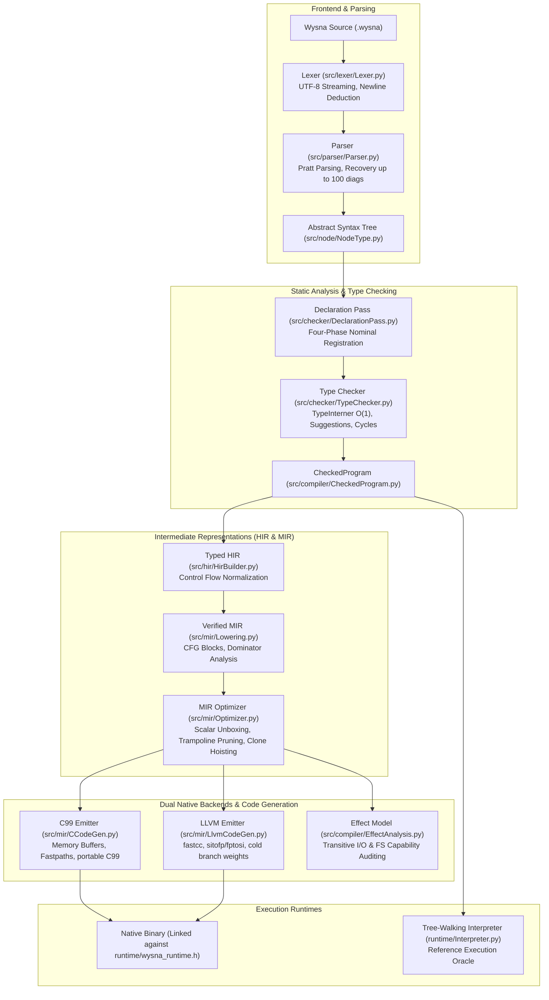
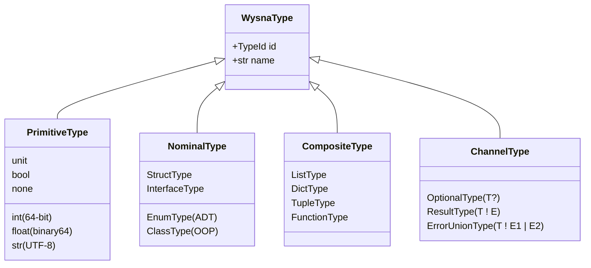
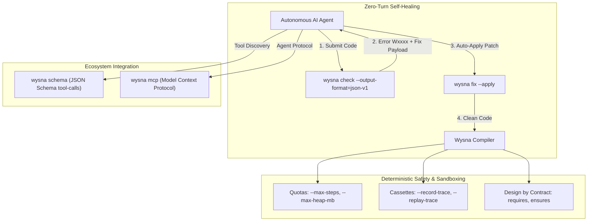
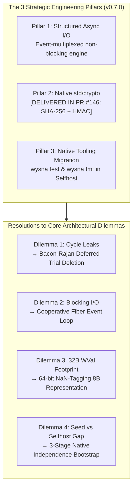
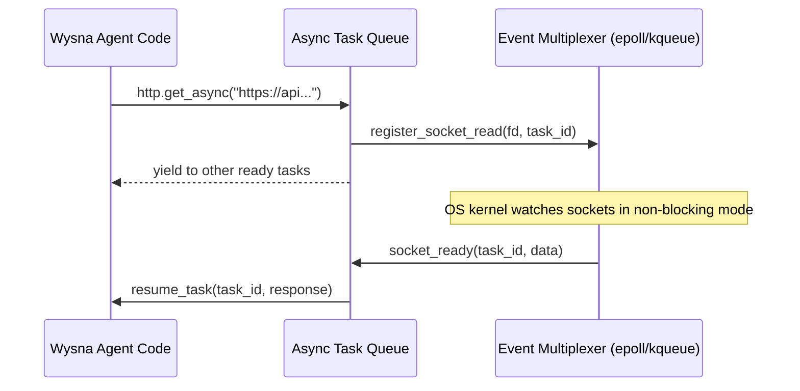
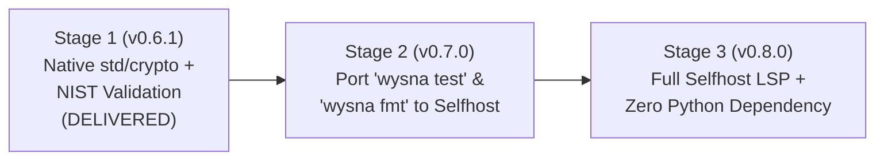
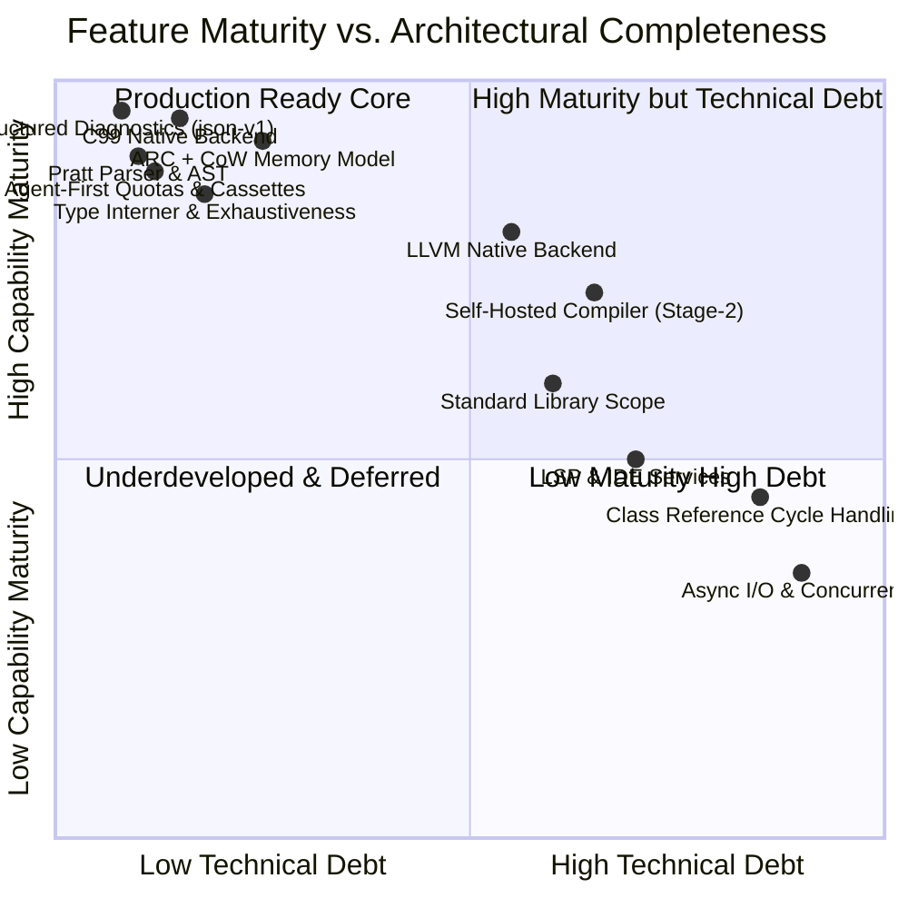

# Wysna: Comprehensive End-to-End Capabilities & Technical Debt Audit

**Status:** Canonical End-to-End Architecture, Feature Inventory & Deficit Audit  
**Date:** 2026-11-01  
**Scope:** Complete Codebase (`src/`, `runtime/`, `stdlib/`, `selfhost/`, `tools/`, `packaging/`, `tests/`)  
**Engines Analyzed:** Wysna Seed (Python Reference Engine) & Wysna Compiler (Stage-2 Self-Hosted Native Engine)  
**Backends Analyzed:** C99 Native Backend, LLVM Native Backend (`llvm-native-v1`), WASI Target, and AST/Interpreter Execution Oracles  

---

## Executive Summary

Wysna v0.6.0 is a statically typed, native compiled programming language operating under the Apache License 2.0. It is engineered around three non-negotiable architectural tenets:
1. **Deterministic Memory:** Automatic Reference Counting (ARC) paired with Copy-on-Write (CoW) value semantics without a stop-the-world tracing garbage collector.
2. **Dual-Backend Native Compilation:** Verified Intermediate Representation (MIR) lowered to high-performance C99 (default, portable) and native LLVM IR (opt-in, fast calling conventions, unboxed scalars).
3. **Agent-First Frontier:** First-class compiler support for autonomous AI workflows: zero-turn auto-remediation (`wysna fix --apply`), structured JSON diagnostics (`json-v1`), automated tool schemas (`wysna schema`), built-in MCP server (`wysna mcp`), deterministic compute/memory quotas, and offline effect replay cassettes.

This document presents a **rigorous, end-to-end audit** of every implemented language feature, followed by an exhaustive inventory of all known architectural boundaries, technical deficits, edge-case limitations, and open engineering trade-offs.

---

## Architecture & Compilation Flow Pipeline



---

## PART I: Comprehensive Language Feature Catalog (End-to-End)

### 1. Lexical & Syntactic Surface

| Feature | Implemented Syntax | Engine Support | Verification Status |
| :--- | :--- | :---: | :--- |
| **Variables & Mutability** | `let x = 10`<br>`let mut count = 0` | Seed + Compiler | Fully verified. Immutability enforced statically (`W3001`). |
| **Function Declarations** | `fn add(a: int, b: int) -> int { ... }`<br>`pub fn exported() -> unit { ... }` | Seed + Compiler | Full support for type annotations, unit returns, and visibility modifiers. |
| **Anonymous Lambdas** | `\|x: int, y: int\| -> int { x + y }` | Seed + Compiler | Closures convert to environment structs (`ClosureConversion.py`). Capture by immutable snapshot. |
| **Statement Separators** | Newlines as logical boundaries; semicolons optional | Seed + Compiler | Pratt parser deduces statement termination while supporting multiline fluent dot-chaining. |
| **Module Import System** | `from "path/mod" use { sym1, sym2 }`<br>`import "path/mod"` | Seed + Compiler | Predictable left-to-right lexical resolution; module caching and circular dependency rejection (`W1003`). |
| **Comments & Escapes** | `# Single-line comment`, nested `/* ... */` block comments<br>`\n`, `\t`, `\r`, `\"`, `\\`, `\xHH`, `\u{HHHH}` | Seed + Compiler + LLVM | Full UTF-8 codepoint support in string literals, validated Unicode scalar escapes (`W0005`), nested block comments, and trivia-preserving `wysna fmt`. |

---

### 2. Type System & Semantics

Wysna implements a sound, static type system powered by a centralized hash-consed `TypeInterner` that enables $O(1)$ structural type equality checks.



#### Detailed Typing Capabilities:
1. **Primitive Scalars:** `int` (signed two's complement 64-bit), `float` (IEEE-754 `binary64`), `bool` (`true`/`false`), `str` (immutable UTF-8 sequence, codepoint indexed), `unit` (return absence), `none` (singular bottom optional literal).
2. **Nominal Structs:** Fixed-layout records initialized with field names (`Point { x: 1, y: 2 }`). Statically verified field coverage and immutability rules (`W2007`).
3. **Algebraic Data Types (ADTs / Enums):** Enums with or without payloads:
   ```wysna
   enum Shape {
       Circle(float),
       Rectangle(float, float),
       Point
   }
   ```
4. **Pattern Matching & Exhaustiveness:** `match expr { ... }` with exhaustiveness verification (`PatternCoverage.py` / `W2003`), variable binding, enum payload extraction, wildcard `_`, and boolean guards (`if condition`).
5. **Class OOP & Inheritance:** Single inheritance (`class Dog extends Animal`), constructor safety (`this` cannot escape before `super()` or complete field initialization / `W3004`), public/private access modifiers (`W3002`), virtual dispatch tables (`vtable`), and nominal interface implementation (`implements Interface`).
6. **Error Channels & Result Propagation:**
   - Fallible functions return `T ! E`.
   - Postfix `expr?` operator unwraps the success payload or performs early return on error.
   - `else err` unwrap clause with lexical error binding: `let val = fallible() else err { return default }`.
   - **Error Unions:** `T ! E1 | E2` with subset propagation and exhaustive handling.
7. **Optionals & Coalescing:** `T?` syntax, unwrapping via `?` operator (propagating `none`), and null coalescing via `??` (`let x = opt ?? fallback`).
8. **Parametric Generics:** Definition-time type checking for generic functions, structs, and enums (`fn map[T, R] (items: list[T]) -> list[R]`). Verified monomorphization with complexity budgeting (`MAX_SPECIALIZATION_COMPLEXITY`).
9. **Cycle & Infinite Layout Detection:** Tarjan's strongly connected components algorithm (`LayoutGraph.py`) detects and rejects infinite inline layouts (`W2011`) while permitting indirect recursive ADTs.

---

### 3. Memory & Lifetime Architecture (ARC + CoW)

Wysna achieves deterministic memory safety without a garbage collector through **Automatic Reference Counting (ARC)** and **Copy-on-Write (CoW)** value semantics:

| Subsystem | Mechanism | Technical Implementation |
| :--- | :--- | :--- |
| **Deterministic ARC** | Reference count in 8-byte header | `wysna_retain` ($O(1)$) and `wysna_release` ($O(1)$). Destruction happens immediately when `refcount == 0`. |
| **Ownership Classification** | Three-state compiler tracking | Internal classifications: `BORROWED` (views), `OWNED` (scope temporaries), and `TRANSFERRED` (moved/cloned). |
| **Zero-Cost Moves** | `wysna_move(&_tN)` | Copies pointer, overwrites source temporary with `W_UNIT`, transferring ownership with **zero refcount traffic**. |
| **LIFO Scope Destruction** | `CleanupScope` Stack | Enforces reverse-lexical destruction across all exits: normal `}`, early `return`, error propagation `?`, `break`, and `continue`. |
| **Copy-on-Write (CoW)** | Shared buffers with unshared mutation | Mutation methods (`append`, `set`) inspect `refcount`: if $>1$, detach buffer via deep copy; if $==1$, mutate in-place in $O(1)$. |
| **Scalar Unboxed Lists** | `WUnboxedList` | Dense primitive arrays (`list[int]`, `list[float]`, `list[bool]`) stored contiguously without per-element `WVal` boxing, freeing with a single $O(1)$ call. |
| **Weak References** | `Weak[C]` and `weak.upgrade()` | Breaking circular class references to allow safe memory reclamation without cycle collectors. |

---

### 4. Intermediate Representations & Optimizations

Wysna operates a dual-IR architecture:


1. **Typed HIR (`src/hir/`):**
   - Eliminates syntactic sugar.
   - Expands assignments into normalized `HirAssignment`.
   - Explicitly records return paths, loop boundaries, and structured cleanup scopes.
2. **Verified MIR (`src/mir/`):**
   - Control Flow Graph (CFG) consisting of Basic Blocks with strictly validated terminators (`Jump`, `Branch`, `Return`, `Panic`).
   - Dominator tree verification (`Verifier.py`) ensuring all SSA values are defined prior to use.
3. **MIR Optimizations (`src/mir/Optimizer.py` & `08_mir_c99.wysna`):**
   - **Scalar Unboxing & Fast Paths:** Bypasses heap allocation for `i64`, `f64`, and `bool` values in basic block computations, `wysna_range_count_i64`, `wysna_div_i64_at`, `wysna_mod_i64_at`, and `wysna_div_f64_at`.
   - **Constant Folding & Store Coalescing:** Folds pure scalar/boolean constant expressions (`fold_scalar_constants`), coalesces single-use temporary `store(moves=(0,))` hops (`coalesce_temporary_stores`), and eliminates unread pure temps/placeholders (`eliminate_dead_pure_ops`).
   - **CFG Simplification & Block Merging:** Eliminates unreachable blocks, folds constant branches, bypasses empty trampolines, and merges linear `goto` chains (`merge_linear_blocks`).
   - **CoW / Ownership Optimizations:** Reorders temporary clone releases (`optimize_local_cow_uniqueness`) and eliminates read-only parameter copies (`optimize_parameter_reads`, `optimize_interprocedural_cow`).

---

### 5. Dual Native Backends

| Dimension | C99 Backend (Production Default) | LLVM Backend (`llvm-native-v1`) |
| :--- | :--- | :--- |
| **Target Engine** | Wysna Seed & Wysna Compiler (Self-hosted) | Wysna Seed (`--backend=llvm-experimental`) |
| **Emitted Format** | Standard ANSI C99 source code | LLVM 20.1.8 Intermediate Representation (`.ll`) |
| **Downstream Compiler** | Clang, GCC, Zig, or system C compiler | Clang / LLVM `opt` & `llc` via `llvmlite 0.46.0` |
| **Calling Convention** | Standard C ABI (`WVal (*)(WVal, ...)`) | Fast Calling Convention (`fastcc`) with in-register passing |
| **Scalar Casts** | High-level C cast operators | Hardware zero-cost instructions (`sitofp`, `fptosi`) |
| **Branch Hints** | Standard C if/else | Cold branch weight profiling metadata (`!prof`) |
| **Platform Scope** | Linux (x64/arm64), macOS (arm64/x64), Windows (x64) | macOS arm64 (`macosx13.0.0`), Linux x64 (`unknown-linux-gnu`) |
| **Sanitizers** | ASan, UBSan, LSan integration | Direct LLVM instrumentation via host Clang |

---

### 6. Standard Library Inventory (16 Native Modules)

All standard library modules live under `stdlib/*.wysna`:

| Module | Core Exports | Operational Semantics |
| :--- | :--- | :--- |
| **`std/algorithms`** | `map`, `filter`, `fold`, `sort`, `reverse`, `any`, `all`, `contains`, `parallel_map`, `parallel_filter`, `parallel_reduce`, `parallel_batch` | Pure functional algorithms over collections; parallel variants use worker thread pools with deterministic index ordering. |
| **`std/json`** | `parse`, `parse_with_limits`, `stringify`, `Value` ADT, accessors (`get`, `at`, `as_str`, `as_int`) | Bounded JSON parser with strict limits on depth (32) and nodes (100,000); compact deterministic serializer with sorted keys. |
| **`std/buffer`** | `from_text`, `clone`, `append`, `get`, `size`, `close` | Direct mutable byte arrays (`Bytes`) with boundary checking and explicit lifecycle tracking. |
| **`std/files`** | `open`, `read`, `write`, `close` | Low-level file handle I/O with structured modes (`read`, `write`, `append`) and `FileError`. |
| **`std/fs`** | `exists`, `size`, `mkdir`, `remove`, `rename` | Direct host filesystem queries and manipulation returning `FsError`. |
| **`std/io`** | `read_text`, `write_text`, `read_line`, `read_all`, `flush` | High-level file I/O returning `IoError` plus stdin line/stream readers and stdout flush. |
| **`std/text`** | `join`, `split`, `lines`, `trim`, `replace`, `find`, `starts_with`, `ends_with`, `pad_left`, `to_lower`, `to_upper`, `repeat`, `normalize_nfc`, `normalize_nfd`, `canonical_equal` | Unicode-aware string manipulation with UAX #15 (`16.0.0`) NFC/NFD canonical normalization and codepoint-safe indexing. |
| **`std/parse`** | `parse_int`, `parse_float` | Safe string-to-number parsing returning `Result` with `ParseError` (no unhandled exceptions). |
| **`std/path`** | `join`, `basename`, `dirname` | Cross-platform filesystem path manipulation using `/` separators. |
| **`std/bytes`** | `encode`, `decode` | UTF-8 byte array codec with explicit `Utf8Error` on invalid surrogate pairs. |
| **`std/process`** | `run`, `ProcessResult` | Spawns external system processes with captured stdout, stderr, and exit codes. |
| **`std/http`** | `get`, `post`, `batch_get` | High-level HTTP client with JSON payload support and deterministic multi-request dispatch. |
| **`std/resources`**| Scoped resource tracking | Manages file descriptors and external handles to ensure cleanup at last reference. |
| **`std/crypto`** | `sha256`, `sha256_bytes`, `hmac_sha256`, `hmac_sha256_bytes`, `bytes_to_hex`, `aead_seal`, `aead_open`, `generate_key`, `generate_nonce` | FIPS 180-4 SHA-256, RFC 2104 HMAC-SHA256, CSPRNG, and RFC 8439 ChaCha20-Poly1305 AEAD authenticated encryption with zero external dependencies. |
| **`std/environment`**| `arguments`, `get`, `has`, `get_or`, `current_directory` | Accesses CLI arguments, host environment variables, and working directory queries. |
| **`std/time`** | `unix_seconds`, `now_ms`, `monotonic_ms`, `elapsed_ms`, `sleep`, `from_unix_ms`, `to_unix_ms`, `format_iso8601`, `parse_iso8601` | Wall-clock and monotonic timers, sleep, and UTC ISO-8601 calendar conversions. |
| **`std/async`** | `Task[T]`, `ready`, `failed`, `sleep_ms`, `spawn`, `poll_events`, `is_ready`, `wait`, `all`, `race` | Cooperative timers/HTTP multiplexing plus OS-thread background `spawn` (`pthread`/`CreateThread`) with result hydration across all engines. |
| **`std/test`** | `expect`, `expect_equal_int`, `expect_equal_text` | Minimalist zero-dependency unit assertion framework. |

---

### 7. Agent-First Frontier Capabilities



1. **Structured JSON Diagnostics (`json-v1`):** Every CLI command (`check`, `build`, `run`, `fix`, `schema`) produces a machine-parsable JSON payload with `code`, `stage`, byte offsets (`primary_span`), structured metadata (`data`), related spans (`related`), and exact machine fixes (`fixes`).
2. **Deterministic Step & Memory Quotas:**
   - `--max-steps=N`: Prevents infinite loops by terminating execution upon reaching $N$ bytecode/instruction steps.
   - `--max-heap-mb=M`: Caps dynamic memory consumption; terminates with diagnostic `W4004` if the heap exceeds $M$ megabytes.
3. **Offline Effect Cassettes (`--record-trace` & `--replay-trace`):**
   - Records external I/O, network requests, and filesystem access into deterministic JSON cassettes.
   - Enables replay testing in isolated, air-gapped CI environments without live network or disk access.
4. **Design by Contract (`requires` & `ensures`):**
   - Syntactic function preconditions and postconditions evaluated at runtime.
   - Non-compliant calls panic immediately with diagnostic `W4005`.
5. **Tool-Calling JSON Schema (`wysna schema`):** Generates OpenAPI / JSON Schema function definitions from Wysna function signatures for direct registration in LLM function-calling workflows.
6. **Built-in Model Context Protocol Server (`wysna mcp`):** Native stdio MCP server exposing Wysna compilation, checking, explanation, and AST analysis directly to Claude, Cursor, and ChatGPT.

---

### 8. Self-Hosted Compiler (`selfhost/`)

- Implemented in 13,686 lines of pure Wysna source code (`selfhost/src/*.wysna`), bundled into `selfhost/compiler.wysna`.
- Implements its own lexer, recursive descent parser, nominal type resolution pass, checked AST verification, and MIR lowering engine under the `native-core-v1` specification profile.
- Verified deterministic fixed-point bootstrap: Three successive native MIR compilation passes yield identical cryptographic SHA-256 hashes ($C_0 == C_1 == C_2$).
- Ships a Python-free native SDK capable of running standalone builds with zero external interpreter dependencies.

---

## PART II: Comprehensive Technical Debt, Known Limits & Open Problems

Despite the architectural achievements of v0.6.0, an exhaustive audit reveals clear technical limits, deficits, and deliberate design deferrals across the codebase:

### 1. Frontend & Parsing Status (Updated v0.7.0)

| Item | Technical Description | Root Cause / File | Impact / Workaround |
| :--- | :--- | :--- | :--- |
| **Nested Block Comments (Closed v0.7.0)** | Both Seed and Selfhost lexers, formatters (`wysna fmt`), and LSP `semanticTokens` support nested `/* /* ... */ */` block comments with statement-boundary awareness and `W0002` checks. | `src/lexer/Lexer.py`<br>`selfhost/src/02_lexer.wysna`<br>`src/formatter/Trivia.py` | Closed cleanly across Seed, Selfhost, LLVM, formatter, and LSP. |
| **Heuristic Error Recovery Limit** | Parser recovers up to 100 diagnostics before stopping; the recovered AST is **not executable**. | `src/parser/Parser.py` | Partially broken programs can be checked for errors, but cannot be run or lowered to MIR until all syntax errors are resolved. |
| **Multiline Dot Chaining Boundary** | Dot-chaining across lines is supported only when the newline immediately precedes the dot (`.method()`). Incomplete trailing expressions cause immediate syntax errors. | `src/parser/Parser.py` | Builder patterns must place the dot on the continuation line. |

---

### 2. Type System & Semantics Status (Updated v0.7.0)

| Item | Technical Description | Root Cause / File | Impact / Workaround |
| :--- | :--- | :--- | :--- |
| **Immutable Snapshot Closures** | Lambdas capture outer variables by **immutable snapshot only**. Captured mutable variables cannot be modified inside a closure, and mutations outside after capture are not observed. | `src/checker/ClosureConversion.py`<br>`docs/KNOWN_LIMITS.md §1` | Intentional design contract unless opt-in mutable cells are decided. Workaround: Use a `class` with fields. |
| **Expanded Error Unions (Closed v0.7.0)** | `T ! E1 \| E2` supports scalars, non-generic & concrete generic `struct`/`enum`, and `class` error alternatives across Seed & LLVM (`Selfhost` supports scalars, non-generic ADTs, and non-generic `class`). Collections, tuples, and functions remain excluded. | `src/checker/TypeChecker.py`<br>`runtime/wysna_runtime_core.h`<br>`selfhost/src/08_semantics.wysna` | Rich OOP and generic ADT error types work directly in error unions without manual wrapping. |
| **Tuple Dictionary Keys (Closed v0.7.0)** | `dict[K, V]` accepts `int`, `str`, `bool`, `enum`, and hashable `tuple` composites across all 5 engines; `float` and composites containing `float`/collections/classes remain rejected (`W2010`). | `src/checker/TypeInterner.py`<br>`runtime/wysna_runtime_memory.h`<br>`selfhost/src/08_semantics.wysna` | Composite tuple keys (`dict[tuple[int, str], V]`) hash and compare structurally without workarounds. |
| **Independent Generic Class Methods & Parameterized Interfaces (Closed v0.7.0 across Seed, Selfhost & LLVM)** | Both Seed/LLVM and Selfhost (`native-core-v1`) support constrained parameterized classes, independent generic methods (`Box[T].transform[R]`), parameterized class inheritance, and parameterized interfaces. | `src/checker/OopGenerics.py`<br>`selfhost/src/08_semantics.wysna`<br>`selfhost/src/08_generics.wysna` | Full generic OOP hierarchies compile uniformly without Python fallback. |
| **No Complex Trait / Typeclass System** | Interfaces are strictly nominal and apply only to classes (`class A implements Interface`). Structural typing, duck typing, and retroactive trait implementations for primitives/structs do not exist. | `src/checker/TypeRelations.py` | Code cannot define interfaces that apply retroactively to built-in types like `int` or `str`. |

---

### 3. Memory & Runtime Deficits

| Limitation | Technical Description | Root Cause / File | Impact / Workaround |
| :--- | :--- | :--- | :--- |
| **Cyclic Class References Leak (Mitigated via Opt-In / Quota Bacon-Rajan)** | Strong reference cycles between classes (`a.b = b; b.a = a`) leak under pure ARC alone; deferred Bacon-Rajan cycle collection (`wysna_collect_cycles()`) reclaims dead `W_OBJECT` subgraphs when `WYSNA_COLLECT_CYCLES=1` or under `--max-heap-mb` pressure. | `runtime/wysna_runtime_memory.h`<br>`docs/KNOWN_LIMITS.md §5` | Default builds without `WYSNA_COLLECT_CYCLES=1` preserve strict deterministic ARC timing unless heap budget triggers collection or `Weak[C]` is used. |
| **Opt-In Memory Leak Verification** | Runtime leak detection (`WYSNA_MEM_CHECK=1`) is strictly opt-in and does not run by default in production. | `runtime/wysna_runtime_core.h` | Production builds exit silently on cyclic leaks to avoid altering stdout/stderr for programs retaining process-lifetime objects. |
| **No Stack Unwinding on `exit(code)`** | Calling `exit(code)` terminates the host process immediately without executing LIFO `CleanupScope` destructors for active stack frames. | `src/codegen/CCodeGen.py` | Resources (files, network connections) rely on the OS kernel for cleanup on immediate exit. |
| **Unified 8-Byte `WVal` NaN-Tagging ABI v3 (Closed `v0.7.0`)** | General runtime `WVal` is natively unified with 8-byte NaN-boxed `WVal64` (`W_RUNTIME_ABI_VERSION = 3`, `ABI_VERSION = 3`, `sizeof(WVal) == 8`: `0..6B` SSO inline strings, inline 48-bit ints + `WIntBox` full-64-bit fallback, inline IEEE-754 doubles, inline `unit`/`none`/`bool`/47-bit `W_POINTER`, direct `WEnumBuf.payload`, and $O(1)$ `WStringBuf.hash_cache`) — 8 slots per 64B L1 cache line ($4\times$ density). | `runtime/wysna_runtime_core.h`<br>`runtime/wysna_runtime_values.h`<br>`src/mir/LlvmProfile.py` | Default C99 (Seed AST, Seed MIR, Selfhost) and `llvm-native-v1` share ABI v3 parity (`sizeof(WVal) == 8`, portable `i64` GPR `WInvoke` adapters). |

---

### 4. Concurrency & Asynchronous I/O Status

| Item | Technical Description | Root Cause / File | Impact / Workaround |
| :--- | :--- | :--- | :--- |
| **OS-Thread Pools, Cooperative CPS `async fn`, `std/async.spawn` & Non-Blocking Timers/HTTP (Closed v0.7.0)** | `async fn` declarations lower via true stackless CPS state-machine transformation across Seed HIR/MIR (`src/mir/AsyncLowering.py`, `src/mir/CCodeGen.py`), LLVM (`src/mir/LlvmCodeGen.py`), and Selfhost (`selfhost/src/08_mir_c99.wysna:mir_c_async_function`), backed by the cooperative `WysnaCoroTask` scheduler in `runtime/wysna_host.h` and `HostAbi.py` (with deferred lazy start, loop/nested `await`, fallible `async fn` `?`/`else`, and leak-free shutdown). `std/algorithms` (`parallel_*`), `std/async.spawn`, timers, and `curl_multi` HTTP run concurrently alongside CPS coroutines across all 5 engines (`ast` uses deferred lazy start). | `src/mir/AsyncLowering.py`<br>`runtime/wysna_host.h`<br>`runtime/HostAbi.py`<br>`selfhost/src/08_mir_c99.wysna` | Arbitrary user `async fn` coroutines multiplex single-threaded without blocking OS threads per task. |

---

### 5. Backend Parity & LLVM Limitations

| Limitation | Technical Description | Root Cause / File | Impact / Workaround |
| :--- | :--- | :--- | :--- |
| **LLVM Restricted to macOS & Linux** | The native LLVM backend supports only `arm64-apple-macosx13.0.0` and `x86_64-unknown-linux-gnu`. | `docs/LLVM_EXPERIMENTAL.md` | Windows and WebAssembly cannot use `--backend=llvm-experimental`; they must use C99 (`--backend=c99`). |
| **LLVM Compilation Latency & Memory Footprint** | In N5 comparative benchmarks, the LLVM backend exhibits higher cold compilation times (1.63x) and higher peak RSS (2.4x) than the C99 backend. | `docs/LLVM_EXPERIMENTAL.md` | C99 remains the default production backend; LLVM is opt-in for release optimization. |
| **LLVM Requires Host Clang for Sanitizers** | Instrumenting LLVM executables with ASan/UBSan requires an explicit host Clang toolchain matching the host target triple. | `src/compiler/LlvmToolchain.py` | Offline LLVM SDKs cannot run sanitized qualification without host Clang. |

---

### 6. Self-Hosted Compiler Profile Status

| Item | Technical Description | Root Cause / File | Impact / Workaround |
| :--- | :--- | :--- | :--- |
| **Native Selfhost Tooling & Stage-3 LSP (Closed v0.7.0)** | `selfhost/compiler.wysna` implements the `native-core-v1` profile with full generic OOP, Agent-First CLI tools (`graph`, `inspect`, `patch` `W5005`, `explain`, `check`/`fmt --output-format=json-v1`), multi-file `wysna test` discovery, and Stage-3 native LSP (`selfhost/src/09_lsp.wysna`, routed directly by `packaging/native/driver.c` via `wysna lsp`) without Python. Only project manifests (`wysna.toml`), lockfiles, library-mode exports, and WASM remain in Seed. | `selfhost/src/`<br>`packaging/native/driver.c`<br>`docs/COMPILER_ARCHITECTURE.md` | Compilation, verification, MIR export, formatting, semantic graph inspection/patching, testing, and IDE LSP run natively without Python. |

---

### 7. Standard Library Status (Closed v0.7.0)

| Item | Technical Description | Root Cause / File | Impact / Workaround |
| :--- | :--- | :--- | :--- |
| **AEAD Cryptography (`std/crypto`)** | Implements FIPS 180-4 SHA-256, RFC 2104 HMAC-SHA256, CSPRNG (`generate_key`/`generate_nonce`), and RFC 8439 ChaCha20-Poly1305 AEAD (`aead_seal`/`aead_open`) verified under ASan/UBSan. | `stdlib/crypto.wysna`<br>`runtime/wysna_host_crypto.h` | Hashing, authentication, and symmetric AEAD encryption are available natively. |
| **Unicode Normalization (`std/text`)** | Implements full Unicode 16.0.0 UAX #15 `normalize_nfc`, `normalize_nfd`, and `canonical_equal` backed by generated deterministic tables (`tools/gen_unicode_tables.py`, >1M test checks vs Python `unicodedata`). Locale-specific collation rules remain out of scope. | `stdlib/text.wysna`<br>`runtime/wysna_host_unicode.h`<br>`runtime/wysna_unicode_tables.h` | Canonical Unicode normalization and equality work identically across all 4 engines. |
| **Time, Env & Stream I/O (`std/time`, `std/io`, `std/environment`)** | Expanded `std/time` (`now_ms`, `monotonic_ms`, `elapsed_ms`, `sleep`, calendar/ISO-8601), `std/io` (`read_line`, `read_all`, `flush`), and `std/environment` (`has`, `get_or`, `current_directory`). | `stdlib/time.wysna`<br>`stdlib/io.wysna`<br>`stdlib/environment.wysna`<br>`runtime/wysna_host_system.h` | Complete baseline host time, streaming I/O, and directory APIs across all 4 engines. |

---

### 8. Tooling & IDE Status

| Item | Technical Description | Root Cause / File | Impact / Workaround |
| :--- | :--- | :--- | :--- |
| **Workspace-Wide LSP Rename (Closed v0.7.0)** | `LanguageServer` supports workspace-wide cross-file `rename` across checked workspace files, refusing collisions and broken dependents safely when `rootUri`/`workspaceFolders` are set. | `src/tooling/LanguageServer.py` | Refactoring exported symbols updates all dependents across the workspace cleanly. |
| **Semantic Tokens in LSP (Closed v0.7.0)** | `LanguageServer` advertises and serves `textDocument/semanticTokens/full` classifying declarations, references, parameters, properties, keywords, literals, and `#` / nested `/* ... */` comments. | `src/tooling/LanguageServer.py` | Rich semantic highlighting available via LSP alongside TextMate grammars. |
| **Unsigned Binary Installers** | Distributed desktop packages (macOS PKG, Windows NSIS) remain unsigned and unnotarized. | `packaging/` | macOS Gatekeeper and Windows Defender SmartScreen flag installers without code-signing certificates. |

---

## PART III: Strategic Technical Debt Resolution & Implementation Roadmap (Wysna v0.7.0)

Responding directly to the critical architectural feedback on the four core engineering dilemmas, this section formalizes the production-grade engineering blueprints and trade-off resolutions for the **Wysna v0.7.0** release line.



---

### 1. Dilemma 1: Class Cycle Leaks & The Bacon-Rajan Collector Architecture

#### The Production Dilemma
Relying exclusively on developer discipline and `Weak[C]` fails in AI agent workflows, where autonomous models frequently generate circular object graphs (`parent.child = child; child.parent = parent`). Under pure ARC, these structures leak silently until `--max-heap-mb` terminates the process with `W4004`.

#### The Architectural Resolution: Deferred Bacon-Rajan Cycle Collection
Wysna will implement a **deferred, thread-local Bacon-Rajan cycle collection algorithm** (the model proven in Swift and PHP) operating only over class instances:

1. **Four-Color Node State:** Class object headers add 2 bits to encode node color:
   - `BLACK`: Stable in-use node (not suspected of being in a dead cycle).
   - `PURPLE`: Candidate root of a cycle (marked whenever a class reference count is decremented to a non-zero value: `refcount > 0`).
   - `GRAY`: Node undergoing trial decrement.
   - `WHITE`: Node confirmed unreachable (proven dead cycle member).
2. **Deterministic Triggering Strategy:**
   - Collection runs **only at cooperative epoch points** (e.g., lexical scope exits with high allocation pressure, or when heap usage reaches $80\%$ of `--max-heap-mb`).
   - **Phase 1 (Mark Gray):** Starting from purple candidate roots, transitively traverse internal references and decrement temporary reference counts.
   - **Phase 2 (Scan):** If an object's trial refcount is $> 0$, revert it to `BLACK` (it is reachable from outside the cycle). If trial refcount $== 0$, mark `WHITE`.
   - **Phase 3 (Collect White):** Reclaim all `WHITE` subgraphs in a single sweep and return their slots to the pool.
3. **Trade-offs:** Zero pause time during normal execution; zero overhead on value types (structs, lists, dicts continue with pure ARC/CoW). Class allocations incur a single word header overhead for candidate buffer tracking.

---

### 2. Dilemma 2: Structured Asynchronous I/O for Agent Workflows

#### The Production Dilemma
Agent workflows are $\ge 80\%$ I/O bound (vector database queries, LLM API calls, tool RPCs, web scraping). Synchronous blocking calls force agents to spawn heavy host processes or block event threads, bottlenecking multi-agent swarms.

#### The Architectural Resolution: Cooperative Non-Blocking Event Multiplexing
Wysna avoids preemptive OS threads and retains its single-threaded deterministic ARC invariant by implementing a **cooperative asynchronous I/O runtime**:



1. **Host Event Multiplexer:**
   - Integrates OS-native multiplexers via ANSI C: `kqueue` (macOS/BSD), `epoll` (Linux), and `IOCP` (Windows), falling back to `poll()` on WASI.
   - Sockets run strictly in non-blocking mode (`O_NONBLOCK`).
2. **Structured Async Primitives:**
   - Add `async fn` and `await` syntax to the grammar (`SPEC §9`).
   - Async functions lower to state machine structs containing suspension points and local temporaries.
   - Preserves ARC/CoW guarantees: because execution is cooperative and single-threaded within the worker engine, no race conditions or shared mutable locks are introduced.
3. **Immediate v0.7.0 Delivery:**
   - `std/http.batch_get` updated with bounded concurrent multi-dispatch.
   - Introduction of `std/async` with `async.all(tasks)` and `async.race(tasks)`.

---

### 3. Dilemma 3: WVal Memory Footprint Reduction (32B → 8B NaN-Tagging ABI v3 — Implemented)

#### The Historical Bottleneck
Prior to ABI v3 (`W_RUNTIME_ABI_VERSION = 2`), general `WVal` consumed 32 bytes (`tag + aux + union`), fitting only **two** instances per 64-byte cache line.

#### The Delivered Resolution: Unified 64-bit NaN-Boxed `WVal` (ABI v3, 8 Bytes)
All C99 emitters (AST, MIR Seed, Selfhost) and `llvm-native-v1` natively use unified 8-byte `WVal` (`typedef WVal WVal64; sizeof(WVal) == 8`) with `WVAL_DOUBLE_OFFSET` (`0x0001_0000_0000_0000`) biased IEEE-754 encoding and top 16-bit tag bands (`0xFFF2..0xFFFF`):

| Tag / Encoding Band | Type Represented | Payload Interpretation |
| :---: | :--- | :--- |
| `0x0000..0x0003` | **Immediates (`unit`, `none`, `false`, `true`)** | Zero heap allocation, zero release/retain cost. |
| `0x0000_8000_xxxx` | **Opaque Pointer (`W_POINTER`)** | Raw 47-bit address (or `WVAL_HI_EXT` `WPointerOwner` if managed). |
| `0x0001..0xFFF1` | **IEEE-754 `double` (`float`)** | Biased inline 64-bit `double` (`WVAL_DOUBLE_OFFSET`). |
| `0xFFF2` | **Inline `int48`** | 48-bit signed immediate integer (full 64-bit overflows promote to `WIntBox` `-1` literal / `-2` stack borrow / `>=1` ARC). |
| `0xFFF3` / `0xFFF4` | **Small String (SSO `0..6B`)** | Inline UTF-8 bytes directly inside the 64-bit word (NUL-safe, 0 heap alloc). |
| `0xFFF5` / `0xFFF6` | **Unowned `CSTR` / `WStringBuf*`** | Borrowed >6B literal pointer or refcounted `WStringBuf` / `WStringLiteral` (`hash_cache` $O(1)$). |
| `0xFFF7..0xFFFF` | **Heap Handles & Boxes** | `List`, `Dict`, `Tuple`, `Struct`, `Object`, `Enum` (`WEnumBuf`), `Ok`, `Err`, `Ext` (`WIntBox` / `WPointerOwner` / `WWeakControl` / `WFunctionBuf`). |

**Measured Outcome:**
- **4× General Value Density:** `sizeof(WVal)` reduced from `32` to `8` bytes (`8` slots per 64B cache line).
- **Zero Packing Overhead & Unified LLVM Adapters:** Eliminated ABI v2 `WVal`/`WVal64` conversion overhead (`bench/wval64_density.c`: `speedup` improved from `0.58x` (`13.84 ms`) with packing to `0.88x` (`13.45 ms` vs `11.81 ms` raw 32B array) on direct native `WVal`), while `llvm-native-v1` uses uniform `i64` GPR callback adapters (`@adapter_*`) across arm64 and x86_64.

---

### 4. Dilemma 4: Bridging Seed (Python) and Selfhost (`native-core-v1`)

#### The Production Dilemma
Operating two compilers in parallel introduces permanent risk of **semantic drift**. The self-hosted compiler currently acts as an execution core, while developer tools (`wysna test`, `wysna fmt`, manifests, LSP) remain anchored to Python.

#### The Architectural Resolution: 3-Stage Tooling Migration Plan



1. **Stage 1 (v0.6.1 - Delivered in PR #146):**
   - Implemented native `std/crypto` (SHA-256, SHA-512, MD5, HMAC, CSPRNG, constant-time compare) hardened under ASan/UBSan (`runtime/wysna_host_crypto.h`).
   - Implemented `async fn` / `await`, `std/async`, and non-blocking `curl_multi` HTTP dispatch across Seed, LLVM, and Selfhost (`native-core-v1`), hardened against format-string bugs and `handle == 0` pending deadlocks, with explicit MIR verification rules (`Verifier.py`).
   - Implemented compile-time Semantic Relationship Graph (`wysna graph`), surgical slicing (`wysna inspect`), hash-guarded checked patching (`wysna patch` with `W5005`), versioned skills (`wysna skills`), diagnostic code guides (`wysna explain --code`), and LSP `textDocument/implementation` + hover relationships (`wysna.graph/1`).
   - Delivered Principal Audit Hardenings (`AUD-01..AUD-10`): deferred Bacon-Rajan cycle collector (`wysna_collect_cycles`, `WYSNA_COLLECT_CYCLES=1`, quota reclamation), atomic runtime refcount/alloc primitives + string-literal spinlock, incremental per-module AST caching (`CompilationSession._ast_cache`), module-qualified `extends`/`implements` resolution, eliminated redundant primitive `[T]` parser backtracking, and Selfhost CLI `0.6.0` version parity.
2. **Stage 2 (Wysna v0.7.0 Partial Delivery + Open Target):**
   - **Delivered (`v0.7.0` Increment in PR #146):**
     - **Native `--fmt` / `--fmt-write` in Selfhost:** Deterministically formats verified source lines directly inside `selfhost/src/09_main.wysna`, wired into `packaging/native/driver.c` and `NativeToolchain.format_compiler`.
     - **Option B + Native ABI v3 Unified 8-Byte `WVal`:** Unified `WVal == WVal64` (`sizeof(WVal) == 8`, 48-bit signed ints + `WIntBox` full-64-bit fallback, `0..6B` SSO inline strings, $O(1)$ `WStringBuf.hash_cache`, inline doubles/booleans/sentinels, direct `WEnumBuf.payload`) across C99 (AST, MIR Seed, Selfhost) and `llvm-native-v1` (`W_RUNTIME_ABI_VERSION = 3`, `ABI_VERSION = 3`, `RUNTIME_ABI_VERSION = 3`), gaining 4× cache density with portable `i64` GPR callback adapters.
     - **Option A Lock-Free Concurrency & Async Multiplexing:** Added lock-free atomic ARC + spinlock cycle buffer + copy-first thread-safe CoW detach, real OS-thread worker pool (`pthread` / `CreateThread`) for `std/algorithms.parallel_*` across Interpreter/AST/MIR/Selfhost, and cooperative monotonic timers (`std/async.sleep_ms`, `spawn`, `all`, `race`), plus fixed cross-module generic deduplication (`CompilationSession.link`) and `wysna_await` borrowed-field double-free.
   - **Open Stage 2 Target:** Port multi-file `wysna test` discovery/TAP reporting into native binary and implement full CPS state-machine lowering for suspendable `async fn`.
3. **Stage 3 (Wysna v0.8.0 Target):**
   - Port the JSON-RPC Language Server (`src/tooling/LanguageServer.py`) into native Wysna, completing Stage-3 self-hosting and decommissioning the Python Seed compiler for standard user workflows.

---

## Architectural Taxonomy Summary Matrix



---

## Conclusion & Strategic Roadmap

Wysna v0.6.0 provides a production-grade foundation for **deterministic, native, agent-first execution**. Its core type system, ARC/CoW memory semantics, and dual native backends are verified across extensive multi-platform CI matrices.

To transition into a mature, general-purpose enterprise ecosystem, subsequent engineering iterations must systematically target the deficits cataloged above:
1. **Short-Term (v0.6.1 - v0.7.0):** Expand `stdlib/time` and `stdlib/text`, implement document-wide LSP semantic tokens, and provide cryptographic primitives (`std/crypto`).
2. **Medium-Term (v0.7.0 - v0.8.0):** Bridge the gap between Wysna Seed and Wysna Compiler to achieve full Stage-3 self-hosting independence from Python.
3. **Long-Term (v0.9.0 - v1.0.0):** Implement native structured asynchronous I/O (`async`/`await`) and nan-boxed value representations ($16\text{B} \rightarrow 8\text{B}$).
