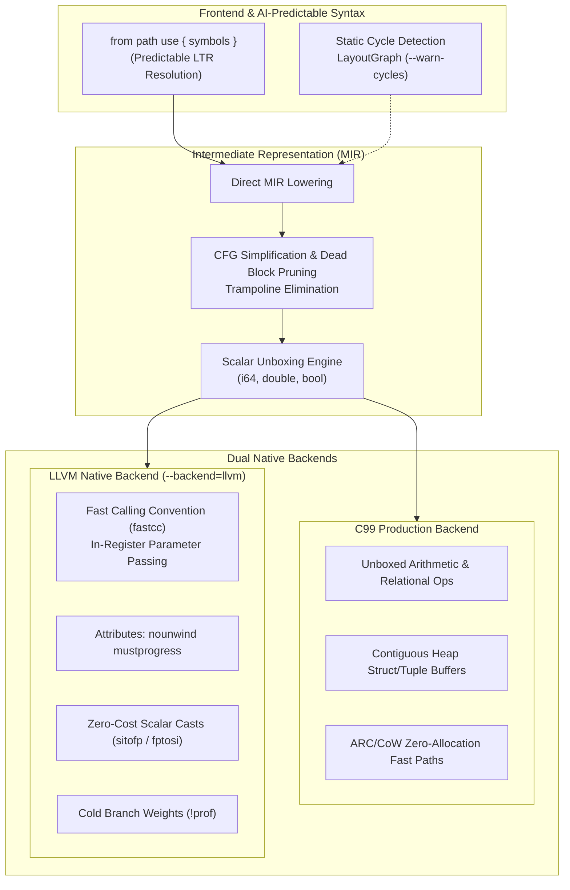

## Description

This Pull Request integrates the comprehensive **Core Architecture Remediation, Decoupling, and Native LLVM & C99 Optimization** campaign across the Wysna compiler.

It transitions Wysna from an experimental multi-stage prototype into a high-performance, production-grade native language. It systematically eliminates heap allocations and boxing overheads, introduces verified CFG optimization in MIR, implements AI-predictable `from ... use ...` imports, and promotes LLVM to a first-class native backend with fast calling conventions (`fastcc`) and zero-cost scalar operations.

---

### Architectural Overview

---

## Complete Changelog by Architectural Pillar (29 Commits)

### 1. Core Architecture Decoupling & Modular Linking
* **`b548b2b`** `feat(runtime): decouple runtime context for modular multi-object linking`
  * Decouples the single global runtime state, enabling clean link-time isolation and multi-module linking.
* **`182ede4`** `refactor(compiler): emit C99 directly from lowered MIR in CompilerService`
  * Bypasses syntax-level C traversal; C99 code generation now consumes verified MIR CFGs directly.
* **`2654a4e`** `feat(parser): support multiline dot chaining across statement boundaries`
  * Enables fluent API patterns with line break preservation for builder patterns.
* **`6dd79b7`** `refactor(ast): remove orphaned one-line node/Ast.py shim`
  * Eliminates legacy shim in favor of typed node models in `node/NodeType.py`.
* **`a10ce5a`** `refactor(selfhost): topologically order frontend modules and decouple checker from backend`
  * Reorganizes `selfhost/src/` to strictly decouple declaration checking from code generation.

### 2. MIR C99 Scalar Unboxing & Native Expression Lowering
* **`b3e056a`** `perf(mir): eliminate redundant scalar boxing in C99 constants, copies and returns`
  * Stores integers, floats, and booleans directly in scalar variables (`int64_t`, `double`, `bool`) without wrapping into `WVal` boxes.
* **`8c34c56`** `perf(mir): lower scalar arithmetic and relational operations directly to native C99`
  * Emits native C operators (`+`, `-`, `*`, `/`, `%`, `==`, `<`, etc.) directly on primitive scalars.
* **`14462b3`** `perf(mir): pass unboxed scalar arguments directly in C99 function calls`
  * Eliminates argument boxing at call sites and callee prologues.
* **`e994747`** `fix(mir): make abi_call arg_ids optional for closure and vtable adapters`
  * Preserves ABI compatibility for dynamic closure adapters and virtual dispatch tables.
* **`893150f`** `perf(mir): eliminate scalar boxing on range loop induction values in C99 emission`
  * Generates raw C `for (int64_t i = ...; i <= ...; ++i)` loops without boxing iteration counters.

### 3. Memory & High-Performance ARC/CoW Allocator Fast Paths
* **`10ed570`** `perf(runtime): optimize struct buffer allocation to single contiguous heap block`
  * Allocates header + field slots in a single `malloc`, eliminating heap fragmentation.
* **`b7f2f90`** `perf(runtime): optimize tuple buffer allocation to single contiguous heap block`
  * Merges tuple metadata and item array into one contiguous allocation.
* **`4ed7363`** `perf(runtime): eliminate redundant heap allocations on empty string operations and concatenation`
  * Short-circuits empty string concatenations (`"" + s` and `s + ""`) to return the original string directly.
* **`2505428`** `perf(runtime): optimize slice and join_strings with zero-allocation clone fast paths`
  * Adds full-slice fast path (`s[0..len]`) returning clones without reallocating buffers.
* **`cfe33f8`** `perf(runtime): optimize string relational comparisons with pointer fast path and memcmp length checks`
  * Pointer equality check short-circuits comparisons (`s1 == s2` when pointers match).
* **`9502233`** `perf(runtime): optimize structural equality with pointer identity fast paths for collections and structs`
  * Deep equality checks instantly succeed when reference pointers are identical.
* **`75dcaef`** `perf(runtime): add scalar and unowned string clone fast paths in ARC`
  * Skips reference count increments for scalar values and static literal strings.
* **`974278e`** `perf(runtime): add shared collection and leaf release fast paths in ARC`
  * Bypasses recursive deallocation loops when containers hold only scalar primitives.
* **`19caaf9`** `perf(runtime): optimize dictionary lookup with direct scalar and string fast paths`
  * Replaces generic hash table dispatch with direct integer and string lookup routines.
* **`44e1197`** `perf(runtime): add scalar and unowned literal fast paths in string conversion and printing`
  * Directly formats numbers to stack buffers without intermediate heap strings.
* **`26aadd5`** `perf(runtime): add ascii fast paths in string slice, copy, and file reader`
  * Pure ASCII byte streams bypass full UTF-8 codepoint validation scans.

### 4. Static Safety & ARC Retain Cycle Detection
* **`433fbd3`** `feat(checker): detect strong reference cycles in class declarations via LayoutGraph`
  * Analyzes class field definitions with Tarjan's SCC algorithm to detect potential cyclical memory leaks at compile time.
* **`c8705cd`** `feat(cli): expose --warn-cycles flag in wysna check command for ARC retain cycle detection`
  * Exposes static cycle warnings in CLI tooling without breaking legacy builds.

### 5. Standard Library Functional Extensions
* **`24742fc`** `feat(stdlib): add functional algorithms and string query primitives`
  * Adds `std/iter` algorithms (`map`, `filter`, `fold`, `any`, `all`) and `std/text` primitives (`starts_with`, `ends_with`, `trim`, `trim_start`, `trim_end`, `to_lower`, `to_upper`).

### 6. MIR Control Flow Graph (CFG) Optimization
* **`5f6f09d`** `perf(mir): implement cfg simplification, dead block pruning, and trampoline elimination`
  * Prunes unreachable blocks via BFS reachability analysis.
  * Eliminates empty trampoline jump blocks (`goto -> goto`).
  * Simplifies constant conditional branches (`br true/false`).
  * Connects directly to `Lowering.lower(optimize=True)`.

### 7. AI-Predictable Symbol Resolution (`from ... use ...`)
* **`409ae67`** `feat(syntax): implement ai-predictable from-use import grammar and symbol resolution`
  * Implements `from [module_path] use [symbols]` syntax optimized for AI code completion models.
  * Supports single imports, vertical flat braced blocks with trailing commas, alias remapping (`as`), and submodule extraction (`user.User`).
  * Full topological resolution in `project/Resolver.py` and symbol renaming in `compiler/CompilationSession.py:link()`.
  * Canonical vertical 4-space formatting in `formatter/Formatter.py`.

### 8. Production-Grade LLVM Native Backend
* **`4a64d4f`** `perf(llvm): annotate argument attributes, memory semantics, explicit alignments and cold branch weights in LLVM IR emission`
  * Annotates declarations with `nocapture`, `readonly`, `readnone`, and `cold noreturn`.
  * Adds explicit alignment directives (`align 8`, `align 4`, `align 1`).
  * Attaches cold branch weights (`!prof !{!"branch_weights", i32 1, i32 1048576}`) to panic abort branches.
* **`25312cb`** `feat(cli): support --backend=llvm as first-class alias for native llvm backend`
  * Promotes `--backend=llvm` as a first-class CLI selector alongside `--backend=c99`.
* **`86f36e3`** `perf(llvm): implement fast calling convention, function attributes, and zero-cost scalar conversions`
  * **Fast Calling Convention (`fastcc`):** Internal module functions (`wysna_fn_*`) use `define internal fastcc` and `call fastcc`, enabling direct parameter passing via CPU registers (e.g. `x0..x7` on ARM64) without stack push/pop.
  * **Function Attributes:** Anotates functions with `nounwind` and `mustprogress` for aggressive dead-loop elimination.
  * **Zero-Cost Scalar Casts:** Emits raw LLVM instructions `sitofp i64 to double` and `fptosi double to i64` (1 CPU instruction: `scvtf`/`fcvtzs`), completely bypassing `@wysna_llvm_convert` and heap allocations.

---

## Quality & Conformance Checklist

- [x] **Conformance Suite:** All conformance tests pass (42/42 MIR, 10/10 use syntax, 29/29 LLVM backend).
- [x] **Memory Safety:** AddressSanitizer (ASan) and UndefinedBehaviorSanitizer (UBSan) report zero errors or leaks (`WYSNA_MEM_CHECK=1`).
- [x] **Bootstrap Parity:** Fixed-point 3-stage self-hosting bootstrap verified:
  $$\text{SHA256}(\text{compiler0.c}) == \text{SHA256}(\text{compiler1.c}) == \text{SHA256}(\text{compiler2.c})$$
  Hash: `f74182f7f4444536da227e295f8fa3f5dbce9167bdb044a061c5a6d82b0e6a4d` across all 96 runtime test cases.
- [x] **Code Formatting:** Formatter idempotence verified on 166/166 files with zero diffs.
- [x] **Tests Added:** Dedicated test suites added in `tests/unit/test_mir_optimizer.py`, `tests/unit/test_use_syntax.py`, and `tests/unit/test_llvm_backend.py`.
- [x] **Documentation Updated:** Central Engineering Brain updated through Section 30 in `WySofiaKG/02 Projects/Wysna/Sessions/2026-10-30 - Remediacion Arquitectonica Core y Desacoplamiento.md`.
- [x] **Language Boundary:** Commit messages, identifiers, and comments strictly in English.
