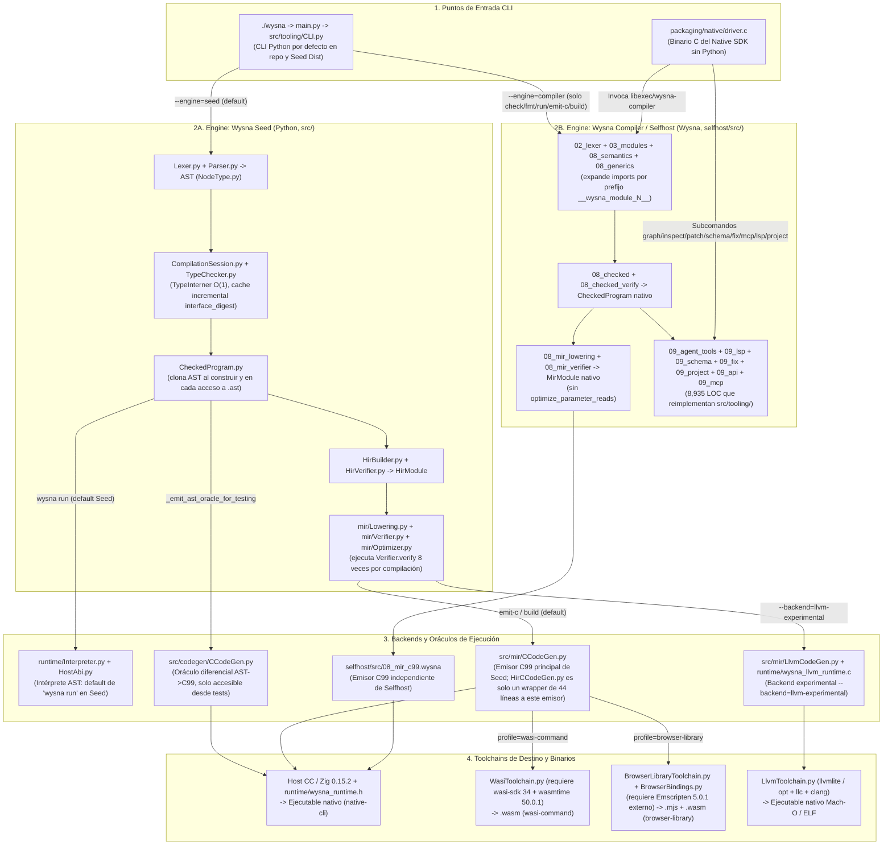

# 02 · Estado Real del Sistema (Reconocimiento Verificable)

> Auditoría histórica de la línea base `a2549fa`. Los problemas y mediciones describen ese snapshot; los estados de implementación y el ciclo vigente se consultan en [00-INDEX.md](00-INDEX.md) y [12-SIGUIENTE-CICLO-LENGUAJE.md](12-SIGUIENTE-CICLO-LENGUAJE.md).

## 1. Línea Base de Git y Entorno Verificado

| Propiedad | Valor verificado | Evidencia / Comando |
| :--- | :--- | :--- |
| **Repositorio** | `https://github.com/WashingtonYandun/Wysna` | `git remote -v` |
| **Rama base al iniciar** | `feat/language-ergonomics-and-tooling` (`2` commits delante de `main` `2c77631`) | `git status && git log -n 6 --oneline` |
| **Rama de trabajo creada** | `docs/evolution-plan` | `git checkout -b docs/evolution-plan` |
| **Commit HEAD** | `a2549fa01294b20f3b893542706015ffe00869f3` (`fix: retain nested match expressions in value position`) | `git rev-parse HEAD` |
| **Versión reportada por CLI** | `Wysna Language Compiler v0.8.0 (Wysna Seed + Wysna Compiler Self-Hosted C99)` | `./wysna --version` (`src/common/Version.py:1`) |
| **Estado del árbol al iniciar** | Sin cambios modificados en archivos trackeados; `1` archivo sin seguimiento en raíz (`NEXT_STEPTS_AF.md`, `90,457` bytes) | `git status` |
| **Entorno de ejecución** | macOS Darwin `25.6.0` `arm64`, Apple M3, `8 GB` RAM, Python `3.14.7`, Apple Clang `21.0.0 (clang-2100.4.1.1)` | [perf_measurements.json](evidence/perf_measurements.json) |
| **Toolchains opcionales en host** | Presentes: `/usr/bin/clang`, `/usr/local/bin/node`, `llvmlite 0.46.0` / LLVM `20.1.8`, `sqlite3`, `libcurl`. Ausentes en PATH del host: `emcc` (Emscripten), `wasm-ld` / `wasi-sdk`, `wasmtime`, `zig`. | [check_web_target.json](evidence/prog_c_wasm/check_web_target.json), [build_web.json](evidence/prog_c_wasm/build_web.json) |

---

## 2. Ejecución de la Suite de Pruebas (Línea Base)

| Comando ejecutado | Resultado | Tiempo | Qué probó / Qué no pudo correr y por qué | Evidencia |
| :--- | :---: | :---: | :--- | :--- |
| `./wysna test` (`make test` → `src/run_conformance.py:run_suite`) | **PASS (`843/843`, 100%)** | `~548 s` (`9m 08s`) | Lexer (`13` valid, `7` invalid), Parser (`21` valid, `9` invalid), Types (`15` valid, `62` invalid), Errors (`2/2`), Formatter idempotente (`185/185`), HIR lowering (`107/107`), Intérprete Seed (`99/99`), Seed AST C99 (`98/98`), Seed HIR/MIR C99 (`98/98`), Selfhost Bootstrap 3 etapas (`C0 == C1 == C2`) + Stage-2 C99 (`98/98`), Ejemplos E2E (`7/7`), y `22` suites unitarias/fuzz/benchmarks/fundaciones acopladas al final de `run_conformance.py`. | [wysna_test_baseline.txt](evidence/wysna_test_baseline.txt) |
| `python3 -m tests.unit.test_architecture_contract` | **PASS (`17/17` tests)** | `1.78 s` | Cobertura de políticas de nodos AST, despacho exacto, tablas inmutables, dirección de imports, independencia de oráculos, headers de runtime y rollback de genéricos. | [test_architecture_contract.txt](evidence/test_architecture_contract.txt) |
| `make selfhost` (`./wysna build --engine=compiler selfhost/compiler.wysna -o .wysna_cache/wysna_selfhost`) | **PASS** | `~21 s` | Compilación nativa del compilador autoalojado (`17,911` líneas, `34` módulos) a binario nativo Mach-O `arm64` (`3,451,856` bytes). | [repro_selfhost_fmt.txt](evidence/repro_selfhost_fmt.txt) |
| `python3 tools/validate_sqlite_import.py --rows 1000 --samples 3` | **PASS (`4/4` rutas + `14` casos de fallo)** | `~8.9 s` | Interoperabilidad C FFI + SQLite transaccional comparando C de referencia (`5.21 ms`), Seed AST C99 (`8.78 ms`), Seed MIR C99 (`6.50 ms`) y Selfhost Stage-2 C99 (`6.61 ms`), con `0` recursos vivos al salir. | [sqlite_ffi_perf.json](evidence/sqlite_ffi_perf.json) |
| `python3 tools/ci_conformance.py --matrix` | **STALE** | `0.8 s` | Detectó que `.wysna_cache/ci-artifacts/summary.json` está obsoleto frente al árbol actual porque `source_fingerprint()` incluye `.github/workflows/ci.yml`, `README.md` y `SPEC.md`, los cuales cambiaron tras el último `ci_conformance.py`. | [ci_conformance_matrix_check.txt](evidence/ci_conformance_matrix_check.txt) |
| `./wysna project build --manifest docs/evolution/evidence/prog_c_wasm/wysna.toml --target web` | **BLOQUEADO (`W5005`)** | `0.4 s` | `project check --target web` pasó (`status: "ok"`), pero `project build --target web` no pudo compilar `.wasm` porque `emcc` (Emscripten `5.0.1`) no está instalado en la máquina local ni empaquetado por Wysna. | [build_web.json](evidence/prog_c_wasm/build_web.json) |

---

## 3. Inventario del Árbol del Repositorio

Medido con el script reproducible registrado en [tree_inventory.txt](evidence/tree_inventory.txt) (excluyendo `__pycache__` y `.git`):

| Directorio | Archivos | Líneas totales | Composición real y observaciones clave |
| :--- | :---: | :---: | :--- |
| `src/` | 142 | 39,527 | Implementación Python (**Seed**): `checker/` (`24` archivos, `9,070` LOC), `tooling/` (`24` archivos, `7,876` LOC), `mir/` (`16` archivos, `4,788` LOC), `compiler/` (`18` archivos, `4,481` LOC), `hir/` (`7` archivos, `2,785` LOC), `codegen/` (`8` archivos, `1,908` LOC), `parser/` (`2` archivos, `1,628` LOC), `common/` (`18` archivos, `1,587` LOC), `node/` (`1,175` LOC), `lexer/` (`855` LOC), `formatter/` (`688` LOC), `project/` (`684` LOC), `run_conformance.py` (`684` LOC). Incluye además `src/wysna.egg-info` (`6` archivos generados en el árbol). |
| `selfhost/` | 35 | 35,822 | **`selfhost/src/` tiene `34` módulos (`17,911` LOC)** y **`selfhost/compiler.wysna` (`17,911` LOC)** es una copia concatenada exacta (`tools/bundle_selfhost.py`) versionada en Git. Del código real (`17,911` LOC), **`8,976` LOC (`50.1%`)** son el compilador (`01_ast`..`08_mir_c99`) y **`8,935` LOC (`49.9%`)** son reimplementaciones de herramientas (`09_agent_tools`, `09_lsp`, `09_project`, `09_schema`, `09_fix`, `09_api`, `09_mcp`, `09_main`). |
| `runtime/` | 35 | 18,124 | Mezcla dos mundos en un mismo directorio: **1)** Runtime C99 y adaptadores de host (`13,517` LOC en `.h`/`.c`/`.def`, incluyendo `wysna_unicode_tables.h` con `3,974` LOC, `wysna_host.h` con `2,213` LOC y `wysna_runtime_memory.h` con `1,420` LOC); y **2)** El intérprete Python de referencia (`4,607` LOC en `.py`: `HostAbi.py` `1,487` LOC, `Interpreter.py` `866` LOC, `Values.py` `666` LOC, `ExpressionRules.py` `646` LOC, `Environment.py` `464` LOC). |
| `stdlib/` | 20 | 2,723 | `19` módulos `.wysna` (`json.wysna` `780` LOC, `http.wysna` `409` LOC, `crypto.wysna` `227` LOC, `time.wysna` `216` LOC, `text.wysna` `204` LOC, `algorithms.wysna` `192` LOC, `async.wysna` `192` LOC, más `12` módulos pequeños de `5` a `70` LOC) y `__init__.py` (`1` LOC). |
| `tests/` | 522 | 30,894 | `unit/` (`118` archivos Python, `25,101` LOC — muchos nombrados por hitos históricos como `test_c03_*`, `test_d01_*`, `test_phase1_*`, `test_phase4_*`), `runtime/` (`199` pares `.wysna`/`.expected`, `2,325` LOC), `types/` (`77` archivos, `590` LOC), `parser/` (`30` archivos), `lexer/` (`20` archivos), `regressions/` (`21` archivos), `fuzz/` (`5` archivos, `795` LOC), `differential/` (`7` archivos, `552` LOC). |
| `tools/` | 29 | 5,766 | Scripts de empaquetado (`package_native.py`, `package_distribution.py`, `package_installers.py`, `package_llvm_sdk.py`), validación de instaladores/SDKs/FFI y campañas (`ci_conformance.py`, `measure_service.py`, `benchmark_llvm.py`). |
| `bench/` | 30 | 6,175 | Microbenchmarks de runtime (`bench/*.wysna`, `run_bench.py`) y suite de evaluación con agentes (`bench/ai_eval/`: `harness.py`, `tasks.py`, `ab_cohort.py`, `impact_benchmark.py`, `token_audit.py`). |
| `docs/` | 22 (+ notas) | 3,932 | Documentación técnica de arquitectura, stdlib, límites, SDKs y notas de release (`docs/release-notes/`). |
| `examples/` | 63 | 3,358 | `7` ejemplos raíz (`01_hello_world`..`07_oop_polymorphism`), `http_json_client.wysna`, y subproyectos (`wysofia-ops/`, `shared-browser-app/`, `automation-sync/`, `automation/`, `service/`, `ffi/sqlite/`, `browser-library/`). |
| `packaging/` | 11 | 1,938 | Driver nativo en C (`packaging/native/driver.c`, `878` LOC + `platform.h`, `292` LOC) e instaladores para macOS (`pkg/`), Linux (`linux/`) y Windows (`windows/`). |
| `editors/` | 5 | 338 | Extensión VS Code (`editors/vscode-wysna/`: `extension.js`, `package.json`, TextMate grammar). |

---

## 4. Ruta Real `Archivo Fuente → Ejecución` Reconstruida desde el Código

Contrario a lo que sugieren los nombres históricos en tests y tablas (`Seed HIR C99`, `Compiler`, `LLVM`, `AST C99`), la inspección de [src/tooling/CLI.py](../../src/tooling/CLI.py), [src/tooling/SourceCommand.py](../../src/tooling/SourceCommand.py), [src/compiler/CompilerService.py](../../src/compiler/CompilerService.py), [src/hir/HirCCodeGen.py](../../src/hir/HirCCodeGen.py) y [packaging/native/driver.c](../../packaging/native/driver.c) demuestra la siguiente arquitectura real:

### Hallazgos arquitectónicos clave de la reconstrucción

1. **`HirCCodeGen` ya no es un generador de código:** [src/hir/HirCCodeGen.py](../../src/hir/HirCCodeGen.py#L13-L44) tiene solo 44 líneas; sus métodos `emit_expr` y `emit_stmt` lanzan `W9999` (*"Direct HIR emission is unsupported; lower a verified module to MIR"*) y `generate()` simplemente invoca `mir.Lowering` seguido de `mir.CCodeGen`. Por tanto, la columna `"Wysna Seed (HIR C99)"` en `docs/ENGINE_PARITY_MATRIX.md` y el paso 11 de `src/run_conformance.py` prueban exactamente `AST → HIR → MIR → C99`.
2. **`wysna run` hace dos cosas radicalmente distintas según `--engine`:**
   - Con `--engine=seed` (por defecto), `wysna run` **interpreta el AST en Python** (`src/runtime/Interpreter.py` + `src/runtime/HostAbi.py`).
   - Con `--engine=compiler` o en el Native SDK (`driver.c`), `wysna run` **compila a C99 nativo en un directorio temporal y ejecuta el binario máquina** (`src/tooling/SourceCommand.py:277-287`).
3. **`wysna fmt --engine=compiler` en la CLI de Seed engaña sobre qué formateador ejecuta:** En [src/tooling/SourceCommand.py:239-254](../../src/tooling/SourceCommand.py#L239-L254), cuando se pasa `--engine=compiler` a `./wysna fmt`, primero ejecuta `check_compiler` con el binario Selfhost, pero **luego formatea el archivo usando el `Formatter()` de Python (Seed)**, no `selfhost_format_body`. En cambio, cuando un usuario del Native SDK ejecuta `wysna fmt` (o el LSP nativo Stage-3 formatea en VS Code), `driver.c` invoca `selfhost_format_body` en `selfhost/src/09_agent_tools.wysna:1398`, que es un indentador por conteo de llaves `{`/`}` que ni normaliza espacios de operadores ni respeta literales `"""..."""`.
4. **Doble implementación total de la capa de herramientas (`src/tooling/` vs `selfhost/src/09_*.wysna`):** Desde la CLI del repositorio (`./wysna`), los comandos `graph`, `inspect`, `patch`, `explain`, `schema`, `fix`, `api`, `capabilities`, `skills`, `project`, `mcp` y `lsp` llaman **siempre** a los módulos Python de `src/tooling/` (ni siquiera aceptan `--engine=compiler`). Las `8,935` líneas de `selfhost/src/09_*.wysna` solo se ejecutan cuando se invoca el binario `.wysna_cache/wysna_selfhost` directamente o a través de `packaging/native/driver.c` en el Native SDK.

---

## 5. Tabla de Subsistemas: Responsabilidad, Madurez, Pruebas y Riesgo

Etiquetas de capacidad según las reglas de verdad: **verificado** / **parcial** / **solo documentado** / **experimental** / **ausente**.

| Subsistema | Archivos principales | Responsabilidad | Estado de madurez | Pruebas existentes | Nivel de riesgo y motivo |
| :--- | :--- | :--- | :---: | :--- | :--- |
| **Frontend Seed (Lexer, Parser, Formatter)** | `src/lexer/`, `src/parser/`, `src/formatter/` (`3,171` LOC) | Tokenización UTF-8, deducción de saltos de línea, Pratt parser con recuperación de hasta 100 errores, formateador canónico con preservación de comentarios (Patience LIS). | **verificado** | `34` tests lexer/parser en conformance, `185` archivos en `formatter_contract.py`, `test_formatter_trivia.py`. | **Bajo.** Estable, rápido y con preservación de AST verificada. |
| **Checker & Type System Seed** | `src/checker/` (`9,070` LOC), `src/compiler/CompilationSession.py` | Hash-consing de tipos (`TypeInterner`), subtipado nominal, varianza invariante, monomorfización genérica con presupuesto, exhaustividad de `match`, detección de ciclos de layout (`W2011`) y de referencias fuertes (`W6002`), caché incremental por `interface_digest`. | **parcial** (núcleo **verificado**, inferencia `[]`/`{}` en canales `T ! E`/`T?` y colisión con prelude **defectuosas**) | `77` fixtures en `tests/types/`, `test_c03_*`, `test_c04_*`, `test_c05_*`, `test_compilation_session.py`. | **Medio.** La inferencia bidireccional de `[]`/`{}` falla al retornar en funciones `T ! E` (`W2004`) y los diagnósticos filtran nombres mangled `__wysna_module_<hex>__`. |
| **Representación HIR (Seed)** | `src/hir/` (`2,785` LOC) | Desazucarado del AST tipado, normalización de orden de evaluación `L→R` (`HirSequence`/`HirBindTemp`), rutas de mutación Copy-on-Write (`HirLValuePath`) y verificador estructural (`HirVerifier`). | **verificado** | `107` archivos en conformance step 6, `test_resolved_hir.py`. | **Bajo-Medio.** Cumple un contrato claro (desacoplar azúcar sintáctico y rutas CoW antes del CFG de MIR), aunque `HirCCodeGen.py` quedó como fachada redundante. |
| **Representación MIR, Verificador y Optimizador (Seed)** | `src/mir/` (`4,788` LOC, excl. LLVM) | CFG de bloques básicos con slots tipados (no-SSA), inserción LIFO de `clone`/`store`/`release`, transformación CPS de `async fn`, verificador de flujo de datos/ownership (`Verifier.py`) y pasadas de optimización (`Optimizer.py`, `Ownership.py`). | **verificado** | `test_mir.py`, `test_ownership_control_flow.py`, `test_native_mir_pipeline.py`, `209` fixtures. | **Medio.** Muy sólido en corrección de memoria, pero ejecuta `Verifier.verify` **8 veces** por módulo durante `emit_c` (`~4.63 s` en `selfhost`). |
| **Backends C99 (Seed MIR C99 y Oráculo AST C99)** | `src/mir/CCodeGen.py` (`786` LOC), `src/codegen/CCodeGen.py` (`943` LOC) | Emisión de C99 portable desde MIR verificado (producción) y desde AST (oráculo diferencial de pruebas). | **verificado** | `98/98` runtime + `209/209` release corpus + campañas ASan/UBSan. | **Bajo.** Es la mayor fortaleza técnica del compilador. |
| **Runtime C99 y Adaptadores Host** | `runtime/wysna_runtime*.h`, `runtime/wysna_host*.h` (`13,517` LOC) | ABI v3 NaN-boxed de `8` bytes (`WVal == WVal64`), SSO `<=6B`, ARC atómico, CoW, recolector de ciclos diferido Bacon-Rajan opt-in (`WYSNA_COLLECT_CYCLES=1`), cuotas `W4004`, sandbox `WYSNA_DENY_CAP_*` (`W5006`), corrutinas CPS y pools de hilos OS. | **verificado** (con afirmaciones **solo documentadas** sobre listas escalares desboxeadas) | Suites sanitizadas ASan/UBSan/LSan, `test_weak_references.py`, `test_foundations.py`. | **Medio.** `WListBuf` sigue almacenando `WVal*` (`8B` boxeados) con un flag `scalar_only` (no existe `WUnboxedList` sin boxing); el acceso a campos de `struct` por nombre en el intérprete/AST contrasta con offsets físicos en MIR. |
| **Intérprete Python de Referencia** | `src/runtime/Interpreter.py`, `HostAbi.py`, `Values.py`, `ExpressionRules.py` (`4,607` LOC) | Ejecución directa del AST enlazado (`wysna run` por defecto), REPL transaccional, grabación/reproducción de trazas de efectos (`EffectTrace.py`). | **verificado** | `99/99` runtime tests, `test_repl.py`, `test_effect_trace.py`. | **Medio.** Mantiene paridad funcional como oráculo, pero vive mezclado en `runtime/` junto a los headers C y duplica cada primitiva de `wysna_host*.h` en Python (`HostAbi.py`). |
| **Compilador Autoalojado (Selfhost Core `01`..`08`)** | `selfhost/src/01_*`..`08_*` (`8,976` LOC) + bundle `selfhost/compiler.wysna` | Lexer, parser, expansor de módulos, checker, monomorfizador, constructor/verificador MIR y emisor C99 nativos en Wysna (`native-core-v1`), verificados por punto fijo de 3 etapas (`C0 == C1 == C2`). | **parcial** | `98/98` runtime tests, `test_selfhost_mir.py`, `test_selfhost_split_conformance.py`, `209/209` corpus. | **Alto.** Diverge de Seed en sombreado del prelude (`import ... as env`), carece de `optimize_parameter_reads` (`15,900x` más `retain` en `import_csv.wysna`), filtra `__wysna_module_N__` en mensajes de error y duplica `17,911` líneas en Git (`compiler.wysna`). |
| **Tooling Agent-First, LSP y MCP (Seed vs Selfhost `09_*`)** | `src/tooling/` (`7,876` LOC) + `src/compiler/SemanticGraph.py`, `EffectAnalysis.py` vs `selfhost/src/09_*.wysna` (`8,935` LOC) | Diagnósticos `json-v1`, `fix`, `schema`, `explain`, `graph`, `inspect`, `patch`, `api`, `capabilities`, `skills`, servidor `mcp` y servidor `lsp`. | **parcial** | `test_agent_tools.py`, `test_mcp_server.py`, `test_lsp.py`, `test_phase4_native_lsp.py`. | **Muy Alto.** Hay ~16,800 líneas divididas en dos implementaciones manuales que ya divergen: `selfhost fmt` corrompe strings `"""..."""`, `McpServer.tool_wysna_check` crashea con warnings, `graph` marca toda función del módulo de entrada como `public`, `schema --emit-codecs` omite contratos `requires`, y `EffectModel.py` bloquea `wysna run --allow/--deny` en `class`, `std/http` y `std/crypto`. |
| **Biblioteca Estándar (`stdlib/`)** | `stdlib/*.wysna` (`2,723` LOC) | `19` módulos estándar (`json`, `http`, `crypto`, `time`, `text`, `algorithms`, `async`, `buffer`, `files`, `fs`, `io`, `parse`, `path`, `process`, `resources`, `environment`, `bytes`, `test`, `result`). | **parcial** | `tests/stdlib/`, `test_standard_toolkit.py`. | **Medio.** Módulos como `std/json` y `std/crypto` son sólidos, pero `std/process` no captura `stdout`/`stderr`, `dict` no tiene `.remove()`, `std/json` tiene dos familias duplicadas de constructores/accesores (`string`/`as_string` vs `from_str`/`to_str`), y `docs/STDLIB.md` contradice las firmas reales de `std/io` y `std/http`. |
| **Backend Directo LLVM (`llvm-native-v1`)** | `src/mir/Llvm*.py` (`1,109` LOC), `src/compiler/Llvm*.py` (`494` LOC), `runtime/wysna_llvm_*` (`290` LOC) | Emisión de LLVM IR desde MIR verificado y puente C para macOS `arm64` y Linux `x64`. | **experimental** | `test_llvm_backend.py`, `tools/qualify_llvm.py`. | **Medio.** Funciona en microbenchmarks pero compila `1.39x–2.56x` más lento en frío, produce binarios más grandes en 11/12 casos y es `1.61x` más lento en `steady_state.wysna` que C99 (`docs/LLVM_EXPERIMENTAL.md:146-161`). |
| **Targets WebAssembly (`wasi-command`, `browser-library`)** | `src/compiler/WasiToolchain.py`, `BrowserLibraryToolchain.py`, `src/codegen/BrowserBindings.py` (`536` LOC) | Compilación de C99 generado por Seed hacia `wasm32-wasip1` (vía `wasi-sdk 34`) y `wasm32-unknown-emscripten` (vía Emscripten `5.0.1`). | **experimental** / **parcial** | `test_wasi.py`, `test_browser_library.py` (se saltan si no hay SDK externo instalado). | **Medio-Alto.** Requieren instalar manualmente `wasi-sdk 34` + `wasmtime` o `Emscripten 5.0.1` fuera de Wysna, pese a que Wysna ya distribuye `Zig 0.15.2` (que soporta targets Wasm nativamente). |
| **Piloto de Servicio HTTP Local (`wysna service serve`)** | `src/tooling/ServiceCLI.py`, `ServiceHost.py` (`600` LOC) | Supervisor Python `aiohttp` en loopback que lanza un proceso nativo Wysna nuevo por cada request HTTP pasándole un archivo JSON temporal. | **experimental** | `test_service_host.py`, `tools/measure_service.py`. | **Medio.** Útil solo como prueba de aislamiento de fallos por proceso; inadecuado como arquitectura de servidor HTTP real. |

---

## 6. Discrepancias Verificadas entre Documentación y Código (`Doc ↔ Código`)

Toda discrepancia entre lo que afirman los documentos del repositorio y lo que hace realmente el código o la ejecución es un hallazgo:

| # | Documento y línea | Afirmación documental | Realidad verificada en código / ejecución | Evidencia reproducible | Categoría |
| :-: | :--- | :--- | :--- | :--- | :---: |
| **D01** | [WYSNA_SINTAXIS.md:660-664](../../WYSNA_SINTAXIS.md#L660-L664) | Muestra como métodos integrados de `str`: `text.trim()`, `clean.split(" ")`, `clean.to_upper()`, `clean.starts_with("Wys")`. | **No compila en ningún motor.** `str` solo tiene `.contains()` e `.is_empty()` (`SPEC.md:767-769`). Seed falla con `[W3002] Cannot access property 'trim' on type 'str'` y Selfhost con `[W3002] unknown string method: trim`. Esas funciones viven en `std/text`. | [repro_str_methods.wysna](evidence/repro_str_methods.wysna), [repro_str_methods.txt](evidence/repro_str_methods.txt) | **Solo documentado (roto)** |
| **D02** | [WYSNA_SINTAXIS.md:674](../../WYSNA_SINTAXIS.md#L674) | Muestra `dict_val.remove("a")` como método integrado de `dict[K, V]`. | **No existe en el lenguaje ni en el runtime.** Seed falla con `[W3002] Cannot access property 'remove' on type 'dict[str, int]'` y Selfhost con `[W3002] unknown collection method`. Hoy no existe ningún método para eliminar una clave de un `dict`. | [repro_dict_remove.wysna](evidence/repro_dict_remove.wysna), [repro_dict_remove.txt](evidence/repro_dict_remove.txt) | **Ausente (ejemplo roto)** |
| **D03** | [docs/STDLIB.md:66](../STDLIB.md#L66) | Documenta en `std/io`: `io.read_line() -> str?`, `io.read_all() -> str`, `io.flush() -> bool`. | **Las tres firmas son falsas.** En [stdlib/io.wysna:32-59](../../stdlib/io.wysna#L32-L59) y `wysna api std/io`: `read_line() -> Line ! IoError` (donde `struct Line { text: str, eof: bool }`), `read_all() -> str ! IoError`, y `flush() -> unit ! IoError`. | [api_std_io.txt](evidence/api_std_io.txt) | **Discrepancia Doc↔Código** |
| **D04** | [docs/STDLIB.md:106](../STDLIB.md#L106) | Documenta `http.batch_get(urls: list[str], max_concurrency: int = 8) -> list[Response ! HttpError]`. | **Firma y sintaxis inexistentes.** Wysna no soporta parámetros con valor por defecto (`= 8`) ni tipos `list[T ! E]`. En [stdlib/http.wysna:371](../../stdlib/http.wysna#L371), la firma real es `pub fn batch_get(urls: list[str]) -> list[BatchItemResult]` (además de `batch_get_all(urls: list[str]) -> list[Response] ! HttpError`, no documentada). | [api_std_http.txt](evidence/api_std_http.txt) | **Discrepancia Doc↔Código** |
| **D05** | [docs/FULL_LANGUAGE_CAPABILITIES_AND_DEBT_AUDIT.md:214](../FULL_LANGUAGE_CAPABILITIES_AND_DEBT_AUDIT.md#L214) | Afirma que `std/process` exporta `run, ProcessResult` y *"Spawns external system processes with captured stdout, stderr, and exit codes"*. | **Falso.** En [stdlib/process.wysna:43](../../stdlib/process.wysna#L43), solo existe `run(executable: str, arguments: list[str], timeout_ms: int) -> int ! ProcessError`; `ProcessResult` no existe y `stdout`/`stderr` del hijo se heredan sin capturarse. | [stdlib/process.wysna:1-61](../../stdlib/process.wysna#L1-L61) | **Solo documentado (ausente)** |
| **D06** | [WYSNA_SINTAXIS.md:180](../../WYSNA_SINTAXIS.md#L180) y [docs/FULL_LANGUAGE_CAPABILITIES_AND_DEBT_AUDIT.md:151](../FULL_LANGUAGE_CAPABILITIES_AND_DEBT_AUDIT.md#L151) | Afirman que `list[int]`, `list[bool]` y `list[float]` se asignan como *"búferes contiguos C sin encajonar (`unboxed scalar buffers` / `WUnboxedList`) stored contiguously without per-element `WVal` boxing"*. | **Sobredimensionado / Falso en almacenamiento.** En [runtime/wysna_runtime_core.h:31-37](../../runtime/wysna_runtime_core.h#L31-L37) y [runtime/wysna_runtime_collections.h:9-27](../../runtime/wysna_runtime_collections.h#L9-L27), `WListBuf` siempre aloja `WVal* data` (`sizeof(WVal) * cap`); `bool scalar_only` solo evita iterar elementos en `release`/`detach` y MIR usa `wysna_list_get_int_at` para desempaquetar el `WVal` al leer. Como reconoce `docs/MIR_DESIGN.md:79`: *"There are no specialized lists or unboxed payload layouts"*. | `runtime/wysna_runtime_core.h:31-37`, `docs/MIR_DESIGN.md:79` | **Parcial (sobredocumentado)** |
| **D07** | [WYSNA_SINTAXIS.md:241](../../WYSNA_SINTAXIS.md#L241) y [SPEC.md:301](../../SPEC.md#L301) | Afirman que el compilador infiere colecciones vacías (`[]`, `{}`) cuando el contexto de `return` o `let` fija el tipo esperado. | **Parcial / Falla en funciones `T ! E` y `T?`.** En [src/checker/CollectionRules.py:195,240](../../src/checker/CollectionRules.py#L195) y `selfhost/src/08_semantics.wysna`, `check_list_expr` y `check_dict_expr` comprueban `isinstance(checker.expected_type, ListType)` sin desenvolver `ResultType` (`T ! E`) ni `OptionalType` (`T?`). Escribir `return []` en `fn f() -> list[T] ! E` falla con `W2004`. | [prog_b_check_seed.json](evidence/prog_b_check_seed.json), [prog_b_check_compiler.json](evidence/prog_b_check_compiler.json) | **Parcial (bug verificado)** |
| **D08** | [SPEC.md:596-598](../../SPEC.md#L596-L598) y [docs/KNOWN_LIMITS.md:199](../KNOWN_LIMITS.md#L199) | Afirman que *"Every valid Wysna program has exactly one canonical formatted representation"* y que `wysna fmt` preserva el AST. | **Falso en el SDK nativo / Selfhost.** `selfhost_format_body` ([selfhost/src/09_agent_tools.wysna:1398](../../selfhost/src/09_agent_tools.wysna#L1398)) no usa el AST: deja `let x=1+2` sin espacios y re-indenta el interior de literales `"""..."""` que contengan `{`, **modificando el valor del string en runtime**. | [repro_selfhost_fmt.wysna](evidence/repro_selfhost_fmt.wysna), [repro_selfhost_fmt.txt](evidence/repro_selfhost_fmt.txt) | **Bug P0 verificado** |
| **D09** | [docs/KNOWN_LIMITS.md:103,237](../KNOWN_LIMITS.md#L103), [docs/AI_AGENT_GUIDE.md:7,83-84,140](../AI_AGENT_GUIDE.md#L7), [docs/ENGINE_PARITY_MATRIX.md:57](../ENGINE_PARITY_MATRIX.md#L57), [docs/MIR_DESIGN.md:28](../MIR_DESIGN.md#L28) | Afirman que `wysna project new` y `wysna project lock` (`wysna.lock`) siguen fuera del SDK nativo (`native-core-v1`) y que `wysna mcp` expone 7 herramientas. | **Desactualizados respecto a v0.8.0.** `README.md:54-60`, `docs/NATIVE_SDK.md:45,104` y `selfhost/src/09_project_lock.wysna` ya implementan `project new` y `project lock` nativos, y `src/tooling/McpServer.py:36-94` + `selfhost/src/09_mcp.wysna` exponen **11** herramientas MCP. | `selfhost/src/09_project_lock.wysna`, `src/tooling/McpServer.py:36-94` | **Discrepancia Doc↔Doc/Código** |
| **D10** | [SPEC.md:3,423,459,488,708](../../SPEC.md#L3) y [docs/TYPE_SYSTEM_DESIGN.md:120,173](../TYPE_SYSTEM_DESIGN.md#L120) | `SPEC.md` declara definir `0.7.0`, afirma que `refcount` es single-threaded sin atómicos, que no existe recolector de ciclos, que `class` y tipos genéricos están prohibidos en uniones `T ! E1 \| E2`, y `TYPE_SYSTEM_DESIGN.md:173` marca `tuple` con `is_valid_dict_key: false`. | **Cinco afirmaciones obsoletas en la especificación normativa.** En `0.8.0`: la versión es `0.8.0`; `runtime/wysna_runtime_core.h:87-126` usa ARC atómico; `wysna_runtime_memory.h` incluye el recolector Bacon-Rajan (`WYSNA_COLLECT_CYCLES=1`); las uniones de error aceptan `class` y `Struct[T]`/`Enum[T]`; y las tuplas hashables son claves válidas de `dict`. | `runtime/wysna_runtime_core.h:68-126`, `docs/KNOWN_LIMITS.md:73-77,203` | **Discrepancia SPEC↔Código** |
| **D11** | [docs/PROJECTS.md:24-34,179](../PROJECTS.md#L24-L34) | El ejemplo canónico de `wysna.toml` usa `language = "0.7"` y `compiler = "0.7.0"`, y la sección `Commands` omite `--target` en `wysna project check`. | Copiar el manifiesto de `docs/PROJECTS.md` falla inmediatamente con `[W5002] package.language must be exactly '0.8' for this compiler`. Además, `wysna project check` sin `--target` falla con `[W5002] unknown target 'app'` si el manifiesto solo define `[targets.web]`. | [check_v07_manifest.json](evidence/prog_c_wasm/check_v07_manifest.json), [check_v08_manifest.json](evidence/prog_c_wasm/check_v08_manifest.json) | **Discrepancia Doc↔CLI** |

---

## 7. Fortalezas Comprobadas (Qué Conservar y Proteger — `KEEP`)

No todo hallazgo es deuda; los siguientes subsistemas demostraron solidez técnica y valor real durante las pruebas de Fase 1 y Fase 2 y **deben protegerse contra reescrituras o eliminaciones prematuras**:

1. **Modelo de Memoria ARC + Copy-on-Write Determinista sobre ABI v3 (`WVal64` de `8` bytes) — `KEEP`:**
   - Unificar `WVal` en `8` bytes NaN-boxed (`runtime/wysna_runtime_core.h:237-276`) con Small String Optimization (`0..6` bytes inline) y liberación LIFO determinista verificada en MIR logró que la importación transaccional de 1,000 filas CSV a SQLite en Wysna (`Seed MIR C99`) ejecute en **`6.50 ms`** frente a **`5.21 ms`** en C escrito a mano (`1.25x`), con solo **`4` operaciones `retain`** en toda la ejecución y **`0` bytes fugados** ([sqlite_ffi_perf.json](evidence/sqlite_ffi_perf.json)).
2. **Backend C99 como Destino Nativo por Defecto — `KEEP`:**
   - La emisión de C99 desde MIR verificado produce binarios nativos de `34 KB – 77 KB` que arrancan en `~2.2 ms`, compilan `1.39x–2.56x` más rápido en frío que LLVM, soportan sanitizadores (`ASan`/`UBSan`/`LSan`) sin fricción y superan a LLVM por `1.61x` en cargas sostenidas (`steady_state.wysna`, `docs/LLVM_EXPERIMENTAL.md:159`).
3. **Arquitectura de Verificación Diferencial y Verificadores Independientes (`HirVerifier`, `mir/Verifier`, Oráculo `AST C99`, Intérprete) — `KEEP`:**
   - Contar con verificadores estructurales independientes antes de emitir C (`src/hir/HirVerifier.py`, `src/mir/Verifier.py`, `selfhost/src/08_mir_verifier.wysna`) y comparar salidas contra el intérprete y el emisor `AST C99` en la suite de conformidad (`843/843`) es lo que garantiza que las optimizaciones de CoW y temporales MIR no introduzcan *use-after-free* ni *double-free*.
4. **Canales de Error Explícitos en la Firma (`T ! E`, `?`, `else err`) y Contratos de Primer Orden (`requires` / `ensures`) — `KEEP`:**
   - En los programas A y B de la Fase 2 ([prog_a_cli.wysna](evidence/prog_a_cli.wysna), [prog_b_api.wysna](evidence/prog_b_api.wysna)), el manejo local con `else err { ... }` y la propagación con `?` permitieron escribir lógica de I/O, parsing y HTTP con cero excepciones ocultas y alta legibilidad tanto para humanos como para agentes.
5. **Baja Latencia del Binario Nativo Selfhost (`4.66 ms`) y del Servidor MCP en Memoria (`1.42 ms`) para Chequeo de Tipos — `KEEP`:**
   - Frente a los `75.38 ms` de arranque en frío de Python (`./wysna check`), el binario nativo `.wysna_cache/wysna_selfhost check` responde en **`4.66 ms`** (`16.2x` más rápido) y la sesión en memoria de `McpServer.tool_wysna_check` responde en **`1.42 ms`** (`53x` más rápido) ([perf_measurements.json](evidence/perf_measurements.json)). Esta velocidad de feedback es un activo genuino para bucles de autoría y reparación por agentes.
