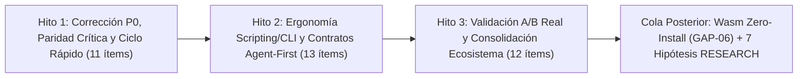

# 09 — Roadmap Secuencial (Tres Hitos + Cola Posterior y Congelados)

> Auditoría histórica de la línea base `a2549fa`. Los problemas y mediciones describen ese snapshot; los estados de implementación y el ciclo vigente se consultan en [00-INDEX.md](00-INDEX.md) y [12-SIGUIENTE-CICLO-LENGUAJE.md](12-SIGUIENTE-CICLO-LENGUAJE.md).

Este roadmap organiza los **37 ítems accionables** y las **7 hipótesis de investigación (`RESEARCH`)** del plan de evolución en tres hitos secuenciales estrictamente ordenados por dependencias técnicas, seguidos de la cola posterior y la tabla de subsistemas congelados o diferidos.

---

## Hito 1 — Desbloqueo de Corrección P0, Seguridad del Formateador y Ciclo Rápido de Verificación

### 1. Objetivo
Materializar el foco de [`01-FOCO.md`](01-FOCO.md) eliminando los 6 defectos `P0` que corrompen código fuente, bloquean el flujo JSON/contratos/capabilities o enseñan sintaxis inválida, mientras se reduce a la mitad la latencia de `wysna check` y del ciclo local de pruebas.

### 2. Ítems incluidos (11 ítems)
- **Bloqueadores `P0` (6 ítems):**
  - [`AGT-01`](04-AGENT-FIRST.md): Reparar corrupción de strings multilínea (`"""..."""`) y espaciado en el formateador nativo Selfhost (`wysna fmt` / `fix`).
  - [`LANG-01`](03-LENGUAJE.md): Propagar el tipo interno de `ResultType` (`T ! E`) y `OptionalType` (`T?`) hacia colecciones vacías (`[]`, `{}`) en `return`.
  - [`LANG-03`](03-LENGUAJE.md): Emitir validación recuperable de contratos `requires` en `wysna schema --emit-codecs` (`Err(JsonError)` en vez de pánico `[W4005]`).
  - [`AGT-02`](04-AGENT-FIRST.md): Reparar crash `TypeError: severity` en `McpServer.tool_wysna_check` cuando el archivo emite warnings (`W6001`, `W6002`).
  - [`AGT-03`](04-AGENT-FIRST.md): Registrar los 8 externs faltantes de `std/http` y `std/crypto` en `EffectModel.py` y corregir falsos positivos `[W5006]` sobre `class` de usuario en `--allow`/`--deny`.
  - [`DX-01`](08-CALIDAD-DX.md) `[QUICK-WIN]`: Corregir ejemplos y firmas falsas en `WYSNA_SINTAXIS.md`, `docs/STDLIB.md` y `docs/PROJECTS.md`, y activar test de bloques `.wysna` documentales.
- **Aceleradores `P1` de feedback y limpieza documental (5 ítems):**
  - [`DX-02`](08-CALIDAD-DX.md) `[QUICK-WIN]`: Eliminar las 15 afirmaciones obsoletas `v0.5.0–v0.7.0` en `SPEC.md` y `docs/*.md`.
  - [`DX-03`](08-CALIDAD-DX.md) `[QUICK-WIN]`: Excluir `*.md` y `.github/workflows/ci.yml` de `source_fingerprint()` en `tools/ci_conformance.py`.
  - [`PERF-01`](07-RENDIMIENTO.md): Eliminar los 4 clones profundos redundantes del AST en `CompilerService.check_source` (`-55.6%` en `wysna check`).
  - [`PERF-02`](07-RENDIMIENTO.md): Eliminar las 6 ejecuciones redundantes de `mir.Verifier.verify(module)` en `Optimizer.py` y `Ownership.py` (`-44%` en fase MIR).
  - [`PERF-04`](07-RENDIMIENTO.md): Paralelizar el Paso 11 de `run_conformance.py` e introducir `./wysna test --fast` (`< 15 s`).

### 3. Lo que explícitamente NO incluye
- Ninguna ampliación de métodos intrínsecos (`str.*`, `dict.remove`) ni nuevos módulos o funciones de `stdlib` (`std/process`, `std/fs`, `std/csv`).
- Ningún cambio en el toolchain WebAssembly (`Emscripten` / `wasi-sdk` / `zig cc`), en `wysna service serve`, ni en `--backend=llvm-experimental`.
- Ninguna ejecución de evaluación A/B con LLMs externos.

### 4. Dependencias
- Ninguna dependencia externa previa. Todos los ítems del Hito 1 operan sobre el commit base `a2549fa01294b20f3b893542706015ffe00869f3` (`v0.8.0`).
- Orden interno recomendado: `DX-03` y `PERF-04` primero (para acelerar la validación local y desacoplar docs del hash de matriz CI), seguidos en paralelo por `AGT-01`, `LANG-01`, `LANG-03`, `AGT-02`, `AGT-03`, `PERF-01`, `PERF-02`, `DX-01` y `DX-02`.

### 5. Criterios de aceptación medibles
1. `wysna fmt --engine=compiler` sobre archivos con `"""..."""` es 100% byte-a-byte idéntico a `wysna fmt --engine=seed` (`diff = 0`).
2. `return []` y `return {}` dentro de funciones `-> list[T] ! E`, `-> dict[K, V] ! E` y `-> list[T]?` compilan sin `[W2004]` en `--engine=seed` y `--engine=compiler`.
3. `decode_<Struct>` generado por `wysna schema --emit-codecs` devuelve `Err(JsonError)` ante violación de `requires` de campo sin abortar el proceso con `[W4005]`.
4. `McpServer().handle_message("tools/call", {"name": "wysna_check", ...})` sobre código con warnings `W6001`/`W6002` devuelve `isError: false` con diagnósticos serializados sin lanzar `TypeError`.
5. `wysna run --deny=network` y `--allow=fs.read,fs.write,net.http` funcionan sobre programas que definen `class` propias e importan `std/http` y `std/crypto` sin errores `[W5006]`.
6. `wysna check --engine=seed selfhost/compiler.wysna` cae de `4.71 s` a `< 2.30 s` y `./wysna test --fast` termina en `< 15 s`.
7. Cero bloques `.wysna` en `README.md`, `WYSNA_SINTAXIS.md`, `SPEC.md` y `docs/*.md` fallan `wysna check`, y editar `.md` no invalida `tools/ci_conformance.py --matrix`.

### 6. Estimación en rango con supuestos
- **Rango:** **5 a 8 días-ingeniero** (10 PRs pequeños de tamaño `S` y 1 PR de tamaño `M` para `AGT-01`).
- **Supuestos:** Desarrollador con conocimiento del pipeline `Seed` (`src/`) y `Selfhost` (`selfhost/src/`), ejecutando `./wysna test --fast` durante iteración y `./wysna test` + `make selfhost` al cierre del hito.

### 7. Riesgos
- **Riesgo de regresión en auto-formateo de `selfhost/src/*.wysna` (`AGT-01`):** Al alinear `selfhost_format_body` con `Formatter.py`, podrían detectarse diferencias cosméticas en tests existentes de `test_agent_tooling.py`. *Mitigación:* añadir corpus diferencial de golden files antes de tocar el lexer de formato en `09_agent_tools.wysna`.
- **Riesgo de mutación accidental del AST compartido (`PERF-01`):** Si un pase futuro modifica el AST post-typecheck, la eliminación de `clone_module` expondría efectos laterales. *Mitigación:* verificación por test unitario de que `analyze_reference_cycles` y `lint_discarded_expressions` son pases estrictamente de solo lectura.

### 8. Métrica de éxito
- **100% de los 6 bloqueadores `P0` cerrados**, `wysna check selfhost/compiler.wysna` `< 2.30 s` (`-51%`), y `./wysna test` completo pasando en `< 440 s` (`--fast` en `< 15 s`).

---

## Hito 2 — Ergonomía de Scripting/CLI y Unificación de Contratos Agent-First (`Seed ↔ Selfhost`)

### 1. Objetivo
Cerrar las brechas ergonómicas verificadas en la Fase 2 para scripting y automatización (`str.*`, `dict.remove`, `process.capture`, `fs.list_dir`, `SPEC.md`, trazas de pánico) y garantizar por CI la equivalencia semántica del contrato `json-v1` entre `--engine=seed` y `--engine=compiler`.

### 2. Ítems incluidos (13 ítems)
- **Ergonomía de lenguaje y colecciones (3 ítems):**
  - [`LANG-02`](03-LENGUAJE.md): Unificar reglas de colisión con preludio (`import "std/environment" as env`) y span real en `Seed` y `Selfhost`.
  - [`LANG-04`](03-LENGUAJE.md) *(Requiere aprobación — ADR-01)*: Implementar los 7 métodos intrínsecos de `str` (`.trim()`, `.split()`, `.to_lower()`, `.to_upper()`, `.starts_with()`, `.ends_with()`, `.replace()`) delegando a `wysna_host_str_*`.
  - [`LANG-06`](03-LENGUAJE.md): Completar la tabla formal de precedencia y asociatividad en `SPEC.md:239-254` (`?`, `await`, `else`, `+=`/`-=`/`*=`).
- **Unificación de contratos Agent-First y deduplicación de tooling (4 ítems):**
  - [`AGT-04`](04-AGENT-FIRST.md): Unificar el contrato `json-v1` (`message` sin mangling `__wysna_module_*`, `data.expected`/`found` en `Selfhost`, y `graph_hash` idéntico).
  - [`AGT-05`](04-AGENT-FIRST.md): Corregir `"visibility": "public"` en funciones privadas del módulo raíz (`SemanticGraph.py:320`) y acotar `wysna api <mod>` al módulo consultado (`--include-deps` opcional).
  - [`SIMP-01`](05-SIMPLIFICACION.md): Cachear `explain` y `semantic_graph` en `CheckedProgram` e instituir `test_tooling_engine_parity.py` entre `src/tooling/` y `selfhost/src/09_*.wysna`.
  - [`SIMP-06`](05-SIMPLIFICACION.md): Consolidar un único camino canónico en documentación y skills para I/O de archivos, entorno/CLI, iteración de `dict` y constructores/extractores de `std/json`.
- **Brechas `P1` de `stdlib` para scripting/CLI (3 ítems):**
  - [`GAP-01`](06-BRECHAS.md): Añadir `process.capture(command, args?) -> ProcessOutput ! ProcessError` en `std/process`.
  - [`GAP-02`](06-BRECHAS.md): Exponer `fs.list_dir`, `fs.is_dir`, `fs.is_file` en `std/fs` y `path.ext` en `std/path`.
  - [`GAP-03`](06-BRECHAS.md) *(Requiere aprobación — ADR-02)*: Implementar `dict.remove(key) -> V?` y `dict.clear() -> void` en `dict[K, V]`.
- **Paridad de rendimiento ARC en Selfhost y diagnósticos de runtime (2 ítems):**
  - [`PERF-03`](07-RENDIMIENTO.md): Portar `optimize_parameter_reads` a `selfhost/src/08_mir_lowering.wysna` (elimina `63,596` `wysna_str_retain` redundantes en `import_csv.wysna`).
  - [`DX-05`](08-CALIDAD-DX.md): Incluir call stack trace en pánicos (`W4001`..`W4005`) y contexto de función/struct/expresión en violaciones de contrato `[W4005]`.

### 3. Lo que explícitamente NO incluye
- Ningún rediseño de sintaxis de errores (`T ! E`), contratos (`requires`/`ensures`) ni imports (`from ... use`).
- Ninguna expansión de `std/http` servidor ni soporte de sockets concurrentes.
- Ningún cambio en el empaquetado de targets WebAssembly.

### 4. Dependencias
- Requiere **Hito 1 completado** (`DX-01` para base documental limpia; `PERF-01`/`PERF-02`/`PERF-04` para ciclo rápido de validación).
- Requiere aprobación de [`ADR-01`](10-DECISIONES.md) (`LANG-04`) y [`ADR-02`](10-DECISIONES.md) (`GAP-03`) antes de iniciar esos dos ítems.
- `SIMP-01` depende de `AGT-04` y `AGT-05`.

### 5. Criterios de aceptación medibles
1. `test_tooling_engine_parity.py` pasa al 100% verificando equivalencia estructural JSON entre `--engine=seed` y `--engine=compiler` en `check`, `explain`, `graph`, `inspect` y `api`.
2. `wysna api std/json --format=json` devuelve `<= 6 KB` (solo símbolos de `std/json`) y reporta `"visibility": "private"` para funciones `fn` sin `pub` en el módulo raíz.
3. [`repro_str_methods.wysna`](evidence/repro_str_methods.wysna) y [`repro_dict_remove.wysna`](evidence/repro_dict_remove.wysna) compilan y pasan en los 4 motores (`Interpreter`, `Seed AST C99`, `Seed MIR C99`, `Selfhost MIR C99`) con `rc_balance == 0`.
4. `process.capture`, `fs.list_dir`, `fs.is_dir`, `fs.is_file` y `path.ext` funcionan en los 3 backends con tests de integración y `EffectModel` (`process.exec`, `fs.read`).
5. El C generado por `--engine=compiler` sobre `examples/flagship/import_csv/src/import_csv.wysna` reduce sus llamadas dinámicas a `wysna_str_retain` de `63,600` a `<= 10` (`PERF-03`).
6. Todo pánico `[W4001]`..`[W4005]` imprime el call stack de funciones Wysna con `archivo:línea` (`DX-05`).

### 6. Estimación en rango con supuestos
- **Rango:** **10 a 15 días-ingeniero** (7 ítems `S` y 6 ítems `M`).
- **Supuestos:** Aprobación previa de `ADR-01` y `ADR-02`; implementación sincronizada en `Seed` y `Selfhost` verificada por `make selfhost` en cada PR que toque `selfhost/src/`.

### 7. Riesgos
- **Riesgo de desbalance ARC o CoW en `dict.remove` (`GAP-03`):** Olvidar `release_key`/`release_val` sobre la entrada eliminada o mutar un buffer compartido con `rc > 1` sin `wysna_dict_detach` causaría fugas o corrupción de memoria. *Mitigación:* tests obligatorios con `wysna_rc_stats()` (`allocs == frees`) y diccionarios clonados antes de `.remove()`.
- **Riesgo de bloqueo por pipes llenos en `process.capture` (`GAP-01`):** En POSIX, leer secuencialmente `stdout` y luego `stderr` puede bloquearse si el hijo llena el buffer del kernel (>64 KB) en `stderr`. *Mitigación:* usar `poll()`/`select()` sobre ambos descriptores en `runtime/wysna_rt.h`.

### 8. Métrica de éxito
- **100% de paridad estructural en `test_tooling_engine_parity.py`** entre `Seed` y `Selfhost`, y reescritura de los Programas A y B de [`docs/evolution/evidence/`](evidence) eliminando los helpers manuales de strings/procesos/directorios con **0 errores de primera compilación**.

---

## Hito 3 — Validación Empírica A/B con Modelos Reales y Consolidación del Ecosistema Local

### 1. Objetivo
Medir empíricamente la tesis Agent-First (`raw_pass_at_1`, `post_fix_pass_at_1`, iteraciones hasta verde) con un harness actualizado a `v0.8.0` y consolidar la higiene arquitectónica del repositorio (`SQLite` unificado, `std/csv`, bundle Selfhost automatizado, suites de tests por dominio y optimizaciones de memoria/tamaño).

### 2. Ítems incluidos (12 ítems)
- **Validación empírica Agent-First y canonización sintáctica (2 ítems):**
  - [`AGT-06`](04-AGENT-FIRST.md): Actualizar `SYSTEM_PROMPT` a `v0.8.0`, separar `raw_pass_at_1` vs `post_fix_pass_at_1` en `bench/ai_eval/` y ampliar `ab_cohort.py` con tareas multi-archivo (`> 300` LOC).
  - [`LANG-05`](03-LENGUAJE.md) *(Requiere aprobación — ADR-03)*: Normalizar `new Class(...)` a `Class(...)` en `wysna fmt` y documentación.
- **Simplificación e higiene arquitectónica del compilador (4 ítems):**
  - [`SIMP-02`](05-SIMPLIFICACION.md): Marcar `selfhost/compiler.wysna` como `linguist-generated=true` y automatizar su regeneración en `Bootstrap.py`.
  - [`SIMP-03`](05-SIMPLIFICACION.md): Retirar la fachada `HirCCodeGen` en favor de `CompilerService.emit_c` y renombrar `"Seed HIR C99"` a `"Seed MIR C99"`.
  - [`SIMP-04`](05-SIMPLIFICACION.md): Formalizar congelamiento (`FREEZE`) de `--backend=llvm-experimental` en `docs/ENGINE_PARITY_MATRIX.md` manteniendo su smoke test MIR.
  - [`SIMP-05`](05-SIMPLIFICACION.md): Añadir test contractual de paridad triple de símbolos `wysna_host_*` (`Interpreter` ↔ `runtime/wysna_rt.h` ↔ `selfhost/src/08_c_backend.wysna`) en `test_architecture_contract.py`.
- **Consolidación de datos/SQLite y optimización de runtime/DX (6 ítems):**
  - [`GAP-04`](06-BRECHAS.md): Incorporar módulo `std/csv` (RFC 4180) implementado en Wysna puro.
  - [`GAP-05`](06-BRECHAS.md): Consolidar los 3 wrappers C de SQLite (`examples/`) en un único paquete local reutilizable y desbloquear `TASK-29`/`TASK-30` en `bench/ai_eval/`.
  - [`PERF-05`](07-RENDIMIENTO.md): Corregir documentación falsa de `WUnboxedList` y compartir arreglos estáticos de `keys` en `WStructBuf`.
  - [`PERF-06`](07-RENDIMIENTO.md): Activar dead-stripping del enlazador (`-Wl,-dead_strip` / `--gc-sections`) en `--profile=size` y hacer `bench/steady_state.wysna` autocontenido.
  - [`DX-04`](08-CALIDAD-DX.md) `[QUICK-WIN]`: Añadir `wysna run -e '<code>'` / `wysna check -e '<code>'` y documentar el esquema JSON de `wysna service serve`.
  - [`DX-06`](08-CALIDAD-DX.md) y [`DX-07`](08-CALIDAD-DX.md) `[QUICK-WIN]`: Agrupar `tests/unit/` por dominios (`--suite=...`), limpiar `src/*.egg-info` en `Makefile clean` y reportar `host_dependencies` en `wysna capabilities`. *(Nota: `DX-06` y `DX-07` suman los 13 ítems si se cuentan por separado; con `DX-07` incluido, el Hito 3 cierra 13 IDs: `AGT-06`, `LANG-05`, `SIMP-02..05`, `GAP-04..05`, `PERF-05..06`, `DX-04`, `DX-06`, `DX-07`).*

### 3. Lo que explícitamente NO incluye
- Ninguna migración del compilador fuera de Python (`Seed`) ni eliminación de los oráculos diferenciales (`SIMP-05`).
- Ninguna expansión de `LLVM` a feature parity con `C99` (`SIMP-04`).
- Ningún registro remoto de paquetes ni servidor HTTP multihilo en `stdlib`.

### 4. Dependencias
- Requiere **Hito 1 e Hito 2 completados**.
- `AGT-06` depende directamente de `AGT-01..05`, `LANG-01`, `LANG-03`, `DX-01` y `GAP-05` (para que las 30 tareas de `tasks.py`, incluidas `TASK-29` y `TASK-30` con SQLite, sean ejecutables extremo a extremo).
- `LANG-05` requiere aprobación de [`ADR-03`](10-DECISIONES.md).

### 5. Criterios de aceptación medibles
1. `bench/ai_eval/` ejecuta las **30/30 tareas** de `tasks.py` más la cohorte multi-archivo (`> 300` LOC) sin skips de SQLite y reporta por separado `raw_pass_at_1`, `post_fix_pass_at_1`, `iterations_to_green` y `context_bytes`.
2. `test_architecture_contract.py` verifica automáticamente la paridad triple de los 86+ símbolos `wysna_host_*` y que `selfhost/compiler.wysna` coincide byte-a-byte con `concat(selfhost/src/*.wysna)`.
3. `std/csv` parsea y serializa campos con comillas escapadas `""`, comas internas y saltos de línea (RFC 4180), y los 3 ejemplos SQLite comparten un único `sqlite_bridge.c`.
4. `WStructBuf` comparte tabla estática de `keys` por tipo (`0` `malloc(sizeof(char*) * cap)` por instancia en el C generado) y `--profile=size` reduce los binarios nativos un `>= 10%` adicional con dead-stripping.
5. `wysna run -e 'fn main() -> int { return 0; }'` y `./wysna test --suite=checker` funcionan con código de salida `0`.

### 6. Estimación en rango con supuestos
- **Rango:** **9 a 14 días-ingeniero** (10 ítems `S` y 3 ítems `M`: `AGT-06`, `GAP-05`, `DX-06`).
- **Supuestos:** Reutilización del adaptador C parametrizado de `examples/flagship/sqlite_analytics/csrc/sqlite_bridge.c` para `GAP-05`.

### 7. Riesgos
- **Riesgo de sobreajuste del benchmark `ai_eval` (`AGT-06`):** Si `SYSTEM_PROMPT` incluye soluciones literales a las tareas del benchmark, `raw_pass_at_1` subirá artificialmente sin reflejar uso real. *Mitigación:* mantener `SYSTEM_PROMPT` limitado a reglas generales de sintaxis y firmas públicas de `stdlib`, prohibiendo ejemplos tomados de `tasks.py`.

### 8. Métrica de éxito
- **Meta de `01-FOCO.md`:** el contrato único [acceptance.py](../../bench/ai_eval/acceptance.py) exige las 30 tareas soportadas, `raw_pass_at_1_rate >= 90%`, `pass_at_1_rate >= 95%` (funcional después de autofix en la primera respuesta) y mediana de reparaciones `<= 1.5` entre tareas resueltas. La paridad Seed/Selfhost se valida aparte. El objetivo empírico permanece pendiente sin un modelo real; una ejecución mock no lo satisface.

---

## Cola Posterior (Ordenada por Prioridad tras el Hito 3)

Una vez completados los Hitos 1, 2 y 3 (36 de los 37 ítems del backlog cerrados), la cola posterior se ejecuta en este orden estricto:

1. **[`GAP-06`](06-BRECHAS.md) (`P2`, Esfuerzo `S` + `L`, Requiere aprobación — [`ADR-04`](10-DECISIONES.md)):**
   - *Sub-etapa A (`S`, integrable en cualquier momento):* Auto-seleccionar el único target declarado en `wysna.toml` cuando no exista `[targets.app]`.
   - *Sub-etapa B (`L`, cola posterior):* Compilar targets `web` (`wasm32-freestanding`) y `wasi` (`wasm32-wasi`) usando el `zig cc` (`Zig 0.15.2`) ya empaquetado con Wysna, eliminando la dependencia externa de `Emscripten 5.0.1` y `wasi-sdk 34`.
2. **`AGT-R01` (`RESEARCH`, pendiente de modelos):** comparar `patch --symbol` con reemplazo de líneas según el [protocolo específico](research/AGT-R01-patch-protocol.md). El prefetch y las consultas `graph`/`inspect` son experimentos distintos; no se atribuye a `patch` el resultado del piloto disponible.
3. **[`PERF-R01`](07-RENDIMIENTO.md) (`RESEARCH`):** Benchmark de escalabilidad quadrática (`1,000` a `100,000` filas) sobre buffers mutables en bucles en `Selfhost` y evaluación de *uniqueness propagation* interprocedural para CoW in-place (`rc == 1`).
4. **[`DX-R01`](08-CALIDAD-DX.md) (`RESEARCH`):** Emisión de directivas `#line <line> "<file>.wysna"` en los backends C99 para depuración a nivel fuente en `lldb`/`gdb` y sanitizers (`ASan`/`UBSan`).
5. **[`SIMP-R01`](05-SIMPLIFICACION.md) (`RESEARCH`):** Unificar tooling mediante delegación de Seed a Selfhost. Decisión aplicada en [ADR-05](ADR-05-arquitectura-hibrida-tooling-selfhost.md). El catálogo FFI pertenece a [SIMP-05](research/SIMP-05-ffi-catalog.md).
6. **[`LANG-R01`](03-LENGUAJE.md) (`RESEARCH`):** Evaluación A/B de si `from "std/..." use ...` reduce o incrementa alucinaciones de agentes frente a `import "std/..." as ...`.
7. **[`PERF-R02`](07-RENDIMIENTO.md) (`RESEARCH`):** Perfilado de contención de caché de memoria para evaluar si migrar `WStructBuf` a structs C nominales aporta `>= 20%` de mejora en benchmarks reales.
8. **[`GAP-R01`](06-BRECHAS.md) (`RESEARCH`):** Evaluación de viabilidad y seguridad de concurrencia de hilos del SO sobre el runtime ARC no atómico (`int rc`).

---

## Congelado / Diferido y Condición de Reapertura

| Subsistema o iniciativa congelada / diferida | Estado actual | Razón del congelamiento (con evidencia) | Condición explícita de reapertura |
| :--- | :--- | :--- | :--- |
| **1. Expansión del backend `--backend=llvm-experimental` y `LLVM SDK`** ([`SIMP-04`](05-SIMPLIFICACION.md)) | Experimental (`1,499` LOC en `src/backend/llvm/`) | Solo existe en `Seed`, carece de soporte para async/await, closures complejas y FFI completo, y el backend C99 (`clang -O2`) ya compila el 100% del lenguaje en los 3 motores y vence a Python 3.13 por `3.3x–102x` ([`perf_measurements.json`](evidence/perf_measurements.json)). | **Reabrir solo cuando:** (1) `Selfhost MIR → C99` sea el único motor de producción con `100%` de paridad en tooling y Wasm, y (2) exista un benchmark reproducible donde la traducción `MIR → C99 → clang -O2` sea un cuello de botella demostrado (`> 25%` de brecha frente a `MIR → LLVM IR` directo). |
| **2. Expansión de `wysna service serve` a framework HTTP de producción** | Experimental (`src/tooling/ServiceRuntime.py`) | Es un wrapper Python `ThreadingHTTPServer` que invoca un subproceso nuevo por cada request HTTP (`fork+exec`), no un servidor HTTP nativo en Wysna ([`prog_b_run.txt`](evidence/prog_b_run.txt)). | **Reabrir solo cuando:** los Hitos 1, 2 y 3 estén cerrados y exista demanda validada para empaquetar un adapter C ligero (`libmicrohttpd`/`mongoose`) o un bucle de sockets persistente con manejo de señales y timeouts. |
| **3. Portar generación de targets WebAssembly (`web`/`wasi`) al binario nativo `Selfhost`** | Parcial (solo `Seed` genera los bridges JS/Wasm en `ProjectSystem.py`) | En la Fase 2, el bloqueo real de Wasm fue la dependencia externa de `Emscripten 5.0.1` (`[W5005]` en [`build_web.json`](evidence/prog_c_wasm/build_web.json)), no la velocidad del driver Python `ProjectSystem.py`. | **Reabrir solo cuando:** [`GAP-06`](06-BRECHAS.md) (`zig cc` zero-install para Wasm) esté implementado y verificado en `Seed`. |
| **4. Registro remoto de paquetes y resolutor de versiones semánticas (`wysna publish` / registry cloud)** | Ausente (solo dependencias locales `path = "../pkg"`) | Construir y operar un registro de paquetes propio tiene alto costo operativo y cero tracción sin antes estabilizar la `stdlib` base (`std/process`, `std/fs`, `std/csv`, SQLite local) y la ergonomía de scripting. | **Reabrir solo cuando:** existan `>= 10` proyectos o librerías externas en uso real que compartan paquetes multi-repositorio y el soporte de dependencias locales/git resulte insuficiente. |
| **5. Nuevos subcomandos CLI Agent-First o nuevas sintaxis de lenguaje (macros, pattern matching algebraico, sobrecarga)** | Congelado | Wysna ya expone 11 subcomandos Agent-First con divergencias `Seed ↔ Selfhost` ([`AGT-01`](04-AGENT-FIRST.md), [`AGT-04`](04-AGENT-FIRST.md)) y 4 pares de formas sintácticas equivalentes (`03-LENGUAJE.md`). Añadir más superficie empeoraría la entropía de generación para agentes. | **Reabrir solo cuando:** [`AGT-06`](04-AGENT-FIRST.md) y [`AGT-R01`](04-AGENT-FIRST.md) demuestren empíricamente una brecha específica no cubierta por los comandos y constructos actuales. |
